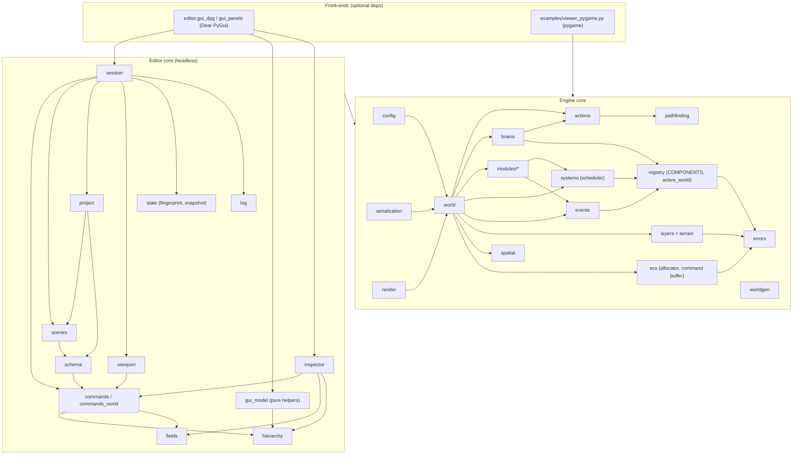

# simworld — Build Blueprint

> A complete, self-contained specification for building **simworld**: a general-purpose 2D flat-world
> simulation engine (pure Python + NumPy) and a Dear PyGui scene/project **editor** on top of it.
> It is written so that an AI coding agent with **zero context and no access to the original source** can
> rebuild an equivalent system, phase by phase, and prove each phase with tests.

* Target reader: a coding agent (or a human) starting from an empty folder.
* Source of truth: the real repository `simworld` v0.1.0 (the code, 260 tests, README and design decisions).
  Every signature, path and number below was checked against that code when this document was written.
* Companion artefacts in the original repo: `README.md`, `tests/`, `examples/`, `benchmarks/bench.py`, `out/`.

## How to read this document (labels)

Every non-trivial statement carries one of these labels, either inline or by section header.
**Do not treat a `[SUGGESTION]` as a description of existing behaviour.**

| Label | Meaning |
| --- | --- |
| **[EXISTS]** | Implemented in the original code and checked against it (signature/path/number grepped or run). |
| **[SUGGESTION]** | A recommendation for a rebuild or a future version. It is **not** in the original code. |
| **[FUTURE]** | A roadmap idea; nothing of it exists (a kind of suggestion, used for perf/feature ideas). |
| **[UNVERIFIED]** | Exists in code (or is claimed) but was **never proven by an automated run** in the original project. |
| **[MEASURED]** | A number that was measured on one machine (Linux, 8 cores, Python 3.13.5, NumPy 2.5.4). Not a guarantee. |

Rules that apply to *you*, the agent who builds from this blueprint:

1. Do not claim something works until a test or command you ran proves it. Say what you ran.
2. Do not add features that this blueprint does not list unless the user asks; if you add one, label it.
3. Where the blueprint says `[SUGGESTION]` you may choose differently, but record the decision.
4. Report honestly: what passed, what you skipped, what you could not verify.

---

## Table of contents

* **[1. Purpose, vision and non-goals](#1-purpose-vision-and-non-goals)**
  * [1.1 Vision](#11-vision-exists)
  * [1.2 Non-goals](#12-non-goals-exists-as-stated-limits-do-not-build-these-unless-asked)
* **[2. Tech stack and constraints](#2-tech-stack-and-constraints)**
  * [2.1 Packaging (`pyproject.toml`, exact)](#21-packaging-exists-pyprojecttoml-exact)
  * [2.2 Versions it was actually built and tested with](#22-versions-it-was-actually-built-and-tested-with-measuredexists)
  * [2.3 Hard constraints](#23-hard-constraints-exists)
  * [2.4 Tooling available on the original box (for GUI verification)](#24-tooling-available-on-the-original-box-for-gui-verification-exists)
* **[3. Architecture overview](#3-architecture-overview)**
  * [3.1 The four generic building blocks](#31-the-four-generic-building-blocks-exists)
  * [3.2 Design principles (each is enforced somewhere in code/tests)](#32-design-principles-exists-each-is-enforced-somewhere-in-codetests)
  * [3.3 Module dependency diagram (arrows = "imports / depends on", lowest layer at the bot...](#33-module-dependency-diagram-exists-arrows--imports--depends-on-lowest-layer-at-the-bottom)
  * [3.4 One simulation step](#34-one-simulation-step-exists)
* **[4. Repository layout](#4-repository-layout)**
  * [4.1 Full tree with purpose (line counts approximate, from the original)](#41-full-tree-with-purpose-exists-line-counts-approximate-from-the-original)
  * [4.2 Layering rule of thumb](#42-layering-rule-of-thumb-exists)
* **[5. Engine specification (core, module by module)](#5-engine-specification-core-module-by-module)**
  * [5.0 Conventions used by every module](#50-conventions-used-by-every-module)
  * [5.1 `errors.py`](#51-errorspy)
  * [5.2 `registry.py`](#52-registrypy)
  * [5.3 `ecs.py` (entity ids, allocator, command buffer)](#53-ecspy-entity-ids-allocator-command-buffer)
  * [5.4 `components.py`](#54-componentspy)
  * [5.5 `layers.py`](#55-layerspy)
  * [5.6 `terrain.py`](#56-terrainpy)
  * [5.7 `world.py`](#57-worldpy)
  * [5.8 `systems.py` (scheduler)](#58-systemspy-scheduler)
  * [5.9 `events.py`](#59-eventspy)
  * [5.10 `actions.py`](#510-actionspy)
  * [5.11 `brains.py`](#511-brainspy)
  * [5.12 `modules/`](#512-modules)
  * [5.13 Plugins](#513-plugins)
  * [5.14 `spatial.py`](#514-spatialpy)
  * [5.15 `pathfinding.py`](#515-pathfindingpy)
  * [5.16 `serialization.py`](#516-serializationpy)
  * [5.17 `config.py`](#517-configpy)
  * [5.18 `worldgen.py`](#518-worldgenpy)
  * [5.19 `render.py`](#519-renderpy)
  * [5.20 Public API (`__init__.py`)](#520-public-api-__init__py)
  * [5.21 Gotchas collected while building](#521-gotchas-collected-while-building)
  * [5.22 Code sketches of the trickiest parts](#522-code-sketches-of-the-trickiest-parts)
* **[6. Editor specification (`simworld/editor/`)](#6-editor-specification-simworldeditor)**
  * [6.1 Design rules](#61-design-rules)
  * [6.2 `errors.py` and `fields.py`](#62-errorspy-and-fieldspy)
  * [6.3 `commands.py` and `commands_world.py` — commands with do/undo semantics](#63-commandspy-and-commands_worldpy--commands-with-doundo-semantics)
  * [6.4 `hierarchy.py`](#64-hierarchypy)
  * [6.5 `viewport.py` model recap](#65-viewportpy-model-recap)
  * [6.6 `state.py` — fingerprint and snapshot/restore (play/stop)](#66-statepy--fingerprint-and-snapshotrestore-playstop)
  * [6.7 `schema.py` — user-defined components without Python](#67-schemapy--user-defined-components-without-python)
  * [6.8 `scenes.py` — scene files](#68-scenespy--scene-files)
  * [6.9 `project.py` — project folders](#69-projectpy--project-folders)
  * [6.10 `viewport.py` — camera math, picking, drag, renderer](#610-viewportpy--camera-math-picking-drag-renderer)
  * [6.11 `inspector.py` — inspector model and the field-type → widget table](#611-inspectorpy--inspector-model-and-the-field-type--widget-table)
  * [6.12 `session.py` — `EditorSession`](#612-sessionpy--editorsession)
  * [6.13 `log.py`](#613-logpy)
  * [6.14 `gui_model.py` — pure helpers for the GUI (11 tests)](#614-gui_modelpy--pure-helpers-for-the-gui-11-tests)
  * [6.15 `gui_dpg.py` and `gui_panels.py` — the Dear PyGui front-end](#615-gui_dpgpy-and-gui_panelspy--the-dear-pygui-front-end)
  * [6.16 Dear PyGui 2.3.1 gotchas](#616-dear-pygui-231-gotchas)
  * [6.17 How the GUI was verified (Xvfb + xdotool)](#617-how-the-gui-was-verified-xvfb--xdotool)
* **[7. Config / scene / save formats](#7-config--scene--save-formats)**
  * [7.1 World save file (`format: "simworld"`, `version: 1`)](#71-world-save-file-format-simworld-version-1-exists)
  * [7.2 Scene file (`format: "simworld-scene"`, `scene_version: 1`)](#72-scene-file-format-simworld-scene-scene_version-1-exists)
  * [7.3 Plain-world save vs scene — which to use](#73-plain-world-save-vs-scene--which-to-use)
  * [7.4 Project folder](#74-project-folder-exists)
  * [7.5 Component schema file (`format: "simworld-component"`)](#75-component-schema-file-format-simworld-component-exists)
  * [7.6 Hand-written world config (`world_from_config`)](#76-hand-written-world-config-world_from_config-exists)
* **[8. Build order: phased plan](#8-build-order-phased-plan)**
  * [Phase 0 — Scaffold and environment](#phase-0--scaffold-and-environment)
  * [Phase 1 — Errors, registries, ECS core](#phase-1--errors-registries-ecs-core)
  * [Phase 2 — Layers, terrain, spatial index, worldgen](#phase-2--layers-terrain-spatial-index-worldgen)
  * [Phase 3 — Events, actions, brains](#phase-3--events-actions-brains)
  * [Phase 4 — Built-in modules and pathfinding](#phase-4--built-in-modules-and-pathfinding)
  * [Phase 5 — Serialization, config, plugins, determinism](#phase-5--serialization-config-plugins-determinism)
  * [Phase 6 — Documentation, examples, viewer, benchmark (engine DoD)](#phase-6--documentation-examples-viewer-benchmark-engine-dod)
  * [Phase 7 — Editor model layer (no GUI, no DPG import)](#phase-7--editor-model-layer-no-gui-no-dpg-import)
  * [Phase 8 — Scenes, projects, session, viewport, inspector](#phase-8--scenes-projects-session-viewport-inspector)
  * [Phase 9 — Dear PyGui front-end](#phase-9--dear-pygui-front-end)
  * [Phase 10 — Performance, hardening, final verification](#phase-10--performance-hardening-final-verification)
  * [8.1 Dependency table (what to build before what)](#81-dependency-table-what-to-build-before-what)
  * [8.2 Rework-avoidance decisions (make them early, in this order)](#82-rework-avoidance-decisions-make-them-early-in-this-order)
* **[9. Test strategy](#9-test-strategy)**
  * [9.1 Inventory (counts are real, from `pytest --collect-only`-style counting of `def tes...](#91-inventory-counts-are-real-from-pytest---collect-only-style-counting-of-def-test_)
  * [9.2 Fixtures and helpers](#92-fixtures-and-helpers)
  * [9.3 Determinism / fingerprint tests](#93-determinism--fingerprint-tests)
  * [9.4 README snippets as tests (`test_readme.py`)](#94-readme-snippets-as-tests-test_readmepy)
  * [9.5 Headless GUI model tests (`test_editor_gui_model.py`, 11 tests)](#95-headless-gui-model-tests-test_editor_gui_modelpy-11-tests)
  * [9.6 Xvfb GUI smoke test (`test_editor_gui_smoke.py`, 1 test)](#96-xvfb-gui-smoke-test-test_editor_gui_smokepy-1-test)
  * [9.7 The interactive harness (`examples/editor_capture.py`)](#97-the-interactive-harness-exampleseditor_capturepy-exists)
  * [9.8 Commands and expected results](#98-commands-and-expected-results)
  * [9.9 What is *not* tested (be explicit in reports)](#99-what-is-not-tested-be-explicit-in-reports-exists)
* **[10. Performance notes](#10-performance-notes)**
  * [10.1 Hot paths and what was done (all behaviour-preserving)](#101-hot-paths-and-what-was-done-all-behaviour-preserving)
  * [10.2 Editor/viewport numbers](#102-editorviewport-numbers-measured)
  * [10.3 FUTURE ideas (none implemented; each needs its own benchmark and fingerprint check)](#103-future-ideas-none-implemented-each-needs-its-own-benchmark-and-fingerprint-check)
* **[11. Known limitations (honest gaps) and roadmap](#11-known-limitations-honest-gaps-and-roadmap)**
  * [11.1 Limitations — engine](#111-limitations--engine)
  * [11.2 Limitations — viewer and editor](#112-limitations--viewer-and-editor)
  * [11.3 Prioritised roadmap](#113-prioritised-roadmap-suggestion--future--nothing-below-exists)
* **[12. Ready-to-paste prompts](#12-ready-to-paste-prompts)**
  * [12.1 Master prompt (paste first)](#121-master-prompt-paste-first)
  * [12.2 Per-phase follow-up prompts](#122-per-phase-follow-up-prompts)
  * [12.3 Review prompt (optional, for a second agent)](#123-review-prompt-optional-for-a-second-agent)
* **[13. Appendix](#13-appendix)**
  * [13.1 The toxin plugin (`examples/projects/demo_project/plugins/toxin.py`, verbatim)](#131-the-toxin-plugin-examplesprojectsdemo_projectpluginstoxinpy-verbatim-exists)
  * [13.2 The demo world (`examples/demo_water_mud.py::build_world`, verbatim)](#132-the-demo-world-examplesdemo_water_mudpybuild_world-verbatim-exists)
  * [13.3 Glossary](#133-glossary)
  * [13.4 Verification checklist (tick each only after running it; otherwise write NOT RUN)](#134-verification-checklist-tick-each-only-after-running-it-otherwise-write-not-run)
  * [13.5 Quick-reference: files in the reference repo that are examples/evidence (not core)](#135-quick-reference-files-in-the-reference-repo-that-are-examplesevidence-not-core)

---

## 1. Purpose, vision and non-goals

### 1.1 Vision **[EXISTS]**

simworld is a **small, general-purpose 2D flat-world simulation engine**. You describe a world; the engine
runs it. The engine itself is deliberately ignorant of any domain:

* **The world is a flat 2D grid.** Cell `(i, j)` covers `[i, i+1) x [j, j+1)`. Positions are floats.
  There is no gravity, no z-axis, no continuous physics.
* **Terrains are data.** `water`, `mud`, `land`, `rock` are just rows `(name, id, move_cost, passable, color, **props)`.
  The engine knows only `move_cost` and `passable`; everything else (`fertility`, ...) is a free-form property.
* **Resources are arbitrary named layers** (NumPy arrays of any dtype/shape): nutrients, toxins, heat, wood, a
  vector wind field... A "field" is a float layer that a module regrows/decays/diffuses.
* **Organisms are ECS entities**: an integer id plus *components* (pure data). Energy, hunger, genomes, speed
  are components defined by *modules or users*, not by the core.
* **Behaviour is extensible by users**: systems, event handlers, actions, brains, whole modules, and drop-in
  plugin files. A brain never mutates the world; it returns **actions** that the action system validates and
  applies.
* **The engine knows nothing about water, nutrients or hunger.** The only components the core itself looks at are
  `Position` (spatial index, movement), `Brain` (the `brain_system` iterates it), an optional `Mover` (speed in
  `plan_move`; if absent `settings.default_speed` is used) and — via settings — the *name* of an energy component
  (`settings.energy_component`, default `"Energy"`, needs a numeric `.value`, optional `.max`) used for action costs.
  Everything else is optional data.

On top of that engine sits an **editor** (Unity/Godot-like for this world): hierarchy, inspector, viewport with
terrain/layer painting, play/stop with exact restore, undo/redo, scenes and projects, user-defined components
authored as JSON, prefabs, plugin hot-reload. The editor is a **headless, fully-tested core** plus a thin
**Dear PyGui** front-end that only draws and forwards input.

### 1.2 Non-goals **[EXISTS as stated limits; do not build these unless asked]**

* No 3D, no continuous rigid-body physics or entity-entity collision, no gravity.
* No networking, multiplayer or threading (the engine is not thread-safe).
* No columnar/archetype ECS storage (pure-Python dict-per-component; see §10 for a **[FUTURE]** idea).
* No hierarchical pathfinding; pathfinding is grid A* over terrain only (ignores other entities).
* No sub-step/event-scheduled time: fixed-step ticks only.
* No native file dialogs, docking/resizable panels, or multi-scene composition in the editor.
* No licence chosen (the original README says so). **[SUGGESTION]** pick one before publishing.
* Not a game engine: no audio, input mapping, asset pipeline.

---

## 2. Tech stack and constraints

### 2.1 Packaging **[EXISTS]** (`pyproject.toml`, exact)

```toml
[build-system]
requires = ["setuptools>=61"]
build-backend = "setuptools.build_meta"

[project]
name = "simworld"
version = "0.1.0"
description = "A small, general-purpose 2D flat-world simulation engine (layers, entities, systems) built on NumPy"
readme = "README.md"
requires-python = ">=3.10"
dependencies = ["numpy>=1.22"]

[project.optional-dependencies]
viewer = ["pygame>=2.0"]
editor = ["dearpygui>=2.0"]
test = ["pytest>=7"]

[project.scripts]
simworld-editor = "simworld.editor.gui_dpg:main"

[tool.setuptools]
packages = ["simworld", "simworld.modules", "simworld.editor"]

[tool.pytest.ini_options]
testpaths = ["tests"]
addopts = "-q"
```

### 2.2 Versions it was actually built and tested with **[MEASURED/EXISTS]**

| Thing | Version |
| --- | --- |
| Python | 3.13.5 (declared minimum 3.10) |
| NumPy | 2.5.4 (declared minimum 1.22) |
| pytest | 9.1.1 (declared minimum 7) |
| pygame (optional viewer demo only) | 2.6.1 (declared minimum 2.0) |
| dearpygui (optional editor GUI) | 2.3.1 (declared minimum 2.0) |
| OS | Linux only. Xvfb + software OpenGL (`LIBGL_ALWAYS_SOFTWARE=1`) for GUI runs |

Windows and macOS were **never tested** **[UNVERIFIED]**. Reproducibility is only promised for the *same*
NumPy/Python versions (NumPy RNG streams are not guaranteed identical across versions).

### 2.3 Hard constraints **[EXISTS]**

* **Core depends on NumPy only** (plus the Python stdlib). `import simworld` must work with nothing else
  installed. No pandas, no scipy, no numba.
* **The editor core (`simworld.editor.*` except `gui_dpg`, `gui_panels`) must import without Dear PyGui**:
  `simworld/editor/__init__.py` imports only headless modules. `gui_dpg` raises a clear `ImportError`
  ("The editor window needs Dear PyGui: pip install 'simworld[editor]'") when missing.
* **Dear PyGui is imported only in `gui_dpg.py` and `gui_panels.py`.** All logic that can be tested without a
  window (layout math, text parsing, frame gating, dirty flags, shortcuts table, hierarchy rows) is in
  `gui_model.py`.
* PNG output uses only `zlib`/`struct` (no Pillow). Saves are JSON (+ optional gzip) with layers as
  zlib+base64.
* Python features used: `from __future__ import annotations`, `dataclass(slots=True)` (so **Python ≥ 3.10**),
  `str | None` unions in annotations, `str.removeprefix` (3.9+).
* Seeded determinism through a single `numpy.random.Generator` (`np.random.default_rng(seed)`).

### 2.4 Tooling available on the original box (for GUI verification) **[EXISTS]**

Xvfb, xvfb-run, ffmpeg (x11grab), xdotool. Not available: scrot, ImageMagick `import`, xwd, `zip`, pyflakes.
(If you need a zip, use Python's `zipfile`.) No `pandoc` was available, which is why this blueprint is Markdown only.

---

## 3. Architecture overview

### 3.1 The four generic building blocks **[EXISTS]**

| # | Block | What it is | Where |
| --- | --- | --- | --- |
| 1 | **Layers** | Named NumPy grids `data[y, x]` (any dtype, optional trailing vector dims). Terrain ids live in an `int16` layer called `terrain`; fields are float layers updated by the `resources` module. | `layers.py`, `terrain.py`, `modules/resources.py` |
| 2 | **Entities + components (ECS)** | Entity = int `(generation<<32)\|index`. Components = registered dataclasses, stored in `world._stores[name][entity]`. Systems iterate with `world.query(...)`. | `ecs.py`, `registry.py`, `world.py`, `systems.py` |
| 3 | **Actions + brains** | Brains return `Action` objects; one core system validates and applies them with a seeded random order, energy cost and rejection reasons. | `actions.py`, `brains.py` |
| 4 | **Modules / plugins** | Named bundles that register components, fields, systems, handlers, actions, terrains into a world; can be toggled as a unit; drop-in `*.py` plugin files do the same. | `modules/`, `plugin.py`, `World.load_plugins` |

Supporting services: **events** (queued, dispatched at the end of each stage), **command buffer** (deferred
structural changes), **spatial hash**, **pathfinding** (A*), **serialization**, **config**, **worldgen**, **render**.

### 3.2 Design principles **[EXISTS]** (each is enforced somewhere in code/tests)

1. **Data-first.** Worlds can be built from a dict/JSON (`world_from_config`), prefabs are dicts, schemas are
   JSON, scenes are JSON. Code is only needed for *new behaviour*.
2. **One public World API, used by the editor too.** The editor mutates the world only through the same
   public/semi-public `World` methods and stores (`world.spawn`, `world.despawn`, `world.add`, `layer.data`,
   `world.define_*`...). There is no private "editor world" or second data model. Consequence: anything the editor can
   do, a script can do, and a saved scene is just a `World` serialisation plus metadata.
3. **Components are pure data.** Dataclasses with defaults, `prop(...)` metadata (min/max/tooltip/widget); no
   methods that touch the world. Brain components are the one component with a lazily-built runtime `policy`
   (marked `serialize=False`).
4. **Command buffer for structural changes.** Systems must not add/remove entities while iterating; they call
   `world.commands.spawn/despawn/add/remove/defer`, applied by the scheduler after *every system* and after
   every stage's event dispatch.
5. **Action system, not direct mutation.** Brains `decide()` -> actions; `action_system` (stage `act`)
   validates (alive, module enabled, custom `validate`, energy cost), applies via handlers, charges cost only on
   success, counts rejections, emits `action_rejected`.
6. **Deterministic seeded RNG.** Every stochastic decision uses `world.rng`. Same seed + same code + same
   NumPy => identical runs. The RNG state is saved/restored by serialization and by editor play/stop.
7. **Registry-based extensibility with helpful errors.** Unknown names raise `UnknownNameError` subclasses that
   suggest close matches and list known names.
8. **Editor = commands.** Every user edit is a `Command` with `do`/`undo` (and `merge`) so undo is exact;
   play/stop uses a whole-world snapshot instead, because the simulation mutates everything.
9. **Headless core, thin GUI.** The GUI is never the only place a behaviour is implemented or tested.

### 3.3 Module dependency diagram **[EXISTS]** (arrows = "imports / depends on", lowest layer at the bottom)



Dependency rules to preserve **[SUGGESTION: enforce with a small import-graph test; not present in the original]**:

* Core never imports `editor`. Editor core never imports `dearpygui`/`pygame`.
* `registry` and `errors` import nothing else from the package. `world` imports almost everything else but is
  imported by `config`, `serialization`, `render`, and the whole editor.
* Circular-import dodges used in the original: `world.py` imports `serialization`/`pathfinding` lazily inside
  methods; `actions.py` imports `pathfinding` lazily inside handlers; `brains.py` imports it lazily too.

### 3.4 One simulation step **[EXISTS]**

```
world.step(dt=None):
  for stage in scheduler.stages  (default: input, sense, decide, act, update, late):
      for system in stage sorted by (order, registration seq):
          skip if system disabled, or its module disabled, or (every>1 and tick % every != 0)
          system.fn(world)
          world.commands.apply(world)          # structural changes land between systems
      world.events.dispatch()                   # handlers run at the end of EVERY stage
      world.commands.apply(world)               # handlers may queue commands
  resources["time"] += dt ; resources["tick"] += 1 ; _dying.clear()
```

Core systems installed by `World._install_core` (module `"core"`): `spatial_sync` (sense, order -100),
`brain_system` (decide, 0), `action_system` (act, 0), `spatial_sync_late` (late, 100).
Built-in module systems: `update_fields` (update, -10), `basal_burn` (update, 0), `ageing` (update, 10),
`reproduction_timers` (sense, 0), `auto_reproduce` (decide, 50).

---

## 4. Repository layout

### 4.1 Full tree with purpose **[EXISTS]** (line counts approximate, from the original)

```
simworld/                                   repo root
├── pyproject.toml                          packaging, extras, entry point, pytest config
├── README.md                               user docs; contains <!-- run --> blocks executed by tests/test_readme.py
├── BLUEPRINT.md                            this file
├── simworld/                               the package
│   ├── __init__.py            (37)         public API re-exports, __version__ = "0.1.0"
│   ├── errors.py              (117)        SimWorldError hierarchy; UnknownNameError with did-you-mean
│   ├── registry.py            (247)        Registry[T]; COMPONENTS; @component; prop(); active_world/loading_into; (de)serialise a component
│   ├── ecs.py                 (201)        entity id math, EntityAllocator (generations), CommandBuffer
│   ├── components.py          (32)         Position, Appearance, Parent (the only core components)
│   ├── layers.py              (239)        Layer (NumPy grid + clamped get/set/add/take, sample, diffuse, decay), LayerStore
│   ├── terrain.py             (176)        Terrain, TerrainRegistry (LUTs: move_cost, passable, prop grids, masks), TERRAIN_LAYER
│   ├── systems.py             (155)        SystemDef, @system, Scheduler (stages, ordering, run_step, profiling)
│   ├── events.py              (116)        Event, HandlerDef, @on, EventBus (queue + dispatch)
│   ├── actions.py             (477)        Action classes, ActionDef, @action, ActionSystem, built-in handlers, plan_move
│   ├── brains.py              (396)        Policy, @brain, Brain component, RandomWalk, SeekField, GoToBrain, CallableBrain, RuleBrain
│   ├── spatial.py             (91)         SpatialHash (uniform grid buckets)
│   ├── pathfinding.py         (327)        terrain_grids, astar, PathFinder (LRU path cache), get_pathfinder, find_path, next_target
│   ├── world.py               (848)        World: layers, terrains, entities, queries, prefabs, modules, plugins, step/run, save/load, describe
│   ├── serialization.py       (162)        world_to_dict / world_from_dict, save_world / load_world, array encoding
│   ├── config.py              (109)        world_from_config(dict | json path)
│   ├── worldgen.py            (87)         value_noise, terrain_from_noise, paint_blobs, random_positions
│   ├── render.py              (111)        render_rgb, encode_png, save_png, save_frame, render_ascii
│   ├── plugin.py              (44)         helpers used inside plugin files (define_terrain/layer/field/prefab)
│   ├── modules/
│   │   ├── __init__.py        (15)         BUILTIN_MODULES, re-exports
│   │   ├── base.py            (82)         Module, FunctionModule, MODULES registry, @module, ModuleState, resolve_module
│   │   ├── terrain.py         (27)         "terrain": ensures the terrain layer, declares terrains from options
│   │   ├── resources.py       (61)         "resources": update_fields system (decay -> regrow -> diffuse -> clamp)
│   │   ├── movement.py        (34)         "movement": Mover component
│   │   ├── metabolism.py      (80)         "metabolism": Energy, Metabolism, basal_burn, eat on `consumed`, `attacked` handler
│   │   ├── reproduction.py    (155)        "reproduction": Reproduction, Genome, timers, auto_reproduce, `reproduce` handler
│   │   └── ageing.py          (38)         "ageing": Age, death at lifespan
│   └── editor/
│       ├── __init__.py                     headless public API of the editor core
│       ├── __main__.py                     `python -m simworld.editor` -> gui_dpg.main
│       ├── errors.py                       EditorError, ValidationError, EditorModeError, SceneError, ProjectError, SchemaError
│       ├── fields.py                       type -> widget-kind table, coerce_value (validation), register_field_widget
│       ├── commands.py            (593)    Command, Composite, CommandStack (undo/redo/merge/transaction), entity commands
│       ├── commands_world.py      (647)    Brush, PaintLayer, FillLayerRegion, layer/terrain/prefab/setting/module/system commands
│       ├── hierarchy.py                    Parent-component tree utilities, unique_name, would_cycle
│       ├── state.py                        world_fingerprint, store_order, WorldSnapshot (play/stop)
│       ├── schema.py              (405)    FieldSchema, ComponentSchema, SchemaStore, Define/RemoveComponentSchema commands
│       ├── scenes.py                       scene JSON read/write, migrations, sidecar npz, RecentFiles, new_world
│       ├── project.py                      ProjectManager: project folder, prefabs, plugins (mtime change detect), PLUGIN_TEMPLATE
│       ├── viewport.py            (342)    Camera, ViewportSettings, Overlay, RAMPS, Viewport (pick, drag, NumPy renderer)
│       ├── inspector.py                    FieldWidget/EntityInspector/WorldPanel/PrefabRow models + builders
│       ├── session.py             (668)    EditorSession: the one object a front-end talks to
│       ├── log.py                          LogModel (levelled console messages)
│       ├── gui_model.py                    pure helpers for the GUI (layout, FrameGate, DirtyFlags, SHORTCUTS, parse/format)
│       ├── gui_panels.py          (575)    Dear PyGui: InspectorView, WorldView, SchemaDialog
│       └── gui_dpg.py             (1131)   Dear PyGui: EditorApp (menus, windows, polling, dialogs, main loop, main())
├── tests/                                  260 tests (see §9)
│   ├── __init__.py, conftest.py, editor_helpers.py
│   └── test_*.py  (19 files)
├── examples/
│   ├── demo_water_mud.py                   headless foraging demo (also used by the benchmark)
│   ├── config_demo.py + config_world.json  world built from data only
│   ├── plugin_demo.py + plugin_toxin/toxin.py   the 19-line original toxin plugin
│   ├── viewer_pygame.py                    minimal live pygame viewer
│   ├── editor_capture.py                   drives the REAL editor window with xdotool and screenshots it
│   └── projects/
│       ├── build_demo_project.py           regenerates the demo project using the editor's own API
│       └── demo_project/                   project.json, plugins/toxin.py, prefabs/*.json, scenes/main.scene.json, schemas/Territory.json
├── benchmarks/bench.py                     steps/second for 3 scenarios + per-system breakdown
└── out/                                    bench_before/after_perf.txt, editor_*.png, editor_verification.txt, frames
```

### 4.2 Layering rule of thumb **[EXISTS]**

`errors` < `registry`/`ecs` < `layers`/`terrain`/`spatial`/`systems`/`events` < `actions`/`brains`/`modules` <
`world` < `config`/`serialization`/`render`/`pathfinding`-users < `editor core` < `editor GUI`.

---

## 5. Engine specification (core, module by module)

Everything in section 5 is **[EXISTS]** unless labelled otherwise. File paths are relative to `simworld/simworld/`.
Signatures were copied from the real code; keep names identical if you want the provided tests and README
snippets (§9) to apply to your rebuild unchanged.

### 5.0 Conventions used by every module

* `from __future__ import annotations` first; type hints use `t.Any`, `t.Callable` with `import typing as t`.
* **Entity** is `int` (type alias `Entity = int`). Id 0 is never valid (generations start at 1), so `0` doubles as
  "none" in components (`Parent.entity`, entity-typed fields).
* Components are `dataclass(slots=True)` classes registered **by name** with `@component`. Names are global per
  process (see gotcha G7).
* Errors derive from `SimWorldError`; lookups failing on a name raise an `UnknownNameError` subclass whose
  message lists close matches ("did you mean ...?") and the known names.
* "Per-world" registries (systems, handlers, actions, terrains, modules-state, layers, prefabs) live on the `World`
  instance; "process-global" registries are `COMPONENTS`, `BRAINS`, `BRAIN_FUNCTIONS`, `MODULES`.
* Hot paths (`query`, `plan_move`, `Layer.take`, brains) use `dict`/`list` access and `.item()` instead of
  NumPy scalar indexing (see §10).

### 5.1 `errors.py`

Hierarchy (all in `__all__`, re-exported by `simworld`):

```
SimWorldError(Exception)
├── UnknownNameError(SimWorldError, LookupError)         # (name, known_names, kind?, hint?) -> did-you-mean message
│   ├── UnknownComponentError, UnknownLayerError, UnknownTerrainError, UnknownActionError,
│   │   UnknownModuleError, UnknownBrainError, UnknownPrefabError, UnknownSystemError
├── StaleEntityError(SimWorldError, LookupError)         # id from a despawned/never-existing entity
├── MissingComponentError(SimWorldError, LookupError)    # entity lacks component
├── DuplicateNameError(SimWorldError, ValueError)
├── NotAComponentError(SimWorldError, TypeError)         # class is not @component-registered
├── OutOfBoundsError(SimWorldError, IndexError)          # layer access outside the grid
├── ActionError(SimWorldError)                           # submit() problems (no handler, unknown kind)
├── ActionRejected(SimWorldError)                        # raised by handlers to reject (no cost paid)
├── ConfigError(SimWorldError, ValueError)
├── PluginError(SimWorldError)
└── SerializationError(SimWorldError)
```

`UnknownNameError.__init__(name, known, kind=None, hint=None)`: build the message from
`difflib.get_close_matches(str(name), [str(k) for k in known], n=3)`; if `kind` is omitted, the subclass supplies it
(`"component"`, `"layer"`, ...). Registries call it as `error(name, self.names())`. **[SUGGESTION]** keep the multiple inheritance
(`LookupError`/`ValueError`...) — user code can then catch familiar built-ins.

Tests: error messages are asserted by substring in several files (e.g. `test_ecs.py::test_unknown_and_missing_component_messages`).

### 5.2 `registry.py`

Public names: `Registry`, `COMPONENTS`, `ComponentInfo`, `FieldInfo`, `prop`, `component`, `component_name`,
`component_to_dict`, `component_from_dict`, `active_world`, `loading_into`.

```python
class Registry(t.Generic[T]):
    def __init__(self, kind: str, error: type[UnknownNameError] = UnknownNameError)
    def register(self, name: str, item: T, *, replace: bool = False) -> T   # DuplicateNameError unless replace
    def unregister(self, name: str) -> T | None
    def get(self, name: str) -> T                                           # raises error(name, names)
    def __contains__(self, name: object) -> bool; __iter__; __len__
    def names(self) -> list[str]; def items(self) -> ItemsView[str, T]
    # internal: self._items: dict[str, T]   (the component decorator reads it directly)
```

```python
@dataclass class FieldInfo:     name, type: str, default, min, max, tooltip="", serialize=True, meta: dict
@dataclass class ComponentInfo: name, cls: type, category="general", doc="", fields: list[FieldInfo]

def prop(default=MISSING, *, default_factory=MISSING, min=None, max=None, tooltip="",
         serialize=True, init=True, **meta) -> dataclasses.Field
# metadata = {"min","max","tooltip","serialize", **meta}; extra meta e.g. widget="color" is kept in FieldInfo.meta

def component(cls=None, *, name: str | None = None, category: str = "general")
# wraps non-dataclass classes with dataclass(slots=True); sets cls.__component_name__; registers ComponentInfo(replace=True)
# Duplicate-name rule: re-registering the SAME (module, qualname) is allowed (plugin reload, re-import);
# a DIFFERENT class under an existing name raises DuplicateNameError(... "Pass @component(name=...)").

def component_name(obj) -> str      # str -> validated against COMPONENTS (UnknownComponentError);
                                    # class/instance -> __component_name__ and must be registered (NotAComponentError)
def component_to_dict(comp) -> dict # calls comp._check_serializable() if present; skips fields with serialize=False;
                                    # numpy scalars -> .item(); tuples/lists -> lists; dict -> str keys; dataclass -> dict;
                                    # anything else -> SerializationError
def component_from_dict(name, data=None) -> instance
# unknown keys -> SerializationError listing valid fields; list -> tuple if the field default is a tuple;
# TypeError from the constructor -> SerializationError
```

**Active-world context** (how decorators know where to register):

```python
_ACTIVE: list = []
def active_world() -> World | None: return _ACTIVE[-1] if _ACTIVE else None
@contextlib.contextmanager
def loading_into(world): _ACTIVE.append(world); try: yield; finally: _ACTIVE.pop()
```

`@system`, `@on`, `@action` call `active_world()` at decoration time: inside `World.use(...)`/`load_plugins`
they register into that world immediately; elsewhere they only attach `__sim_system__`/`__sim_handlers__`/`__sim_action__`
metadata to the function and the user calls `world.register(fn)`.

Edge cases / gotchas:
* **G7 process-global**: components are shared by all worlds in the process; tests that define components must clean up (§9.2).
* `component_from_dict` fills missing fields with dataclass defaults (so prefabs/scenes can be partial).
* Slots + dataclass: `Brain.policy` is a real field declared `prop(None, serialize=False, init=False)` because slotted classes
  cannot get arbitrary attributes.

### 5.3 `ecs.py` (entity ids, allocator, command buffer)

```python
Entity = int
INDEX_BITS = 32; INDEX_MASK = (1 << 32) - 1
def entity_index(e) -> int; def entity_generation(e) -> int         # e & MASK ; e >> 32
```

**Id layout:** `id = (generation << 32) | index`. Generation starts at **1** (so id 0 is never valid and `is_alive(0)` is False).

```python
class EntityAllocator:
    generations: list[int]; alive: list[bool]; free: list[int]
    def alloc(self) -> Entity           # pops self.free (LIFO) else appends gen=1
    def release(self, e)                # alive=False; generations[idx] += 1; free.append(idx)
    def revive(self, e)                 # undo release: only valid immediately after (LIFO); checks gen+1; removes idx from free; restores gen
    def rollback_alloc(self, e)         # undo alloc: brand-new slot (gen==1, last index, not in free) is popped; recycled slot goes back on free
    def is_alive(self, e) -> bool       # False for non-int / negative / out-of-range / dead / wrong generation
    def check(self, e) -> None          # raises StaleEntityError with a precise message (not an id / never existed / stale)
    def count_alive(self) -> int
    def to_dict(self) / from_dict(d)    # {"generations": [...], "alive": [...], "free": [...]}
```

Invariants: the free list is a stack (last released is reused first). Because ids are reused with a bumped generation,
a held id from before a despawn is *stale*: `world.get(stale_id, ...)` raises `StaleEntityError("Entity 4294967296 is stale: it was
despawned (id has generation 1, slot 0 is now at generation 2) ...")`. Verified: after `despawn(e)` then `spawn()` the new id is
`8589934592 == 0x200000000` (same index 0, generation 2).

`revive`/`rollback_alloc` exist **only for editor undo** and are exact only when undo is applied in LIFO order, which a
command stack guarantees (§6.3).

**CommandBuffer** (deferred structural changes). `world.commands`:

```python
class CommandBuffer:
    _ops: list[tuple[str, tuple, dict]]; skipped: int = 0; strict: bool = False
    def spawn(self, *components, name=None) -> Entity          # RESERVES an id now (alloc), queues ("spawn", (e, comps, name))
    def spawn_prefab(self, prefab, *, entity_name=None, **overrides) -> Entity   # builds components now, queues spawn
    def despawn(self, e); add(self, e, *components); remove(self, e, *components)
    def defer(self, fn: Callable[[World], None])               # run arbitrary code at apply time
    def apply(self, world=None, max_rounds=100) -> int
```

Semantics (each is a test in `tests/test_commands.py`):
1. Ops are applied **in queue order**; ops queued *by* applied ops (via `defer`) form a new round. More than `max_rounds`
   rounds -> `RuntimeError("Command buffer did not settle ...")`.
2. A `spawn` reserves the id **immediately**, so later commands in the same buffer can target it (`commands.add(e, ...)`); but the
   entity has no components and is *not visible to queries* until applied. It **is** alive for `world.is_alive`/`entities()`.
3. A command whose target is stale is **skipped and counted** in `commands.skipped` (two systems may legitimately despawn the
   same entity). `strict=True` re-raises `StaleEntityError`.
4. The scheduler applies the buffer after **every system** and after each stage's event dispatch.

Sketch (the whole algorithm):

```python
def apply(self, world=None, max_rounds=100):
    world = world or self._world; applied = rounds = 0
    while self._ops:
        rounds += 1
        if rounds > max_rounds: raise RuntimeError("Command buffer did not settle (commands keep queueing commands).")
        ops, self._ops = self._ops, []                  # swap: ops queued while applying land in the next round
        for op, args, _ in ops:
            try:
                if   op == "spawn":   e, comps, name = args; world._finish_spawn(e, comps, name)
                elif op == "despawn": world.despawn(args[0])
                elif op == "add":     world.add(args[0], *args[1])
                elif op == "remove":  world.remove(args[0], *args[1])
                else:                 args[0](world)
                applied += 1
            except StaleEntityError:
                if self.strict: raise
                self.skipped += 1
    return applied
```

### 5.4 `components.py`

```python
@component(category="core") class Position:   x: float = 0.0; y: float = 0.0
@component(category="core") class Appearance: color: tuple = prop((255,255,255), tooltip=..., widget="color"); size: int = prop(1, min=1, ...)
@component(category="core") class Parent:     entity: int = prop(0, tooltip=..., widget="entity")   # 0 = none; engine never reads it
```

Gotcha G6 (types): nothing enforces `float`. `Position(1, 1)` keeps Python `int`s until a move writes a float. Simulation
code in the original writes **Python floats** into positions (`plan_move` returns floats; `random_positions` wraps in `float()`),
but data you pass in (`Position(*rng.uniform(0,200,2))`) stays whatever type you gave (e.g. `np.float64`) until the entity moves.
Observed in a quick experiment (5 random-walkers spawned at `Position(1,1)` plus one `Position(*world.rng.uniform(0,10,2))`, then `run(3)`): the set of `type(p.x).__name__` over all entities was `{'float', 'float64'}` — i.e. a mix of Python floats (moved entities) and `np.float64` (the never-moved one).
Do not rely on `type(p.x) is float` in tests; compare values with `pytest.approx` or round.

### 5.5 `layers.py`

```python
class Layer:
    name; width; height; dtype: np.dtype; default; shape: tuple (extra per-cell dims); min; max
    decay_rate; diffusion_rate; color: tuple|None; tooltip; kind: "layer"|"field"|"terrain"; props: dict
    data: np.ndarray   # shape (height, width) + shape, np.full(..., default, dtype)
    def __init__(self, name, width, height, dtype=float, default=0, *, shape=(), min=None, max=None, decay=0.0,
                 diffusion=0.0, color=None, tooltip="", kind="layer", props=None)
    is_float (property); in_bounds(x, y)
    get(x, y=None, *, default=_M)       # x may be a (x,y) tuple or object with .x/.y; floors to cell; OutOfBoundsError unless default= given
    set(x, y, value=_M)                 # clamps to [min,max] if float and min/max set
    add(x, y, amount=_M) -> float       # clamps; returns the change actually applied
    take(x, y, amount=_M) -> float      # removes up to amount; floor = min if not None else 0.0; returns amount really taken; amount<0 -> SimWorldError
    __getitem__/__setitem__             # raw numpy indexing, [y, x]
    sample(x, y)                        # bilinear sample at world position (cell centres at +0.5)
    gradient(x, y) -> (gx, gy); window(x, y, radius=1) -> (array, x0, y0); neighbours(x, y, diagonal=True)
    clamp(); fill(value); diffuse(rate, mask=None); decay(rate=None, dt=1.0); total(); mean()

class LayerStore(dict):  # world.layers; __missing__ raises UnknownLayerError(key, self.keys())
```

Key rules & gotchas:
* **Indexing order is `data[y, x]`** (row = y). World coordinates are `(x, y)`; mixing them is the #1 bug source.
* **`take` clamp (G4):** `take(x, y, amount)` can never push a cell below `min` (or below 0 when no `min`), and returns the *actual*
  amount; consumers must use the return value. Verified: a cell holding 2.0, `take(1,1,10)` -> `2.0`, cell is `0.0`, next `take` -> `0.0`.
  Regression test: `test_pathfinding.py::test_layer_take_semantics_unchanged` (the perf pass touched `take`).
* `set`/`add` clamp only when the layer is float *and* `min` or `max` is set. Int layers (terrain) are not clamped.
* `get(..., default=v)` returns `v` for out-of-bounds instead of raising.
* **Diffuse (explicit, mass-conserving)** — `rate in [0, 0.25]` else `SimWorldError`; float layers only:

```python
def diffuse(self, rate, mask=None):
    a = self.data
    fx = (a[:, 1:] - a[:, :-1]) * rate         # flux between horizontal neighbours
    fy = (a[1:, :] - a[:-1, :]) * rate         # between vertical neighbours
    if mask is not None:                       # flux only between two cells both True in mask
        fx *= (mask[:, 1:] & mask[:, :-1]); fy *= (mask[1:, :] & mask[:-1, :])
    a[:, :-1] += fx; a[:, 1:] -= fx            # what one cell gains the other loses -> total conserved, no flux through border
    a[:-1, :] += fy; a[1:, :] -= fy
```
  Stability bound 0.25 comes from 4 neighbours. The `resources` module splits larger `diffusion*dt` into `ceil(total/0.25)` sub-steps.
  Tests: `test_diffusion_conserves_mass_and_spreads`, `test_diffusion_with_mask_does_not_leak`.
* `decay(rate, dt)`: `data *= exp(-rate*dt)` (exponential, framerate independent). Test: `test_decay_exponential`.
* Clamping after diffusion is by `Layer.clamp()` (`np.clip` in place).

### 5.6 `terrain.py`

```python
TERRAIN_LAYER = "terrain"
@dataclass class Terrain: name; id: int; move_cost: float = 1.0; passable: bool = True; color: (r,g,b) = (128,128,128); props: dict; to_dict()
class TerrainRegistry:                     # world.terrains
    by_name: dict[str, Terrain]; by_id: dict[int, Terrain]
    _mc: list[float]; _pass: list[bool]; move_cost_lut: np.ndarray; passable_lut: np.ndarray(bool); _prop_cache
    define(name, id, move_cost=1.0, passable=True, color=(128,128,128), **props) -> Terrain
    undefine(name) -> Terrain
    ensure_layer() -> Layer        # creates int16 layer "terrain" (kind="terrain") filled with min(by_id) or 0
    layer (property) -> Layer|None; get(key: str|int); id_of(name); names() (sorted by id)
    at(x, y) -> Terrain; move_cost_at(x, y); passable_at(x, y)
    prop_grid(prop, default=0.0) -> float grid via LUT[layer.data]   # cached per (prop, default) until _rebuild
    mask(names) -> bool grid; passable_grid(); move_cost_grid()
```

* Validation: `id >= 0`; passable terrains need `move_cost > 0`; colour is an RGB triple; **re-defining the same name with the same id
  updates it**, a different id for an existing name, or an id already used by another name -> `DuplicateNameError`.
* `_rebuild()` recomputes LUTs, clears the prop cache and calls `world._paths_changed()` (pathfinding invalidation).
* **`move_cost` divides speed** (cost 2.0 = half speed): `plan_move` caps a step at `speed * dt / move_cost`. Energy for moving is
  `Mover.energy_per_unit * distance actually moved`. (The README sentence "`move_cost` multiplies the energy cost of moving" is
  looser than the code; follow the code.)
* A cell can hold an id that is not defined (e.g. after `undefine`): `at()` raises `UnknownTerrainError`; LUT lookups treat unknown ids as
  cost 1 / passable (`tid < len(lut)` checks) — **gotcha**: the *editor viewport* paints cells with an undefined terrain id dark purple `(90, 0, 90)` (`editor/viewport.py`); the engine's `render_rgb` has its own handling.
* `world.terrain_at`, `set_terrain`, `fill_terrain`, `define_terrain` are the sanctioned mutators; **direct writes to
  `layers["terrain"].data` bypass invalidation** (the pathfinder still notices at the next tick via a checksum, §5.15).

### 5.7 `world.py`

`WorldSettings` (dataclass; stored at `world.resources["settings"]` and in saves):

```python
width: int = 64; height: int = 64; seed: int = 0; dt: float = 1.0; cell_size: float = 8.0
energy_component: str = "Energy"; default_speed: float = 1.0; shuffle_actions: bool = True; extra: dict = {}
```

`World.__init__(self, width=64, height=64, *, seed=0, dt=1.0, modules=(), cell_size=8.0, extra=None, **settings)`
(unknown `**settings` keys -> `TypeError` listing valid ones). `modules` entries: name/class/instance or `(module, options_dict)`.
Instance state: `settings`, `resources` (`time`, `tick`, `dt`, `rng`, `settings` + user entries), `layers: LayerStore`, `terrains`,
`_alloc`, `_stores: dict[str, dict[Entity, component]]`, `_names`/`_entity_names` (bidirectional name map), `_prefabs`,
`_dying: set`, `modules: dict[str, ModuleState]`, `plugin_dirs`, `commands`, `events`, `scheduler`, `actions`, `spatial`.

Properties: `width, height, dt (resources["dt"]), time, tick, rng`.

**Public API** (signatures verbatim):

| Area | Method |
| --- | --- |
| layers | `define_layer(name, dtype=float, default=0, *, shape=(), min=None, max=None, decay=0.0, diffusion=0.0, color=None, tooltip="", kind="layer", replace=False, **props) -> Layer`; `define_field(name, *, initial=0.0, min=0.0, max=None, decay=0.0, diffusion=0.0, regrow=0.0, regrow_by=None, diffuse_on=None, color=None, tooltip="", replace=False, **props) -> Layer` |
| terrain | `define_terrain(name, id, move_cost=1.0, passable=True, color=(128,128,128), **props) -> Terrain`; `terrain_at(x, y)`; `set_terrain(x, y, name)`; `fill_terrain(name)`; `find_path(start, goal) -> list[(cx,cy)] \| None`; `_paths_changed()` |
| entities | `spawn(*components, name=None) -> Entity`; `despawn(e)`; `is_alive(e)`; `add(e, *components)`; `remove(e, *components)`; `get(e, comp)`; `try_get(e, comp)`; `has(e, *comps)`; `components_of(e) -> dict`; `entities() -> list`; `query(*comps, without=()) -> Iterator[tuple]`; `count(*comps, without=()) -> int` (no comps = number of live entities); `set_name(e, name)`; `entity(name)`; `name_of(e)` |
| prefabs | `define_prefab(name, components: Mapping)`; `spawn_prefab(name, *, entity_name=None, **overrides) -> Entity`; `prefabs` (property -> dict) |
| spatial | `sync_spatial()`; `nearby(pos, radius, *, with_=(), exclude=None, distances=False) -> list` |
| energy | `get_energy(e)`; `add_energy(e, amount)` (clamped to `max` if present); `kill(e, cause="unknown", **info) -> bool` |
| events | `emit(name, **data)`; `on(event, *, order=0)` (decorator) |
| systems | `add_system(fn_or_SystemDef, **overrides)`; `system(*, stage="update", order=0, reads=(), writes=(), name=None, every=1)` decorator; `enable_system(name, enabled=True)`; `disable_system(name)`; `register(*objs)` |
| modules | `use(module, **options) -> World` (idempotent; resolves `requires`); `module_enabled(name)`; `module_options(name)`; `enable_module(name, enabled=True)`; `disable_module(name)` |
| plugins | `load_plugins(directory) -> list[str]`; `plugin_names()`; `reload_plugin(name) -> list[str]` |
| actions | `act(entity, action)` |
| run | `step(dt=None)`; `run(steps, dt=None, callback=None) -> World` (callback returning `False` stops) |
| persistence | `to_dict()`, `from_dict(data, plugins=())` (classmethod), `save(path)`, `load(path, plugins=())` (classmethod) |
| introspection | `describe_data() -> dict`, `describe() -> str` |

Behaviour details and invariants:

* **`spawn` validates before allocating**: `component_name(c)` for each component and the optional name first, so a failing
  spawn does not leak an id. A second component of the same type -> `SimWorldError("spawn() got two 'X' components.")`. Duplicate
  entity name -> `DuplicateNameError`.
* **`despawn`** removes from every store, from the spatial hash, from the name maps, and releases the id. Stale -> `StaleEntityError`.
* **`get`** raises `StaleEntityError` for a dead id *only after* the store lookup misses (fast path first); missing component ->
  `MissingComponentError("Entity N has no component 'X' (it has: ...)")`. **`try_get` never raises for a dead entity** (returns None).
* **`has`** is False for dead entities.
* **`query`** (sketch below) snapshots the *smallest* store's items at creation (`list(stores[k].items())`), so despawning during
  iteration is safe; it re-checks membership of the base store while yielding; `without=` excludes entities having any of them.
  Result order = insertion order of the smallest store (deterministic, but depends on *which* store is smallest!).
* **Prefabs** are `{component_name: {field: value}}` dicts (deep-copied on spawn). Overrides: `Energy={"value": 5}`,
  `**{"Energy.value": 5}`, a component instance, or `Brain=None` to drop the component. Unknown prefab -> `UnknownPrefabError`.
  `define_prefab` validates immediately by building the components once.
* **`nearby(pos, ...)`**: `pos` can be `(x, y)`, an object with `.x/.y`, or an **entity id** (then excluded automatically).
  Results nearest-first, ties by entity id (the hash returns sorted `(distance, entity)` tuples).
  The index refreshes at the start of `sense` and end of `late`; call `sync_spatial()` after manual moves.
* **`kill(e, cause, **info)`** is *deferred*: emits `died` (`entity, cause, position, **info`) once per step (guarded by `_dying`) and queues
  `commands.despawn(e)`. `_dying` is cleared at the end of `step`.
* **`step`** runs the scheduler, then increments `resources["time"]` by the (possibly overridden) dt and `resources["tick"]` by 1.
  A `dt=` override applies only for that step.
* **`_install_core`** registers module `"core"` with four systems (§3.4). `brain_system` iterates `list(world._stores["Brain"].items())`
  (a snapshot) and `submit`s each `policy.decide(...)`.
* **`load_plugins(dir)`**: `PluginError` if not a directory; files sorted by name, `_*.py` skipped; records `str(dir)` in `plugin_dirs`.
* **`describe_data()`** returns `size, tick, time, entities, layers, terrains, components(+counts, fields), systems (ordered), handlers, actions, modules, prefabs`;
  `describe()` renders it as text (tested by `test_describe_lists_everything`).

Query sketch (iteration over the smallest store):

```python
def query(self, *comps, without=()):
    if not comps: raise SimWorldError("query() needs at least one component.")
    stores = [self._store(component_name(c)) for c in comps]
    excl   = [self._store(component_name(c)) for c in without]
    k = min(range(len(stores)), key=lambda i: len(stores[i]))      # smallest store drives the loop
    base_items = list(stores[k].items())                            # snapshot -> despawn-safe
    return self._iter_query(stores, excl, k, base_items)

@staticmethod
def _iter_query(stores, excl, k, base_items):
    n = len(stores)
    if n == 1 and not excl:                                         # fast path
        s = stores[0]
        for e, c in base_items:
            if e in s: yield (e, c)                                 # skips entities removed meanwhile
        return
    for e, c in base_items:
        row = []
        for i in range(n):
            comp = c if i == k else stores[i].get(e)
            if comp is None: break
            row.append(comp)
        else:
            if excl and any(e in x for x in excl): continue
            if e in stores[k]: yield (e, *row)
```

### 5.8 `systems.py` (scheduler)

```python
DEFAULT_STAGES = ("input", "sense", "decide", "act", "update", "late")
@dataclass class SystemDef:
    name: str; fn: Callable[[World], None]; stage: str = "update"; order: float = 0
    reads: tuple[str, ...] = (); writes: tuple[str, ...] = ()   # DOCUMENTATION ONLY, never enforced
    module: str | None = None; enabled: bool = True; every: int = 1; doc: str = ""
    seq: int = 0; base_order: float | None = None               # base_order = order as written in code (editor shows edits vs. base)
def system(fn=None, *, stage="update", order=0, reads=(), writes=(), name=None, every=1)   # decorator; registers if active_world()
class Scheduler:
    stages: list[str]; systems: dict[str, SystemDef]; profile: bool; timings: dict[str, float]
    add_stage(name, *, after=None, before=None); add(sd, *, replace=False); get(name); remove(name); set_enabled(name, enabled)
    ordered() -> list[SystemDef]; run_step()
```

* Ordering within a stage: `sorted(key=(order, seq))` where `seq` is the registration counter -> **stable, deterministic**. The sorted lists are
  cached in `_sorted`; **anything that changes `order`/membership must set `scheduler._sorted = None`** (the editor does this in
  `SetSystemOrder`, scene load and `reload_plugin`). Missing this made a system-order command "succeed" without changing execution —
  covered by `test_system_order_actually_changes_execution_order`.
* A system runs only if `sd.enabled` and its module is enabled and (`every <= 1` or `tick % every == 0`).
* Unknown stage at `add` -> `UnknownSystemError(stage, stages, "stage")`; duplicate name without `replace` -> `DuplicateNameError`.
* `profile=True` accumulates wall time per system (including the command-buffer apply after it) in `timings`.
* The module a system belongs to is `world._current_module` at registration (set by `use()`, `_install_core`, `_exec_plugin_file`).

### 5.9 `events.py`

```python
class Event: name: str; data: dict; attribute access to data keys (AttributeError listing fields); __repr__
@dataclass class HandlerDef: event: str; fn: Callable[[World, Event], None]; name=""; order=0; module=None; seq=0
def on(event, *, order=0, name=None)    # decorator; "*" = wildcard; registers if active_world()
class EventBus:
    queue: deque[Event]; handlers: dict[str, list[HandlerDef]] (sorted by (order, seq)); dispatched: int
    add_handler(hd); has_handlers(name) -> bool (specific or "*"); emit(name, **data)
    dispatch(max_events=100_000) -> int
```

* Handlers run **in the dispatch at the end of every stage** (not at emit time). A handler may emit more events: they are processed in the
  same dispatch (FIFO). Over 100 000 events -> `RuntimeError` mentioning an endless re-emit.
* Handlers of disabled modules are skipped (`world.module_enabled(hd.module)`).
* `hds = specific + star` creates a new list when both exist; otherwise a tuple copy of the single list — a handler registering handlers during
  dispatch cannot corrupt iteration.
* Built-in events: `consumed(entity, field, amount)`, `emitted(entity, field, amount)`, `attacked(attacker, target, damage, steal)`,
  `died(entity, cause, position, **info)`, `born(parent, child)`, `action_rejected(entity, action, reason)` (only emitted if `has_handlers`).
* Events with no handler are still queued and dropped at the next dispatch (cheap).

### 5.10 `actions.py`

Action data classes (all `@dataclass` except `Custom`; each has `kind: ClassVar[str]`):

| Class | `kind` | Fields |
| --- | --- | --- |
| `Move` | `"move"` | `dx: float = 0.0, dy: float = 0.0` |
| `MoveTo` | `"move_to"` | `x, y` |
| `GoTo` | `"go_to"` | `x, y` (one step along the cached A* path) |
| `Consume` | `"consume"` | `field: str = "", amount: float = 1.0` |
| `Emit` | `"emit"` | `field: str = "", amount: float = 1.0` |
| `Attack` | `"attack"` | `target: Entity = 0, damage: float = 1.0, range: float = 1.5, steal: float = 0.0` |
| `Reproduce` | `"reproduce"` | — (no handler until the `reproduction` module installs one) |
| `Custom(kind, **data)` | any | payload readable as attributes |

```python
@dataclass class ActionDef: name; handler: Handler|None = None; cost: float|CostFn = 0.0; validate: ValidateFn|None = None
                            cls: type|None = None; module: str|None = None; doc: str = ""
Handler  = Callable[[World, Entity, Action], bool | None]         # return False or raise ActionRejected -> rejected, no cost
CostFn   = Callable[[World, Entity, Action], float]
ValidateFn = Callable[[World, Entity, Action], None | bool | str] # None/True ok; False -> "validation failed"; str -> that reason
def action(name, *, cost=0.0, validate=None)                      # decorator for a function handler OR an Action subclass with apply()/validate()/cost()
class ActionSystem:
    defs: dict[str, ActionDef]; queue: list[(Entity, Action)]; applied: Counter[str]; rejected: Counter[(kind, reason)]
    register(ad); get(kind) (UnknownActionError); set_handler(kind, handler, *, cost=None, validate=None)
    find(name) -> ActionDef  # case-insensitive, ignores "_", matches kind or class name ("Consume" == "consume" == "go_to" == "GoTo")
    submit(entity, act | iterable | None); process()
def action_system(world): world.actions.process()   # stage "act", order 0
```

**`submit`** accepts one action, an iterable, or `None`; unknown kind -> `UnknownActionError`; a kind with no handler ->
`ActionError("... Load the module that provides it (e.g. world.use('reproduction')) ...")` — **at submit time, not at apply time** (test
`test_reproduce_without_module_is_a_clear_error`).

**Conflict resolution (G3):** at `process()` the queue is permuted with the world RNG when `settings.shuffle_actions` and `len(queue) > 1`:

```python
def process(self):
    w = self._world
    queue, self.queue = self.queue, []
    if not queue: return
    if w.settings.shuffle_actions and len(queue) > 1:
        order = w.rng.permutation(len(queue))                 # seeded -> reproducible, but not entity-id biased
        queue = [queue[i] for i in order]
    notify = w.events.has_handlers("action_rejected")
    for entity, act in queue:
        ad = self.defs[act.kind]
        reason = self._run_one(w, entity, act, ad)
        if reason is None: self.applied[ad.name] += 1
        else:
            self.rejected[(ad.name, reason)] += 1
            if notify: w.events.emit("action_rejected", entity=entity, action=act, reason=reason)
```

Actions apply **immediately and sequentially in that shuffled order**, so the first of two entities consuming the same cell wins and the
second sees the reduced value (or gets `"field empty here"`). Not simultaneous. The consequence for determinism: *the number of RNG draws in
`process` depends only on queue length* (`permutation(n)`), which is why the vectorisation experiments in §10 were rejected (they would change
draw order).

**Validation / execution order (`_run_one`, exact):**

```python
def _run_one(self, w, entity, act, ad) -> str | None:           # returns a rejection reason or None
    if not w._alloc.is_alive(entity):                      return "entity not alive"
    if ad.module is not None and not w.module_enabled(ad.module): return f"module {ad.module!r} disabled"
    try:
        if ad.validate:
            v = ad.validate(w, entity, act)
            if v is False or isinstance(v, str): return v if isinstance(v, str) else "validation failed"
        cost = ad.cost
        if cost.__class__ is not float and callable(cost): cost = cost(w, entity, act)
        if cost:
            have = w.get_energy(entity)                     # None when the entity has no energy component => cost is waived
            if have is not None and have < cost:            return "insufficient energy"
        ok = ad.handler(w, entity, act)
    except ActionRejected as exc:                           return str(exc) or "rejected"
    if ok is False:                                         return "handler returned False"
    if cost: w.add_energy(entity, -cost)                    # PAID ONLY AFTER SUCCESS
    return None
```

Gotchas: the affordability check is `have < cost` (so having exactly the cost is fine); `add_energy` clamps to `max` (negative adds are
unaffected); an exception other than `ActionRejected` raised by a handler propagates and aborts the step.

**Built-in handlers:**
* `move`/`move_to`/`go_to`: `plan_move(w, entity, dx, dy) -> (nx, ny, dist) | None`: step length = `min(|d|, speed*dt/move_cost(cell))`;
  tries `(sx, sy)` then slides along the dominant axis first (`(sx,0)` then `(0,sy)` or the reverse); each candidate is clamped to
  `[0, width-1e-6]`, rejected if outside or impassable (via `terr._pass` LUT and `grid.item(int(ny), int(nx))`); returns the first with
  `dist > 1e-12`. `None` -> `ActionRejected("blocked")`. Speed = `Mover.speed` or `settings.default_speed`. Cost =
  `Mover.energy_per_unit * dist` (0 when no `Mover`/zero rate).
* `go_to`: path from the cached A* (`get_pathfinder(w).find`), head for the centre of the next cell (`next_target`), or the exact goal once
  in the goal cell; rejections `"no path"`, `"arrived"` (already within 1e-9).
* `consume`: `layer.take(...)`; rejects `"nothing to consume"` (amount<=0 or outside) or `"field empty here"`; emits `consumed(entity, field, amount=taken)`.
* `emit`: `layer.add`; rejects `"outside the world"`; emits `emitted`.
* `attack`: validate target alive / has Position / `hypot <= range` (reasons `"target not alive"`, `"attacker or target has no Position"`,
  `"target out of range"`); handler only emits `attacked` — damage is applied by the `metabolism` module's handler (data in the event, effect in the module).
* `reproduce`: handler/cost/validate installed by the `reproduction` module through `set_handler`.

Custom actions (user extension) — two forms:

```python
@sw.action("heal", cost=1.0, validate=lambda w, e, a: None)      # function form
def heal(world, entity, act): world.add_energy(entity, act.amount)     # act is Custom("heal", amount=3)

@sw.action("dash")                                                # class form: methods apply/validate/cost
class Dash(sw.Action):
    def __init__(self, dist=2.0): self.dist = dist
    def apply(self, world, entity): ...
```
Tests: `test_custom_action_with_decorator_and_cost`, `test_custom_action_class`.

### 5.11 `brains.py`

```python
Decision = Action | Iterable[Action] | None
BRAINS: Registry[type[Policy]]; BRAIN_FUNCTIONS: Registry[Callable]
class Policy:  name: ClassVar[str]; params: dict; decide(self, world, entity) -> Decision   # MUST NOT mutate the world
def brain(name) -> class decorator (registers in BRAINS, replace=True)
def brain_function(name) -> decorator registering fn(world, entity) so Brain("callable", {"fn": name}) is saveable
def make_policy(kind, **params) -> Policy      # TypeError from __init__ -> ConfigError
@component(category="behaviour") class Brain:
    kind: str = "random_walk"; params: dict = {}; policy: Any = prop(None, serialize=False, init=False)
    get_policy()  # lazy: builds from kind/params on first use, then cached on the component
    _check_serializable()  # kind == "callable" and params["fn"] is None -> SerializationError (unregistered lambda cannot be saved)
    @classmethod of(kind | Policy instance | function, **params) -> Brain
```

Shipped policies: `random_walk` (`step=None` -> `speed*dt`), `seek_field(field, radius=3, bite=1.0, eat_threshold=0.05, min_signal=1e-3,
avoid_impassable=True, eat=True)`, `go_to(x, y, arrive=0.1, retry=20)` (`GoToBrain`, state in `idle|moving|arrived|no_path`),
`callable(fn | name)`, `rule(rules, aliases)`.

`SeekField.decide` algorithm: read the cell value `here`; if `eat and here >= eat_threshold` and the entity is not full (or has no energy
component) -> `Consume(field, min(bite, here))`. Else take `layer.window(x, y, radius)`, mask impassable cells to `-1`, add `rng.random(shape)*1e-6`
(random tie-break, **consumes RNG**), `argmax`; if `best > max(here, 0) + min_signal` -> `MoveTo(centre of best cell)`, else a random-direction `Move`.

**RuleBrain schema (declarative behaviour, saveable as JSON):**

```jsonc
{
  "aliases": {"hungry_level": "Energy.value"},                  // optional; defaults: energy=Energy.value, energy_max=Energy.max, age=Age.value, x=Position.x, y=Position.y
  "rules": [                                                     // first rule whose `when` all hold wins; no `when` = always
    {"when": "energy < 30 and field:nutrients > 0.1",           // string with `and`-joined clauses
     "do":   {"action": "consume", "field": "nutrients", "amount": 2}},
    {"when": ["terrain == 'water'", {"lhs": "random", "op": "<", "rhs": 0.5}],   // or a list of strings / {lhs, op, rhs} dicts
     "do":   [{"action": "move", "dx": 1, "dy": 0}, {"action": "emit", "field": "toxin", "amount": 0.2}]},  // one dict or a list
    {"do": {"brain": "seek_field", "field": "nutrients"}}        // delegate to another registered policy (kwargs = remaining keys)
  ]
}
```
Operators: `< <= > >= == !=`. Operands: number, `'quoted string'`, `Component.field` (None-propagating), `field:<layer>` (value at the
entity's cell), `terrain` (name), `random` (uses `world.rng`), or alias (nested up to 5 levels). A clause where either side is `None`
(missing component) is False. Action names resolve via `world.actions.find` (kind or class name, case-insensitive); other keys become constructor
kwargs; unknown names / bad kwargs -> `ConfigError`. Compile happens in `__init__` (errors at construction, not at first tick):
a rule without `do`, a `do` without `action`/`brain`, unparsable clause -> `ConfigError`.
Sketch of compile+decide:

```python
class RuleBrain(Policy):
    def __init__(self, rules, aliases=None):
        if isinstance(rules, dict): aliases = aliases or rules.get("aliases"); rules = rules.get("rules", [])
        al = {**DEFAULT_ALIASES, **(aliases or {})}
        self._rules = [(_compile_when(r.get("when"), al), [(f"{i}.{j}", dict(s)) for j, s in enumerate(_as_list(r["do"]))])
                       for i, r in enumerate(rules)]          # raises ConfigError for malformed rules
    def decide(self, world, entity):
        for conds, specs in self._rules:
            if all(c(world, entity) for c in conds):
                out = []
                for key, spec in specs: out.extend(_as_actions(self._run_spec(world, entity, spec, key)))
                return out
        return None
```
`params` = `{"rules": rules_data, "aliases": user aliases}` so a `Brain("rule", {...})` serialises to plain JSON. `RuleBrain.from_json(path)`.
Tests: `test_rule_brain_from_dict_and_json`, `test_rule_brain_errors`.

### 5.12 `modules/`

`modules/base.py`:

```python
MODULES: Registry[Module]
class Module: name: str; requires: tuple[str, ...] = (); description: str = ""; setup(self, world, **options)
class FunctionModule(Module): FunctionModule(name, fn, requires=(), description="")
def register_module(mod_or_class, *, replace=True); def module(name, *, requires=(), description="")   # decorator on setup(world, **options)
@dataclass class ModuleState: name; options: dict; enabled: bool = True; description: str = ""; builtin: bool = False
def resolve_module(spec)   # name | class | instance -> Module instance
```

`World.use(module, **options)`: resolve; **if already loaded return silently (options are NOT updated)**; recursively `use` each `requires`; record `ModuleState`;
set `_current_module`; run `setup` inside `loading_into(world)`; on any exception remove the state (so a retry is clean).
`world.modules["reproduction"].options["max_population"] = 3000` (direct mutation) is how the demo sets options after the fact.

Built-ins (`BUILTIN_MODULES = ("terrain", "resources", "movement", "metabolism", "reproduction", "ageing")`):

| module | requires | provides |
| --- | --- | --- |
| `terrain` | — | `setup(world, terrains=())` defines terrains from dicts and `ensure_layer()` |
| `resources` | `terrain` | system `update_fields` (update, order -10): for each `kind == "field"` layer: decay -> regrow -> diffuse -> clamp |
| `movement` | `terrain` | `Mover(speed=1.0 [0..20], energy_per_unit=0.0)` |
| `metabolism` | — | `Energy(value=50, max=100)`, `Metabolism(basal=0.1, diet={})`, system `basal_burn` (update, 0; `value <= 0` -> `kill("starvation")`), handlers `eat_consumed` (`gain = amount * diet.get(field, 0)`) and `apply_attack` (damage, `steal`, kill `"killed"`) |
| `reproduction` | — | `Reproduction(threshold=80, cost=10, offspring_energy=30, cooldown=10, mutation_rate=0.05, spawn_radius=1.0, auto=True, timer=0)`, `Genome(genes={})`, systems `reproduction_timers` (sense), `auto_reproduce` (decide, 50), action handler for `reproduce`; option `max_population` |
| `ageing` | — | `Age(value=0, lifespan=0 [0 = immortal])`, system `ageing` (update, 10): `kill("old_age")` |

Field update (`update_fields`) exact formulas, per field layer, `dt = world.dt`:
1. `decay_rate` -> `data *= exp(-decay*dt)`.
2. `regrow` (needs `max`, enforced in `define_field` with `ConfigError`): `rate = clip(regrow*dt*terrain.prop_grid(regrow_by), 0, 1)` if `regrow_by` else
   `clip(regrow*dt, 0, 1)`; `data += max(layer.max - data, 0) * rate`. If `regrow_by` names a property no terrain defines -> `ConfigError`.
3. `diffusion_rate` -> `n = max(1, ceil(diffusion*dt/0.25))` sub-steps of `diffuse(total/n, mask)` where `mask = terrains.mask(diffuse_on)` if given.
4. `clamp()`.

Reproduction details (gotchas):
* Child = `deepcopy` of **all** parent components (so a stateful brain policy is copied too); energy set to `offspring_energy` (and `max` raised if lower);
  `Age.value = 0`; genes: `new = value * (1 + rng.normal(0, mutation_rate))`, clamped to the target field's `min`/`max` metadata, written to `Component.field` of the child
  (`ConfigError` if the entity lacks the component/field); position jittered by `uniform(-r, r, 2)` and clamped, **kept only if passable**.
  The child is created via `world.commands.spawn(...)` (deferred) and `born` is emitted.
* **Population cap needs a pending counter:** because spawns are deferred, `_can_reproduce` counts `len(Reproduction store) + resources["reproduction_pending"]`;
  the counter is reset by `reproduction_timers` each tick. Without it, one tick could overshoot the cap by the number of simultaneous parents.
* Cost charged to the parent = `cost + offspring_energy` (action cost function), paid after the handler succeeds.
* `reproduction_timers` increments `timer` in the `sense` stage; `auto_reproduce` submits `Reproduce()` for entities with `auto and timer >= cooldown and can_reproduce`.

**Writing your own module** (`test_custom_module_with_requires_and_describe`):

```python
@sw.module("wood", requires=("terrain",), description="trees grow wood")
def setup(world, rate=0.01):
    world.define_field("wood", max=5.0, regrow=rate, regrow_by="fertility")
    world.register(my_system_fn)            # @system-decorated function, tagged with module "wood" automatically
```

### 5.13 Plugins

`plugin.py` exposes `current_world()` (raises `PluginError` with advice when no world is loading) and `define_terrain/layer/field/prefab(*a, **k)` that forward to it.

A **plugin** is a `*.py` file in a folder. `world.load_plugins(dir)` (sorted, skips `_*.py`):
1. creates `ModuleState("plugin:<stem>", {"file": str(path)}, ...)` (description = first docstring line);
2. sets `_current_module = "plugin:<stem>"`, registers a fresh Python module named **`simworld_plugin_<stem>`** in `sys.modules` for the duration;
3. inside `loading_into(world)` it **compiles the source text itself** (`compile(f.read_text(), str(f), "exec")`) and `exec`s it in the module dict —
   **not** through the import loader — so an edited file is never shadowed by a stale `.pyc` with matching mtime+size (a real gotcha found when testing
   reload);
4. calls `setup(world)` if the file defines one; wraps any exception as `PluginError` (original chained), removes the half-registered module state;
5. `@component` inside the file registers **globally**; `@system/@on/@action` + `define_*` register into the loading world.

`reload_plugin(name)` (accepts `"toxin"` or `"plugin:toxin"`):

```python
# 1. back up: old systems / handlers / actions of this plugin, all layers (dict copy), all COMPONENTS, the ModuleState, enabled flags
# 2. remove the plugin's systems, handlers, actions; set self._reload_layers = True  (define_layer then keeps painted data if dtype+shape unchanged)
# 3. self._exec_plugin_file(f)     # on PluginError: restore everything (systems, handlers, actions, layers, COMPONENTS, module state) and re-raise
# 4. restore module enabled flag and per-system enabled flags; keep a system's edited `order` (order != base_order) and reset scheduler._sorted
# 5. migrate live component instances whose class object was replaced: new_cls(**{shared fields}) so values survive, new fields get defaults
# returns the names of the systems the plugin now provides
```
Tests: `test_plugin_live_reload_and_change_detection`, `test_plugin_reload_failure_keeps_old_code` (editor), `test_load_plugin_registers_layer_component_system`,
`test_plugin_is_per_world`, `test_plugin_errors_are_wrapped`, `test_plugin_terrain_action_event_and_setup`, `test_define_helpers_outside_plugin_error` (core).

**Security:** plugins execute arbitrary code. Loading a *saved* world never executes plugin code: `World.load(path, plugins=[dir])` must be told which
directories to load (`world_from_dict` skips `plugin:*` module entries); config files can list `plugins` (documented as executing code).

### 5.14 `spatial.py`

Uniform grid hash. `SpatialHash(cell_size=8.0)`: `_cells: dict[(cx,cy), set[Entity]]`, `_where: dict[Entity, (cx,cy)]`.

```python
def insert(e, x, y): c = (int(x // cs), int(y // cs)); if _where.get(e) == c: return; discard old; add to bucket
def sync(positions):                       # entity -> Position store
    for e, p in positions.items():
        c = (int(p.x // cs), int(p.y // cs))
        if where.get(e) != c: self.insert(e, p.x, p.y)
    if len(where) != len(positions):       # someone lost their Position component
        for e in [e for e in where if e not in positions]: self.remove(e)
def query(x, y, radius, positions) -> sorted [(distance, entity)]:
    for cy in range(cy0, cy1+1): for cx in range(cx0, cx1+1):          # only buckets overlapping the radius' bounding box
        for e in cells.get((cx,cy), ()): d2 = ...; if d2 <= r2: out.append((sqrt(d2), e))
    out.sort()                                                         # ties on distance broken by entity id => deterministic
```
Determinism note (G5): buckets are `set`s (arbitrary iteration order), but the **final sort on `(distance, entity)` makes results deterministic**. Never
let set iteration order leak into behaviour. `world.spawn` inserts immediately; `despawn` removes immediately; movement is picked up by `sync` at the two
sync systems. Test: `test_spatial_nearby_matches_brute_force`.

### 5.15 `pathfinding.py`

Grid A* over the `terrain` layer. Cells are integer `(cx, cy)` with `cx = floor(x)`. Public: `Cell`, `PathStats`, `terrain_grids(world)`,
`astar(passable, cost, start, goal, *, diagonal=True, max_nodes=None, stats=None)`, `path_cost(passable, cost, path)`, `PathFinder`,
`get_pathfinder(world)`, `invalidate_paths(world)`, `find_path(world, start, goal, *, diagonal=True, max_nodes=None)`, `next_target(path, goal_xy)`.
`World.find_path(start, goal)` forwards to the cached finder.

**Cost model:** step from cell a to adjacent b costs `dist * (cost[a] + cost[b]) / 2`, `dist = 1` (orthogonal) or `sqrt(2)` (diagonal).
Only `passable` cells may be entered (passable additionally requires `move_cost > 0`). **No corner cutting**: a diagonal step requires both
orthogonal neighbours passable. The *start* cell need not be passable (an entity may stand on a cell that became impassable); the goal must be.
Out-of-grid or blocked goal -> `None`. `start == goal` -> `[start]`.

**Heuristic (admissible):** `cmin * ((dx + dy) + (sqrt2 - 2) * min(dx, dy))` where `cmin` = cheapest passable cell cost (octile distance scaled by
the cheapest terrain). Using plain octile distance would over-estimate on cost<1 terrain.

A* core sketch (heap entries `(f, g, tie, cell)`, closed set, `best` g-table, `parent` map; `tie` counter makes ordering deterministic):

```python
def astar(passable, cost, start, goal, *, diagonal=True, max_nodes=None, stats=None):
    h, w = passable.shape
    if not inside(start) or not inside(goal) or not passable[goal[1], goal[0]]: return None
    if start == goal: return [start]
    pas, cst = passable.tolist(), cost.tolist()                      # python lists: much faster than numpy scalar indexing in the loop
    cmin = float(cost[passable].min()) if passable.any() else 1.0
    heap = [(heur(*start), 0.0, 0, start)]; best = {start: 0.0}; parent = {}; closed = set(); tie = 0
    while heap:
        _, g, _, cur = heappop(heap)
        if cur in closed: continue
        if cur == goal: break
        closed.add(cur)
        if max_nodes is not None and len(closed) > max_nodes: return None
        for dx, dy in ORTHO + (DIAG if diagonal else ()):
            n = (cur[0] + dx, cur[1] + dy)
            if out_of_grid(n) or not pas[n[1]][n[0]] or n in closed: continue
            if dx and dy and not (pas[cur[1]][n[0]] and pas[n[1]][cur[0]]): continue     # no corner cutting
            step = SQRT2 if dx and dy else 1.0
            ng = g + step * (cst[cur[1]][cur[0]] + cst[n[1]][n[0]]) * 0.5
            if ng < best.get(n, inf): best[n] = ng; parent[n] = cur; tie += 1; heappush(heap, (ng + heur(*n), ng, tie, n))
    else: return None
    return reconstruct(parent, start, goal)                          # goal -> ... -> start, reversed
```

**`PathFinder` (per-world service, held in a `WeakKeyDictionary` keyed by the world)**: `PathFinder(world, *, max_cached=256, diagonal=True, max_nodes=None)`;
holds a weakref to the world, `stats: PathStats` (`searches`, `cache_hits`, `nodes_expanded`, `invalidations`), cached `(passable, cost)` grids and:
* `_paths: OrderedDict[(goal, diag) ... ]` LRU of `(path, {cell: index})`, and `_by_goal[(goal, diag)] -> [entries]`;
* `_failed: set[(start, goal, diag)]` of known-unreachable pairs (cleared when it exceeds `max_cached*4`).

`find(start, goal, *, diagonal=None)`:
1. `_sync()` (below). 2. `s, g = cell_of(start), cell_of(goal)`. 3. **Cache hit even if `s` is not the original start**: look through the cached paths to `g`;
if `s` is on one, return `path[index[s]:]` (a slice from there). This is what makes the "re-ask every tick while walking" pattern a dict lookup.
4. If `(s, g, diag)` is in `_failed` -> `None`. 5. Else run `astar`; on success `_remember`, on failure add to `_failed`.
The returned list is shared with the cache: **never mutate it**.

**Invalidation:** `_sync()` computes a fingerprint `(shape, zlib.adler32(layer.data), tuple(_mc), tuple(_pass), width, height)` **at most once per tick**
(marker `(world.tick, id(terrain layer))`); if it changed, the grids and every cached path are dropped. Therefore:
* a terrain edit *inside* a tick takes effect from the next tick unless `PathFinder.invalidate()`/`invalidate_paths(world)` is called;
* the engine calls `invalidate_paths` from `set_terrain`, `fill_terrain`, `TerrainRegistry._rebuild`/`undefine` (via `_paths_changed`); the editor calls it after every
  terrain edit and when play stops (§6.12).
* direct writes to `layers["terrain"].data` are only noticed through the checksum on the next tick.

`GoToBrain.decide`: no `Position` -> None; within `arrive` -> `state="arrived"`, None; before `_retry_at` -> None; if `find(...) is None` -> `state="no_path"`,
`_retry_at = tick + retry`, None; else `state="moving"`, `GoTo(x, y)`.

Tests (25 in `test_pathfinding.py`): grid A* correctness against brute-force Dijkstra on random grids (optimal cost), diagonal/corner rules, impassable
start allowed / goal blocked, cache hits for "start further along", failed-pair cache, invalidation (terrain edit, `define_terrain`, play/stop), `GoTo` action
(arrived/no path), `GoToBrain` states and retry, determinism with `go_to` brains, and `test_layer_take_semantics_unchanged`.
**Unverified/not done:** no hierarchical search and no large-scale benchmark of pathfinding (§10, §11).

### 5.16 `serialization.py`

Format marker `FORMAT = "simworld"`, `VERSION = 1`. Functions: `world_to_dict(world)`, `world_from_dict(data, plugins=())`, `save_world(world, path)`,
`load_world(path, plugins=())` (`World.save/load/to_dict/from_dict` delegate). `.gz` suffix = gzip (text mode, UTF-8). `save_world` creates parent dirs.

Layer arrays are `{"dtype": a.dtype.str, "shape": [...], "data": base64(zlib.compress(a.tobytes(), 3))}`; decoding uses `np.frombuffer(...).reshape(shape).copy()`.
(Exact JSON in §7.1.)

Load algorithm (order matters):
1. validate `format` and `version` (`SerializationError` otherwise);
2. `World(...)` from `settings`; 3. `load_plugins(d)` for each `plugins` dir **(this is the only way plugin code is ever executed on load)**;
4. `use(name, **options)` for each saved module except `plugin:*` (plugin module states were recreated by step 3);
5. `define_terrain` each; 6. `define_layer(..., replace=True)` each, then replace `layer.data` with the decoded array (shape mismatch -> `SerializationError`);
7. `_prefabs`, allocator (`EntityAllocator.from_dict`: so stale ids stay stale across save/load — `test_stale_ids_stay_stale_after_load`);
8. components: unknown component name -> `UnknownComponentError(... hint="If it comes from a plugin, pass plugins=[directory] to World.load().")`;
   build each with `component_from_dict`, **inserting directly into the store in saved order** (preserves iteration order => same query order after load);
9. rebuild the spatial hash from `Position`; names; `time`, `tick`, `dt`, extra `resources`; **`rng.bit_generator.state = saved`** (so a loaded world continues identically —
   `test_loaded_world_continues_identically`); 10. module enabled flags; 11. disable the systems listed in `disabled_systems` (unknown names ignored).

Gotchas: **G8** the component *classes* are not saved, only data by name; the Python code defining them (builtin modules, user modules, plugins) must be imported
before `load`. **G11** `Brain("callable")` with an unregistered function raises `SerializationError` at save time (register with `@brain_function("name")`).
User `resources` that are not JSON-serialisable are **silently skipped** on save. `rng_state` is `_jsonable(bit_generator.state)` (PCG64: nested dict of Python ints).

### 5.17 `config.py`

`world_from_config(config: dict | str | Path) -> World`. Valid keys (`_KEYS`): `width, height, seed, dt, cell_size, settings, extra, modules, plugins, terrains, terrain_init, layers, fields, prefabs, spawn`;
unknown keys -> `ConfigError`. The dict is deep-copied. Application order is **fixed** (so a config is deterministic and plugins can add terrains/layers before they are referenced):

```
1. World(width=64, height=64, seed=0, dt=1.0, cell_size=8.0, extra=..., **settings)
2. modules  (default: all BUILTIN_MODULES; entries are "name" or {"name":..., "options": {...}})
3. plugins  (directories; executes code)
4. terrains (list of define_terrain kwargs)
5. layers   ({name: define_layer kwargs, + "fill": value})
6. fields   ({name: define_field kwargs})
7. prefabs  ({name: {Component: {field: value}}})
8. terrain_init: "fill" -> "noise" {bands:[[name, upper]...], scale, octaves} -> "blobs" [{terrain,count,radius:[a,b]}] -> "rects" [{terrain,x,y,w,h}]
9. spawn: [{"prefab", "count"=1, "area": [x0,y0,x1,y1], "passable_only": true, "overrides": {...}}]
```
Spawn rule: if the prefab (or overrides) contain `Position` and overrides do not pin it, `count` random positions are drawn with `worldgen.random_positions` (passable only by
default) and written as `Position` overrides. Errors: missing file, invalid JSON, bad module entry, bad terrain entry -> `ConfigError`.
Tests: `test_world_from_config_dict`, `test_world_from_config_json_file_and_determinism`, `test_config_errors`, `test_example_config_file_loads` (loads `examples/config_world.json`).

### 5.18 `worldgen.py`

* `value_noise(rng, height, width, scale=32.0, octaves=4, persistence=0.5) -> ndarray in [0,1]` (octaves of bilinearly up-sampled random grids, normalised).
* `terrain_from_noise(world, bands: Sequence[(name, upper_threshold)], scale=40.0, octaves=4) -> noise` — assigns each cell to the first band whose upper bound it does not exceed;
  noise above the last band and the exact minimum are patched so every cell gets a terrain. Uses `world.rng` (consumes RNG).
* `paint_blobs(world, terrain, count, radius=(5, 15))` — random ellipses (centre uniform in the world, radii uniform in `radius`).
* `random_positions(world, n, *, passable_only=True, area=None) -> list[(float, float)]` — rejection sampling; raises `RuntimeError` after `1000*max(n,1)` tries.

### 5.19 `render.py`

`render_rgb(world, *, fields=None, scale=1, entities=True, entity_color=None, field_alpha=0.6) -> uint8 (H*scale, W*scale, 3)`: terrain colours by LUT (40,40,40 if no terrain),
then every `kind == "field"` layer that has a `color` blended with alpha `clip(value / (max or data.max()), 0, 1) * field_alpha`, then entities as `scale`-sized squares coloured
by `entity_color(world, e)` or `Appearance` (white if none). `encode_png(rgb)` is a dependency-free PNG encoder (zlib + struct + CRC); `save_png`, `save_frame`,
`render_ascii(world, max_width=100, entities=True)` (terrain prop `char` or first letter; entities as `o`). The editor has its **own** faster viewport renderer (§6.10); this module is for headless output.
Test: `test_render_png_and_ascii`. A pygame live viewer is `examples/viewer_pygame.py` (optional, minimal, **not covered by tests**).

### 5.20 Public API (`__init__.py`)

`simworld.__all__` (the stable surface; keep the names, README snippets use them): `World, WorldSettings, world_from_config, component, prop, system, on, action, brain, brain_function, module, Module, Layer, Terrain, Position, Appearance, Energy, Metabolism, Mover, Age, Genome, Reproduction, Brain, RandomWalk, SeekField, RuleBrain, CallableBrain, Policy, make_policy, Action, Move, MoveTo, GoTo, GoToBrain, PathFinder, find_path, get_pathfinder, Consume, Emit, Attack, Reproduce, Event, SpatialHash, COMPONENTS, BRAINS, BUILTIN_MODULES, DEFAULT_STAGES, render_rgb, render_ascii, save_png, save_frame, encode_png, worldgen, define_terrain, define_layer, define_field, define_prefab, entity_index, entity_generation, __version__` plus every error class. `__version__ = "0.1.0"`. Importing `simworld` imports `modules` which registers all builtin modules and their components.
Note `Parent` is a registered component in `components.py` but is **not** in `__all__` (the editor imports it from `simworld.components`).

### 5.21 Gotchas collected while building

| # | Gotcha | What to do | Evidence |
| --- | --- | --- | --- |
| G1 | **Stale entity ids**: ids embed a generation; a slot is reused after despawn. Holding an id across a despawn is a bug. | `world.is_alive(e)` before use; `try_get`/`has` are safe for dead ids; `get`/`add`/`despawn` raise `StaleEntityError` with the generations in the message. | `test_ecs.py::test_stale_ids_detected_with_generation`, `test_serialization.py::test_stale_ids_stay_stale_after_load` |
| G2 | **Command-buffer ordering**: applied per system in queue order; a reserved id is alive but has no components until applied; stale targets are skipped (counted); `spawn` inside a system is *invisible* to later queries of the same system. Never call `world.spawn/despawn` inside a loop over `world.query` in a system (works because query snapshots, but breaks reasoning about order) — use `world.commands`. | read `commands.skipped`; set `strict=True` in tests. | `test_commands.py` (6 tests) |
| G3 | **Action conflicts** resolved by a **seeded random permutation** of the whole queue, applied sequentially (first come first served). Do not assume entity-id or submission order. Turn off with `settings.shuffle_actions=False` (then queue order = brain order = store order). | keep resource-contention logic in handlers/validate, which see the live state. | `test_terrain_actions.py::test_consume_emit_and_events`, determinism tests |
| G4 | **`Layer.take` clamps** to the cell's remaining amount (above `min`, or 0); returns the amount really taken; negative -> error. Always use the returned value. | | verified in this session: take(10) from a 2.0 cell returned 2.0 |
| G5 | **Determinism pitfalls**: (a) all randomness must come from `world.rng`; never `random`, `np.random.*`, `hash()`, or `set`/`dict` iteration of unordered things; (b) the *number* of RNG draws per step must not depend on non-deterministic input (the `permutation(n)` depends only on queue length); (c) results are promised only for the same Python/NumPy versions; (d) sets in the spatial hash are fine only because results are sorted by `(distance, id)`; (e) floating-point sums of NumPy arrays (`layer.total()`) are compared rounded (`round(..., 6)`) in tests. | fingerprint tests (§9.3) | `test_determinism.py` |
| G6 | **Positions may hold `int`, `float` or `np.float64`** depending on how they were created (see §5.4). | write `float(...)` when creating positions from NumPy; compare with tolerance. | experiment in §5.4 |
| G7 | **`COMPONENTS` is process-global**; defining a component in a test leaks to later tests (a README snippet leaked a `Hunger` schema into the registry once). Re-registering the same class (same module + qualname) is fine; a different class with the same name raises. | `clean_components` fixture (unregister new, re-register changed) used by README tests and any test that defines components; use unique component names in tests. | `tests/conftest.py`, `test_readme.py` |
| G8 | **Save/load needs component classes imported first** (data by name; no code saved); plugin code only re-executes if you pass `plugins=[dir]`. | import your modules before `World.load`; in the editor, scene `editor.plugin_dirs` + schemas do this (§6.8). | `test_serialization.py::test_load_errors_are_clear` |
| G9 | **Plugin reload must not use the import system's pyc cache** (an edited same-size file within the same second keeps its stale `.pyc`). Compile from source text. Editor change detection is mtime-based, so a same-size edit needs a newer mtime. | | `test_editor_scenes.py::test_plugin_live_reload_and_change_detection` |
| G10 | **Terrain edits**: use the world API (`set_terrain`, `fill_terrain`, `define_terrain`) so cached paths are invalidated immediately; raw `layer.data[...] = ...` is noticed next tick only. | | `test_pathfinding.py` invalidation tests |
| G11 | **Unregistered callable brains cannot be saved** (`SerializationError`); register functions with `@brain_function`. | | `test_serialization.py` |
| G12 | **`use(module)` is idempotent and ignores new options** if already loaded. Mutate `world.modules[name].options` or define options at first use. | | `World.use` |
| G13 | **`Scheduler._sorted` cache**: after changing `order`, adding/removing systems manually, set `scheduler._sorted = None`. | | editor `SetSystemOrder` |
| G14 | **Yes, `reads`/`writes` are documentation only.** | | `systems.py` docstring |
| G15 | **Indexing**: layers are `[y, x]`; world coords `(x, y)`; cell `(i, j)` covers `[i, i+1) x [j, j+1)`. | | `components.Position` docstring |
| G16 | **`Brain.get_policy()` builds the policy lazily and caches it on the component** (`policy` is a non-serialised field). Changing `Brain.kind`/`params` afterwards does not rebuild it. **Verified gap in the shipped editor:** after `session.set_field(e, "Brain", "kind", "go_to")` on a brain whose policy was already built, `brain.policy` was still a `RandomWalk` instance (observed in this session). Save + load builds a fresh policy (the field is not serialised); a Play->Stop snapshot deep-copies the component *including* its cached policy, so it does not reset it. A fix would be to set `policy = None` whenever `kind` or `params` change **[SUGGESTION — not implemented]**. | | `simworld/brains.py::Brain.get_policy`, `simworld/editor/commands.py::SetField` |
| G17 | **Child components are deep copies** (reproduction), including stateful policies such as `GoToBrain.state`. | | `reproduction._handle` |

### 5.22 Code sketches of the trickiest parts

Already given inline above: smallest-store `query` (§5.7), `CommandBuffer.apply` (§5.3), action validation `_run_one` and conflict shuffle (§5.10), `Layer.diffuse` (§5.5),
`SpatialHash` (§5.14), A* and the path cache (§5.15), `RuleBrain` schema (§5.11). The editor-side sketches — **snapshot/restore for play/stop** (§6.6), **command merge for drags and
brush strokes** (§6.3), **inspector widget table** (§6.11) — live next to the code they belong to. Index:

| Sketch | Section |
| --- | --- |
| query over smallest store | 5.7 |
| command buffer apply | 5.3 |
| action validation / conflict resolution | 5.10 |
| layer diffuse | 5.5 |
| spatial hash | 5.14 |
| A* with cache | 5.15 |
| RuleBrain schema | 5.11 |
| WorldSnapshot snapshot/restore | 6.6 |
| command merge (drag, brush stroke) | 6.3 |
| inspector field-type → widget table | 6.11 |

## 6. Editor specification (`simworld/editor/`)

Everything except `gui_dpg.py` / `gui_panels.py` is **headless** (no GUI import) and fully unit-tested. The GUI is a thin skin over `EditorSession`.
Package `simworld.editor` re-exports the headless API (`__init__.py`: all command classes, errors, `FieldWidget/EntityInspector/WorldPanel`, `inspect_entity`, `world_panel`,
`prefab_panel`, `entity_choices`, `LogModel`, `ProjectManager`, `RecentFiles`, `load_scene/save_scene/new_world`, `SCENE_VERSION`, schema classes, `EditorSession`,
`WorldSnapshot`, `world_fingerprint`, `store_order`, `Camera`, `Viewport`, `ViewportSettings`). `python -m simworld.editor [project-or-scene]` runs `gui_dpg.main`.

### 6.1 Design rules

1. **Same API as users.** The editor only mutates a `World` through public methods plus a handful of documented-private internals (`world._stores`, `_alloc`, `_names`, `_prefabs`) needed for *exact* undo.
2. **Every edit is a `Command`** with `do`/`undo` (+ optional `merge`) executed on a `CommandStack`; the UI never mutates the world directly. Validation lives in the command constructors/`do` (so scripts, tests and GUI share it).
3. **Edit mode vs play mode.** While playing or paused, edits raise `EditorModeError`; Stop restores an in-place snapshot, so the undo history needs no handling for play.
4. **Models, not widgets.** `inspect_entity`, `world_panel`, `prefab_panel`, `compute_layout`, `hierarchy_rows`, `DirtyFlags`, `FrameGate` are dataclasses/functions testable without a display.
5. **The GUI never lets an exception escape a callback** (`EditorApp._guarded` logs to the console).
6. **Data formats are versioned** (`scene_version`, `project_version`, schema `format_version`, plain world `version`), with a `MIGRATIONS` table and "newer than supported" errors.

### 6.2 `errors.py` and `fields.py`

`EditorError(SimWorldError)` base; `ValidationError`, `EditorModeError`, `SceneError`, `ProjectError`, `SchemaError`.

`fields.py`:
* `WIDGET_KINDS = ("float","int","bool","text","color","vec2","tuple","entity","choice","list","json","readonly")`.
* `_WIDGETS` (type-name -> kind): `float, int, bool, str->text, tuple, list, dict->json, Entity->entity, any->json`; unknown type -> `json`.
* `normalize_type(tp)`: strips quotes/generics/unions/module prefix; `"dict[str, t.Any]"` -> `"dict"`; `float` (class) -> `"float"`; case-folds the builtins.
* `register_field_widget(type_name, kind)`; `widget_kind(fi: FieldInfo)`: **`meta["widget"]` > `choices` (-> `"choice"`) > type table > `"json"`**; `field_choices(fi)`.
* `coerce_value(fi, value, *, clamp=False, label=None)`: validated normalisation used by *every* edit:
  bool accepts `True/False/0/1`; int/entity require whole finite numbers (entity >= 0); float requires finite number (bools rejected); text must be `str`;
  color needs 3 numbers in 0..255 (out of range -> error, or clamped with `clamp=True`) and returns a tuple of `int`; vec2 needs 2; `tuple` length follows the default tuple's length, and stays `int`
  if the default's items are `int`; list -> list; dict-typed json must be a dict; `choices` membership; numeric `min`/`max` -> error or clamp (clamp keeps the type).

### 6.3 `commands.py` and `commands_world.py` — commands with do/undo semantics

**Contract of `Command`** (class attrs `label`, `merge_key: Hashable | None`, `noop: bool`):
* `do(world)` must be callable again after `undo` (redo) and leave the world exactly as the first `do`.
* `undo(world)` is only ever called in strict LIFO order (stack guarantees), which makes exact restoration possible: ids, allocator free list, component-store iteration order.
* `merge(newer) -> bool`: absorb a newer command (already applied to the world) of the same kind. The stack merges only if `top.merge_key == cmd.merge_key` (non-None), same `type`, the stack is not "sealed", and `top.merge(cmd)` is true.
* set `self.noop = True` in `do` if nothing changed; no-ops are not recorded.

**`CommandStack(limit=200)`**: `can_undo/can_redo`, `undo_label/redo_label`, `labels()`, `__len__`, `token` (= `(len(undo), id(top), version-of-top)`; equal tokens = equal world state => dirty flag, undo back to the saved point is clean),
`revision` counter, `seal()` (end of drag/stroke: next command will not merge), `clear()`, `execute(world, cmd)`, `undo(world)`, `redo(world)` (both also seal), `transaction(world, label)`.
`execute` order: `cmd.noop=False; cmd.do(world); revision++`; in a transaction group -> append to group; else if noop -> drop; else `_record`.
`_record` clears redo, then merges into top (bumping `_versions[id(top)]`) or appends (dropping the oldest beyond `limit`).
`transaction`: nested allowed (inner joins the outer group); on exception **undo the group's commands in reverse, remove them, re-raise**; on success record one `Composite(group, label)` unless all no-ops.
`Composite(commands, label)`: `do` rolls back already-done children if one raises; `undo` reverses; merges child-wise if same length/types.

Merge sketch (this is what makes drags, sliders and brush strokes single undo steps):

```python
# CommandStack._record
top = self._undo[-1] if self._undo else None
if (top and not self._sealed and cmd.merge_key is not None
        and top.merge_key == cmd.merge_key and type(top) is type(cmd) and top.merge(cmd)):
    self._versions[id(top)] = self._versions.get(id(top), 0) + 1     # token changes -> still dirty
else:
    self._undo.append(cmd)

# SetFields: merge_key = ("set", entity, component, tuple(sorted(fields)))
def merge(self, newer):   # keep OLD values from the first command, take NEW values from the newest
    if isinstance(newer, SetFields) and (newer.entity, newer.name, set(newer.new)) == (self.entity, self.name, set(self.new)):
        self.new = newer.new; return True
    return False

# _LayerEdit (paint): stores flat indices + old + new of *changed* cells; merge keeps the OLDEST old value per cell and the NEWEST new value:
idx = np.concatenate([self.idx, newer.idx]); old = np.concatenate([self.old, newer.old]); new = np.concatenate([self.new, newer.new])
uniq, first = np.unique(idx, return_index=True)                         # first occurrence -> oldest 'old'
_, last_rev = np.unique(idx[::-1], return_index=True); last = len(idx) - 1 - last_rev   # last occurrence -> newest 'new'
self.idx, self.old, self.new = uniq, old[first], new[last]   # then drop cells where old == new
```
Paint dabs share `merge_key = ("paint", layer, stroke_id)`; `EditorSession.begin_stroke` seals then allocates a fresh `stroke_id` (`itertools.count`), `end_stroke` seals. Entity drags share the `SetFields` key, `pointer_down` seals first, `pointer_up` seals after.

**Entity commands (`commands.py`)** — constructor -> semantics:

| Command | do | undo / notes |
| --- | --- | --- |
| `CreateEntity(components=(), name=None, label=)` | `world.spawn(*deepcopies, name=)`; `DuplicateNameError` if the name exists; stores `entity` | `despawn`, then `alloc.revive(e)` and `alloc.rollback_alloc(e)` so the *next* spawn gets the same id/generation (exact LIFO). Accepts instances, or **a mapping** `{name_or_class: {field: value}}` (a list of tuples is rejected). |
| `DeleteEntity(e)` | records every `(component, instance, index-in-store)` + name, `despawn` | revive id, put components back **at their original store positions** (`_insert_at`), restore name. Does not touch children. |
| `delete_entity_command(world, e, *, recursive=False)` | factory -> `Composite`: non-recursive re-parents children to the grandparent, then deletes; recursive deletes descendants (deepest first) | one undo step |
| `DuplicateEntity(e, offset=(0,0))` | deep-copies all components, offsets `Position`, name `unique_name(base)` -> `"name (2)"` | as `CreateEntity` |
| `RenameEntity(e, name|None)` | unique-name check (`DuplicateNameError`); `merge_key=("rename", e)` | restores old name; noop if same |
| `ReparentEntity(e, parent|None)` | rejects dead ids; **rejects cycles** (`would_cycle`) with `EditorError`; adds/updates/removes the `Parent` component | restores previous parent/component position |
| `AddComponent(e, comp, values=None)` | error if already present | removes (store position irrelevant) |
| `RemoveComponent(e, comp)` | error if missing; remembers the instance and its index | puts the *same instance* back at the index |
| `SetFields(e, comp, {field: value}, *, clamp=False)` | validates names + `coerce_value` at **construction**; remembers old values at first `do`; `setattr(deepcopy)`; re-inserts into the spatial hash when `Position`; noop if equal; mergeable | restores old values |
| `SetField(e, comp, field, value, *, clamp=False)` | single-field `SetFields` | |

Helpers: `_alive` (checks the allocator -> `StaleEntityError`), `_insert_at(store, e, comp, index)` (rebuilds the dict to insert at an index), `_pop_with_index`, `_put_component`/`_take_component` (keep the spatial hash consistent for `Position`), `_make_component(spec, values)`, `_templates(components)`.

**World commands (`commands_world.py`)**:

| Command | Behaviour |
| --- | --- |
| `Brush(shape="circle"|"square", radius=1.5, mode="set"|"add"|"erase", value=1.0)` | validated dataclass (radius 0..512) |
| `brush_cells(shape, cx, cy, radius, width, height)` | cells whose **centre** is within the radius (Euclidean/Chebyshev); the cell containing the centre is always included; clipped to the grid |
| `PaintLayer(layer, x, y, brush, *, stroke=None)` | computes cells, stores a diff of *changed* cells; terrain layer accepts a terrain **name** as value; modes: set / add (float math) / erase (layer default); respects `min/max`; integer dtypes rounded+clipped to dtype range; clears the terrain prop cache when `kind=="terrain"` |
| `FillLayerRegion(layer, x0, y0, x1, y1, value=1.0, mode="set")` | rectangle `[x0,x1)x[y0,y1)` clipped |
| `DefineLayer(name, dtype=float, default=0, *, kind="layer", **kw)` | `define_field` when `kind=="field"`; undo pops the layer |
| `SetLayerProperty(layer, attr, value)` | attrs `min,max,decay,diffusion,tooltip,color,props.<key>`; validates numbers/colour; mergeable per (layer, attr) |
| `DefineTerrain(name, id, move_cost=1.0, passable=True, color=..., **props)` | redefine same name+id allowed; undo restores previous or undefines (and drops the `terrain` layer if this created it) |
| `EditTerrain(name, **changes)` | `move_cost/passable/color/props`; mergeable per (name, fields) |
| `SetWorldSetting(name, value)` | `seed,dt,cell_size,energy_component,default_speed,shuffle_actions` or `extra.<key>`; `width/height` rejected; `seed` re-seeds the RNG (old RNG state restored on undo); `dt` updates `resources["dt"]`; `cell_size` rebuilds the spatial hash |
| `SetResourceValue(key, value)` | JSON-like resource; protected: `rng, settings, time, tick, dt` |
| `SetModuleEnabled(module, enabled)`, `SetSystemEnabled(system, enabled)` | toggles; noop detection |
| `SetSystemOrder(system, order)` | sets `SystemDef.order`, **`scheduler._sorted = None`** (G13); mergeable |
| `DefinePrefab(name, spec)` / `DefinePrefabFromEntity(world, e, name)` / `DeletePrefab(name)` | spec validated through `component_from_dict`; `Parent` dropped when capturing |
| `SpawnPrefab(prefab, position=None, overrides=None, name=None)` | like `CreateEntity` with lazily-built prefab components; position written into `Position` |

`commands.py` also owns `unique_name` use; `hierarchy.py` (below) supplies the tree helpers.

**Verified invariant (test helper `roundtrip(w, cmd, *, check_redo=True)` in `tests/editor_helpers.py`):** `state(w)` = `(world_fingerprint(w), store_order(w))`; the helper runs the command through a fresh `CommandStack`, asserts the state *changed*, `undo` -> equals the state before, `redo` -> equals the state after the first do, `undo` again -> before. [Whether *every* command in `test_editor_commands.py` goes through it was not re-checked line by line.]

### 6.4 `hierarchy.py`

Parent/child tree over the optional `Parent(entity: int)` component (0 or absent = root; a dead or self parent = root). `TreeNode(entity, label, children, depth)`; `display_name(world, e)` (name or `"Entity #<index>"`), `parent_of`, `parent_map`, `children_map` (children sorted by entity index), `children_of`, `ancestors` (stops at cycles), `descendants` (pre-order), `would_cycle`, `roots`, `build_tree(world, *, filter=None)`, `flatten_tree`, `unique_name(world, base)`.

### 6.5 `viewport.py` model recap

See §6.10 for camera math/picking/rendering.

### 6.6 `state.py` — fingerprint and snapshot/restore (play/stop)

* `world_fingerprint(world) -> dict`: canonical, order-independent description: entities->components (normalised: numpy -> python, arrays -> sha1, dataclasses skipping non-serialised fields so `Brain.policy` is ignored), alive ids, allocator, names, layers (dtype, shape, **sha1 digest**, min/max/decay/diffusion/tooltip/color/kind/default/props), terrains, prefabs, resources (RNG state JSON-ified), modules (enabled+options), systems `(enabled, stage, order, module)`.
* `store_order(world) -> {component: [entity ids in iteration order]}` — compared separately because iteration order affects determinism.
* `WorldSnapshot.capture(world)` deep-copies stores (insertion order kept), allocator dict, names, prefabs, every layer (`_LayerState` = deepcopy of `layer.__dict__`), terrain dicts, settings, resources (skipping `rng`/`settings`; un-copyable resources kept by reference), RNG bit-generator state, module/system enabled flags, action counters.
* `restore(world)` — **in place** so systems/plugins/handlers/held layer references survive:

```python
for name, store in snap.stores.items():           # keep the dict objects; replace content in captured order
    live = world._stores.setdefault(name, {}); live.clear(); live.update(deepcopy(store))
for name in world._stores.keys() - snap.stores.keys(): world._stores[name].clear()
world._alloc = EntityAllocator.from_dict(deepcopy(snap.alloc)); restore names/entity_names/prefabs; world._dying.clear()
# terrains: if definitions differ, rebuild registry (by_name/by_id) and reg._rebuild()
# layers: delete layers not in snapshot; for each saved layer restore_into(): update __dict__ attrs, copy data into the SAME ndarray when shape+dtype match
world.terrains._prop_cache.clear()
setattr each setting; delete resources not in snapshot; deepcopy resources back; world.rng.bit_generator.state = deepcopy(snap.rng_state)
restore module/system enabled flags; world.actions.queue.clear(); restore applied/rejected counters; world.events.queue.clear()
world.spatial.cell_size = settings.cell_size; world.spatial.clear(); world.sync_spatial(); world._paths_changed()
```
Not captured: code (it cannot change in play) and profiling counters. **Caveat:** component instances (including a cached `Brain.policy`) are deep-copied as they were at capture time.
Tests: `test_editor_session.py` (play/stop restores fingerprint + store order exactly, across several scenarios), `test_demo_project.py` (round trip on the demo project).

### 6.7 `schema.py` — user-defined components without Python

JSON component schema -> real registered dataclass (`dataclasses.make_dataclass(..., slots=True)`) so a scene using it loads with **no code**.
Constants: `SCHEMA_FORMAT="simworld-component"`, `SCHEMA_FORMAT_VERSION=1`, `SCHEMA_MODULE="simworld_user_components"` (generated classes get this `__module__`), `FIELD_TYPES=("float","int","bool","str","vec2","color","entity","choice")`.

| schema type | dataclass type | default (if none given) | widget meta | validation |
| --- | --- | --- | --- | --- |
| float | float | 0.0 (raised to `min` if below) | float | min/max numbers |
| int | int | 0 | int | min/max |
| bool | bool | False | bool | |
| str | str | "" | text | |
| vec2 | tuple | (0.0, 0.0) | `widget="vec2"` | 2 numbers |
| color | tuple | (255,255,255) | `widget="color"` | 3 numbers 0..255 |
| entity | int | 0 | `widget="entity"` | id >= 0 |
| choice | str | first choice | `choices=[...]` | distinct non-empty `choices`, only for choice fields |

`FieldSchema(name, type="float", default=None, min=None, max=None, tooltip="", choices=[])` — names must be identifiers, not keywords, not starting with `_`; min/max only for float/int and `min <= max`;
unknown dict keys rejected. `ComponentSchema(name, fields=[], category="user", doc="", version=1)` — name must be an identifier **starting with a capital letter**, unique field names; `to_dict/from_dict/to_json/from_json/field/same_definition/build_class`.
`SchemaStore`: `schemas` dict; `register(schema)` (rejects names owned by a Python-defined component via `check_name_free`; builds the class; `COMPONENTS.register(..., replace=True)`), `define(schema)` (bumps `version` to `old+1` when the definition changed, keeps it when identical), `remove`, `load_dir(folder)` / `save_dir(folder)` (one `<Name>.json` per schema; deleted schemas' files are removed), `to_list`, `load_list`.
Commands: `DefineComponentSchema(store, schema)` (migrates every live instance with `_migrate`: keeps still-valid shared fields via `coerce_value`, new fields get defaults; undo restores previous schema/class/instances) and `RemoveComponentSchema(store, name)` (deletes the schema **and every instance**; undo restores both).
Exact JSON: §7.5. Note: the registry is process-global, so schemas are visible to all worlds in the process (G7).

### 6.8 `scenes.py` — scene files

Constants `SCENE_FORMAT="simworld-scene"`, `SCENE_VERSION=1`, `SCENE_SUFFIX=".scene.json"`, `MIGRATIONS: dict[int, fn]`.
* `new_world(width=64, height=64, *, seed=0, builtin=True, terrain=True)` — world with all builtin modules and a `land` terrain id 0 colour (90,140,70).
* `scene_to_dict(world, schemas=None, *, name="", editor=None)` -> `{"format","scene_version","name","editor","schemas":[...],"world": world_to_dict(...)}`. `editor.system_order` is filled with **only the orders edited away from `SystemDef.base_order`** (so editing `order=` in a plugin file still takes effect for scenes that never overrode it).
* `save_scene(world, path, schemas=None, *, name=None, editor=None, layers="embedded"|"sidecar")`: records `editor.plugin_dirs` **relative to the scene file** (`os.path.relpath`); `sidecar` writes `<scene-stem>.layers.npz` (compressed, keys `layer{i}`) and replaces each layer's `array` with `{"sidecar": <npz file name>, "key": "layer{i}"}`, JSON indented; embedded mode deletes a stale sidecar; `.gz` suffix = gzip; atomic write via `<name>.tmp` + `os.replace`; wraps `SimWorldError` into `SceneError`.
* `migrate_scene(data)`: a plain world file (`format == "simworld"`) is wrapped; wrong format/`scene_version` -> `SceneError`; newer version rejected with a clear message; older ones upgraded one version at a time through `MIGRATIONS`.
* `scene_from_dict(data, schemas=None, *, plugins=(), base=None) -> (world, editor_meta)`: **registers schemas first**, resolves sidecars, computes plugin dirs = explicit `plugins` + `editor.plugin_dirs` resolved against the scene's folder, then `world_from_dict(..., plugins=dirs)`; reapplies `system_order`; maps `KeyError/TypeError/...` to `SceneError("Scene data is malformed ...")`.
* `load_scene(path, schemas=None, *, plugins=())`.
* `RecentFiles(path=None, limit=10)`: `default_path()` = `$XDG_CONFIG_HOME` or `~/.config` + `/simworld-editor/recent.json`; `add/remove/existing/load`; write errors ignored.
Portability wart (verified in the demo scene): `world.modules["plugin:toxin"].options.file` stores an **absolute** path in the saved JSON; loading never uses it (plugins load from `plugin_dirs`) **[SUGGESTION: store a relative path]**.

### 6.9 `project.py` — project folders

Layout (also §7.4): `project.json`, `scenes/*.scene.json`, `prefabs/*.json`, `plugins/*.py`, `schemas/*.json`. Constants `PROJECT_FORMAT="simworld-project"`, `PROJECT_VERSION=1`, `PROJECT_FILE="project.json"`, `PREFAB_FORMAT="simworld-prefab"`; `is_project(folder)`.
`ProjectManager(root, meta)`: `create(root, name=None)` (makes the four folders; refuses an existing project), `open(root)` (validates format/version), `save_meta`, properties `name, scenes_dir, prefabs_dir, plugins_dir, schemas_dir`, `scene_path(name)` (rejects `/`, `\`, leading `.`), `scenes()`, `main_scene_path()` (meta `main_scene` else first scene), `plugin_files()` (skips `_*.py`), `plugin_dirs()`,
`load_schemas(store)`, `save_schemas(store)`, `load_scene(name_or_path, store)` (schemas -> `load_scene(..., plugins=plugin_dirs)` -> `load_prefabs` -> remember plugin mtimes), `new_scene_world(store, w, h, seed)`, `save_scene(world, name, store, *, layers, editor)` (first save sets `main_scene`),
`prefab_names/save_prefab/delete_prefab_file/read_prefab/load_prefabs` (**project prefabs fill in only names the scene does not define**; validated before defining), `load_plugins(world)`, `note_plugins_loaded`, `changed_plugins(world)` (**mtime inequality**), `reload_plugin(world, name)`, `new_plugin_file(name, template=None)` (never overwrites; `PLUGIN_TEMPLATE` is a tiny `@system(stage="update", order=50)` skeleton).

### 6.10 `viewport.py` — camera math, picking, drag, renderer

Constants `MIN_ZOOM=0.05`, `MAX_ZOOM=400.0`. Screen origin top-left, y down, same as world. `Camera(cx, cy, zoom=8.0, width=640, height=480)` — `zoom` = pixels per world unit, `(cx, cy)` = world point at the view centre:

```python
world_to_screen(x, y) = ((x - cx) * zoom + width/2,  (y - cy) * zoom + height/2)
screen_to_world(sx, sy) = ((sx - width/2) / zoom + cx, (sy - height/2) / zoom + cy)
pan(dx_px, dy_px):      cx -= dx_px / zoom; cy -= dy_px / zoom                     # content follows the cursor
zoom_at(sx, sy, f):     wx, wy = screen_to_world(sx, sy); set_zoom(zoom * f)       # clamp to MIN/MAX
                        cx = wx - (sx - width/2) / zoom; cy = wy - (sy - height/2) / zoom    # world point under the cursor stays put
fit(w, h, margin=.95):  cx, cy = w/2, h/2; set_zoom(min(width/w, height/h) * margin)
```
Also `resize`, `visible_rect`. `ViewportSettings(show_terrain, show_entities, show_grid, grid_min_px=12.0, overlays: dict[str, Overlay], entity_min_px=2, entity_max_px=12, background=(24,24,28), selection_color=(255,220,0))`; `Overlay(layer, ramp="viridis", opacity=0.65, vmin=None, vmax=None, visible=True)`; ramps `viridis, heat, gray, coolwarm` (`ramp_lut(name, n=256)`, linear interpolation of anchor colours).
`Viewport(width, height)`: `cell_at(world, sx, sy)` (None outside), `entity_radius_px` = `clamp(round(Appearance.size * zoom * 0.4), min, max)`, 
**`pick(world, sx, sy, tolerance_px=4.0)`**: convert to world, `sync_spatial()`, query `world.nearby((wx, wy), (entity_max_px + tol)/zoom, distances=True)`, accept entities whose pixel distance <= their drawn radius + tolerance, return the nearest; `pick_rect` (box select, sorted by id), `begin_drag/drag_command/end_drag` (keeps the grab offset; `drag_command` returns a mergeable `SetFields(Position)` clamped to `[0, width-1e-6]`).
**`render(world, selection) -> uint8 (H, W, 4)`** algorithm: (1) per pixel centre compute world cell indices (`floor`), masks for inside/outside the world; (2) compose colour **per world cell** (terrain LUT — undefined ids dark purple (90,0,90); no terrain -> (40,40,40)); (3) overlays: scalar view of the layer (vector layers -> magnitude), normalise with `vmin/vmax` (default layer min/max else data min/max), colour through the ramp LUT, blend with opacity; (4) pack cells to RGBA `uint32` and **gather** once into pixels (`cell8.view(uint32)[rr[:,None], cc[None,:]]`), fill outside with the background; (5) grid lines (darken by 0.78) only when `zoom >= grid_min_px`, only inside the world; (6) entities as dots stamped via precomputed disk offsets per radius (dark rim, then fill by `Appearance.color`), selection as a yellow ring. Measured: ~6–7 ms/frame at 990x628 versus 31 ms for the first per-pixel version (§10).

### 6.11 `inspector.py` — inspector model and the field-type → widget table

`inspect_entity(world, entity) -> EntityInspector(entity, label, name, parent, components: list[ComponentPanel], addable: list[str])`; one `ComponentPanel(name, category, doc, fields, removable)` per component present, **sorted `core` category first, then category, then name**; fields with `serialize=False` (e.g. `Brain.policy`) are not shown. `FieldWidget(component, name, type, kind, value, default, min, max, tooltip, choices, entity, readonly)` with `.label` and `.make_command(value, *, clamp=False) -> SetFields`. Tuples are exposed as lists. `entity_choices(world, exclude=None) -> [(0, "(none)"), (id, "name [index]"), ...]`.
World panel: `world_panel(world, view_settings) -> WorldPanel(width, height, tick, layers: [LayerRow], terrains: [TerrainRow], settings: [WorldSettingRow], resources: [ResourceRow], modules: [ModuleRow], systems: [SystemRow])` (terrain layer excluded from `layers`; `SystemRow.position` = index in the execution order; `reads/writes` shown). Rows expose `make_command/property_command/edit_command/toggle_command/order_command`. `prefab_panel(world, project_prefabs)` -> `[PrefabRow(name, components, in_project)]` with `.spawn_command(...)`.

Field-type → widget kind → Dear PyGui widget (precedence: `meta["widget"]` > `choices` > type; default `json`):

| Python type / meta | widget kind | Dear PyGui widget (`gui_panels.InspectorView._field`) | notes |
| --- | --- | --- | --- |
| `float` | `float` | `input_double(format="%.6g", step=0)` | commits on edit; clamped via `clamp` when min/max set |
| `int` | `int` | `input_int(step=0)` | |
| `bool` | `bool` | `checkbox` | |
| `str` | `text` | `input_text` | |
| `meta widget="color"` (tuple of 3) | `color` | `color_edit(no_alpha=True, 0–255 floats)` | `dpg_color_to_rgb` converts to ints |
| `meta widget="vec2"` | `vec2` | `input_doublex(size=2)` | |
| `tuple` (no meta) | `tuple` | `input_text(on_enter=True)` | `format_value`/`parse_text_value` ("1, 2" / "[1, 2]" / `;`) |
| `Entity` / `meta widget="entity"` | `entity` | `combo` of `entity_choices` if <= 600 entities, else `input_int` | 0 = none |
| field with `choices=[...]` | `choice` | `combo` | |
| `list` | `list` | `input_text(on_enter=True)` JSON | |
| `dict`, `Any`, unknown | `json` | `input_text(on_enter=True)` JSON | |
| `meta widget="readonly"` | `readonly` | `text` | |

`_commit(fw, raw)` converts with `_convert` then `app.run(fw.make_command(value, clamp=...))`; `_sync_values` refreshes widget values after each world change but **skips any widget that is active or focused** so typing is not clobbered. Custom types: `register_field_widget("Vec3", "vec2")` (front-end must support the kind).
Tests: `test_editor_inspector.py` (12): widget kinds per field, ordering, choices, entity choices, commands from widgets (clamp/validation), world panel rows and commands, prefab panel.

### 6.12 `session.py` — `EditorSession`

Constants `EDIT, PLAY, PAUSED = "edit","play","paused"`, `SPEEDS=(0.25,0.5,1,2,4,8)`, `STEPS_PER_SECOND=30.0`, `MAX_STEPS_PER_ADVANCE=20`, `TOOLS=("select","paint","spawn")`.
`EditorSession(world=None, *, schemas=None, history_limit=200, recent=None, project=None, viewport_size=(640, 480))` holds: `schemas`, `world`, `history`, `log`, `viewport` (camera fitted to the world), `recent`, `project`, `scene_path`, `scene_name="untitled"`, `mode`, `speed`, `selection: list`, `active_layer`, `brush`, `tool`, `active_prefab`, `layers_mode="embedded"`, `_snapshot`, dirty tokens, listeners.

Key behaviours:
* **Events**: `subscribe(fn(topic))`, topics `world`, `selection`, `mode`, `scene`, `tool`.
* **Dirty**: `dirty = _misc_dirty or history.token != _clean_token`; `title = "<scene>[*] [- <project>]"`.
* **Edit guard**: `_require_edit(what)` raises `EditorModeError("Cannot {what} while the simulation is {mode}; press Stop first.")`.
* `execute(cmd)` (guard -> `history.execute` -> `_after_change`), `run(cmd)` (same but logs `SimWorldError/EditorError` instead of raising — used by every UI callback), `transaction(label)`, `undo()`/`redo()` (return the label; log "Undo: …"), `_after_change()` = `world._paths_changed()` + prune dead entities from the selection + emit `world`.
* Selection: `select(entities, additive=False)`, `toggle_select`, `clear_selection`, `primary` (last selected).
* Entity ops (all commands): `create_entity(components=(), name=None, position=None, *, select=True)` (default = a `Position` at the view centre), `delete_entities` (one transaction; recursive by default), `duplicate_entities(offset=(1,1))`, `rename_entity`, `reparent_entity`, `set_field`, `add_component`, `remove_component`.
* Prefabs: `define_prefab_from_selection`, `spawn_prefab`, `delete_prefab`, `save_prefab_to_project`.
* World ops: `set_setting`, `set_module_enabled`, `set_system_enabled`, `set_system_order`, `define_terrain`, `edit_terrain`.
* Painting: `set_active_terrain(name)` (sets layer `terrain`, mode `set`, value = id, tool `paint`), `set_active_layer(layer, value=None)`, `set_tool`, `begin_stroke/paint_at(wx, wy)/end_stroke`, `fill_region`. `paint_at` **interpolates dabs at most half a cell apart** from the previous point (capped at 400 per call) so fast mouse moves leave no gaps.
* Pointer: `pointer_down(sx, sy, *, shift=False)`: select tool -> pick (shift toggles; click on unselected replaces; click on empty clears unless shift) then begins a drag if editing and the entity has a Position; paint tool -> begin stroke + paint; spawn tool -> spawn the active prefab inside the world (warns if none picked). `pointer_move` continues a drag or stroke; `pointer_up` ends it (seal).
* **Play/stop**: `play()` (from edit: `_begin_play()` = capture snapshot, end stroke/drag, log "Play: snapshot captured at tick N"), `pause()`, `stop()` (restore snapshot, mode edit, prune selection, log "Stop: world restored to tick N (discarded K simulated steps)", emit `mode` and `world`), `set_speed`, `step_once()` (from edit enters **paused play**, so the plugin-reload guard applies afterwards), `advance(seconds)`: accumulates `seconds * speed * 30` steps, runs at most 20 per call and **drops the excess** (`advance(1.0)` runs 20 ticks, not 30); `_run_steps(n)` catches any exception from `world.step()`, switches to `PAUSED`, logs `Simulation error at tick N: Type: msg` (+ debug traceback).
* Schemas/plugins: `define_schema`, `remove_schema` (undoable + mark dirty), `reload_plugin(name)` (**edit only, not undoable**; clears the history when a component class changed, with a warning; failures are logged via `log.plugin_error` and the old code stays), `reload_changed_plugins()`.
* Scenes/projects: `editor_meta()` (camera, overlays, active_layer, brush — saved in the scene), `_apply_meta`, `_adopt` (replace world, clear history/selection/snapshot, apply meta, mark clean, emit all), `new_scene`, `open_scene` (stops play first; logs and re-raises errors), `save_scene(path=None, *, layers=None)` (edit-only; saves schemas into the project when the scene is inside it; updates recents), `open_project(folder)` (loads schemas, opens the main scene or a new one), `new_project(folder, name=None)`.

Tests: `test_editor_session.py` (32), `test_editor_commands.py` (46), `test_editor_scenes.py` (28), `test_editor_viewport.py` (20).

### 6.13 `log.py`

`LEVELS = ("debug","info","warning","error")`; `LogEntry(level, message, source="editor", stamp, seq)` with `format()` -> `"[HH:MM:SS] LEVEL   source: message"`; `LogModel(limit=1000)`: `subscribe(fn)`, `log/debug/info/warning/error`, `plugin_error(plugin, exc)` (source `plugin:<name>`), `entries(min_level="debug", source=None)`, `error_count`, `clear`, `__len__`; invalid level -> `ValueError`. 4 tests.

### 6.14 `gui_model.py` — pure helpers for the GUI (11 tests)

* `SHORTCUTS` (18 pairs): Ctrl+N New scene; Ctrl+O Open scene; Ctrl+S Save; Ctrl+Shift+S Save As; Ctrl+Z Undo; Ctrl+Y / Ctrl+Shift+Z Redo; Ctrl+D Duplicate; Delete; F2 Rename; F5 Play/Pause; Shift+F5 Stop; F10 Step; F Frame world; Q/B/P tools (mouse over viewport); Mouse wheel zoom at cursor; Middle drag or Space+drag pan; Left click/drag select/move/paint/spawn by tool; Shift+click add/remove from selection.
* `format_value(kind, value)`, `parse_text_value(kind, text)` (sequences from `"1, 2"`, `"[1, 2]"`, `"(1;2)"`; list/json via `json.loads`; `ValidationError` with a readable message), `dpg_color_to_rgb(vals)` (clamp+round the first 3 channels to ints 0..255; no 0–1 rescale).
* `rgba_to_texture(rgba)` -> flat C-contiguous float32 `reshape(-1) / 255` (what DPG dynamic textures want; raises `ValueError` if not `(h, w, 4)`).
* `FrameGate(play_fps=30, settle=0.15)` dataclass: `request()`, `should_render(now, playing)` (not dirty and not playing -> False; playing is rate-limited to `play_fps`), `rendered(now)`, `size_change(current, wanted, now) -> new size | None` (returns the wanted size only after it has been stable for `settle` seconds; ignores sizes < 16 px).
* `DirtyFlags` (`on_topic(topic)`, `take(panel) -> bool` (read-and-clear), `mark(*panels)`; `PANELS = (hierarchy, inspector, world, prefabs, palette, toolbar, viewport, console, title)`) and topic mapping:

| topic | panels marked dirty |
| --- | --- |
| world | hierarchy, inspector, world, prefabs, viewport, toolbar, title |
| selection | hierarchy, inspector, viewport |
| mode | toolbar, title, viewport |
| scene | hierarchy, inspector, world, prefabs, palette, viewport, toolbar, title |
| tool | palette, toolbar |

* `compute_layout(width, height, *, menu_h=22, toolbar_h=36, status_h=24, left_w=270, right_w=340, console_h=190) -> dict[name, (x, y, w, h)]`: min size 640x420, `left_w=min(left_w, w//4)`, `right_w=min(right_w, w//3)`, `console_h=min(console_h, body_h//3)`, hierarchy takes `body_h*55//100` of the left column and the palette the rest; keys `toolbar, hierarchy, palette, viewport, console, right, status`.
* `hierarchy_rows(world, text_filter="", limit=HIERARCHY_LIMIT=400) -> (list[HierarchyRow(entity, label, depth)], hidden_count)`: with a filter -> flat list of matches by display name (case-insensitive substring) or exact id, sorted by id; without -> the indented tree. `clamp_int(value, lo, hi, default)` parses the New Scene dialog fields.

### 6.15 `gui_dpg.py` and `gui_panels.py` — the Dear PyGui front-end

**Layout (fixed, proportional — not dockable; 1600x900 verified):**
```
+-------------------------------------------------------------------------------------+
| menu bar:  File  Edit  Sim  View  Plugins  Help                                      |
| win_toolbar: Play Stop Step | speed combo | tick txt | mode txt | tools | Undo Redo Frame |
+-----------------+-------------------------------------------+------------------------+
| win_hier        | win_viewport  (vp_image dynamic texture)  | win_right (right_tabs) |
|  + Dup Del Ren  |                                           |  Inspector | World |   |
|  Unparent       |                                           |  Prefabs               |
|  hier_filter    |                                           |                        |
|  hier_list      |                                           |                        |
+-----------------+                                           |                        |
| win_palette     +-------------------------------------------+                        |
|  terrains, brush| win_console (level combo, Clear, auto)    |                        |
+-----------------+-------------------------------------------+------------------------+
| win_status: status_msg ........................................ status_info          |
+-------------------------------------------------------------------------------------+
```
Item tags: `win_toolbar` (`btn_play`/Play, Stop, Step, `combo_speed`, `txt_tick`, `txt_mode`, `btn_tool_select|paint|spawn`, Undo, Redo, Frame), `win_hier` (`hier_filter`, `hier_list`), `win_palette` (`pal_terrains`, `brush_shape` circle|square, `brush_mode` set|add|erase, `brush_radius` slider 0–24, `brush_value`, "Fill whole layer"), `win_viewport` (`vp_image`), `win_console` (`console_level`, `console_auto`, `console_list`), `win_right` (`right_tabs` with `tab_insp`/`insp_body`, `tab_world`/`world_body`, `tab_prefabs`/`prefab_body`), `win_status` (`status_msg`, `status_info`). Window flags: `no_move, no_resize, no_collapse, no_close, no_bring_to_front_on_focus, min_size=(20,20)`.
Menus: **File** New scene… / Open scene… / Open recent / Save / Save as… / "Store layers in a .npz sidecar" (check item) / New project… / Open project… / Quit; **Edit** Undo / Redo / New entity / Duplicate / Delete / Rename… / "Define component…"; **Sim** Play / Pause, Stop (restore), Step, Speed submenu (0.25x…8x); **View** Frame world, Terrain / Entities / Grid check items; **Plugins** "Reload changed plugins", "Reload plugin" submenu (one item per loaded plugin), "New plugin file…"; **Help** Keyboard shortcuts / About. Modal dialogs via `_modal`, `prompt`, `confirm`; `SchemaDialog` (in `gui_panels.py`) edits a `ComponentSchema` (rows per field; Apply/Delete call `define_schema/remove_schema`).

**`EditorApp(session=None, *, width=1600, height=900, font_size=15, title="simworld editor")`**: `setup()`, `frame()`, `run(max_frames=None, on_frame=None)`, `shutdown()`.
* `setup()`: `dpg.create_context()` -> `_build_theme` -> `create_viewport(... min_width=900, min_height=560, vsync=True, x_pos=0, y_pos=0)` -> `_load_font` (first existing of `FONT_CANDIDATES`: DejaVuSans, LiberationSans, `/usr/share/fonts/TTF/DejaVuSans.ttf`, `C:/Windows/Fonts/segoeui.ttf`, macOS Arial — only the Linux ones were ever exercised) -> texture registry `tex_reg` with a 16x16 dynamic texture -> `_build_menu`, `_build_windows`, `_build_handlers` (key press, mouse wheel) -> `setup_dearpygui` -> `show_viewport` -> `_layout` (applies `compute_layout`) -> creates `InspectorView` and `WorldView`; subscribes to `session.subscribe(self._on_topic)` and `session.log.subscribe(self._on_log)`.
* **`frame()` order**: (1) if playing, `session.advance(min(dt, 0.1))`; (2) `_poll_pointer()`; (3) toolbar if dirty (else just the tick text while playing); (4) the *slow* panels — hierarchy, inspector, world — refresh when dirty, and **at most every 0.25 s while playing**; (5) prefabs, palette, title if dirty; (6) `_ensure_texture(now)` (texture replaced only when `FrameGate.size_change` says the size has been stable for `settle` s — except the very first resize from 16x16, which is immediate and calls `cmd_fit()`); (7) render the viewport if `FrameGate.should_render(now, playing)`; (8) flush the console; (9) status bar (`<scene>[*] | N entities | <hover> | zoom Z | F fps`); (10) `dpg.render_dearpygui_frame()`.
* **Pointer is polled each frame, not event-driven**: state `_pointer in {None, "pan", "pointer"}`; middle button or Space+left press = pan (`camera.pan(dx, dy)`); left press inside the viewport -> `session.pointer_down(sx, sy, shift=...)`, while held and moved `pointer_move`, on release `pointer_up`; a paint/spawn press while not editing logs the warning "Stop the simulation (Stop button) to paint or spawn."; hover text `cell (ix, iy) <terrain name>` or `outside the world`. Wheel: `camera.zoom_at(sx, sy, 1.15 ** delta)`.
* `_on_key(key)` dispatches Ctrl+Z/Y(Shift+Z)/S(Shift = Save As)/N/O/D, F5, Shift+F5, F10, F2, Delete and F/Q/B/P (only with the mouse over the viewport); `_typing()` (an input widget has focus) blocks letter/Delete shortcuts. (`dpg.is_any_item_active` does not exist — use focus checks.)
* Hierarchy: `_refresh_hierarchy` builds one selectable per `hierarchy_rows` row (indented); click = select, double-click = rename; **drag a row onto another to reparent** (`payload_type = ENTITY_PAYLOAD = "simworld_entity"`; DPG drop callbacks give `user_data=None`, read `dpg.get_item_user_data(sender)`).
* Console: `CONSOLE_LINES=400`; replays existing log entries at start (otherwise empty), colours by level, level filter, auto-scroll.
* `open_target(session, target)` opens a project folder (contains `project.json`) or a scene file; `main(argv)`: `[target] [--size WxH (default 1600x900)] [--font-size N (default 15)]`.
* All callbacks go through `cbv`/`act`/`_guarded` so a failure is logged, never raised into DPG.

### 6.16 Dear PyGui 2.3.1 gotchas

* Never call `dpg.*` before `create_context()`; call `destroy_context()` at the end.
* Window `min_size` defaults to 100x100 — clipped the toolbar and status panels until `min_size=(20,20)` was set.
* Without a window manager the viewport opens at (100,100): set `x_pos=0, y_pos=0` in `create_viewport`.
* `left_w` was raised 250 -> 270 because the hierarchy buttons were clipped.
* `dpg.get_value("right_tabs")` returned the active tab's alias string (`"tab_world"`) in the harness.
* Drop callbacks have `user_data=None`; read the target's user data via `dpg.get_item_user_data(sender)`.
* `dpg.is_any_item_active` does not exist; `_typing()` instead checks `get_focused_item()` + `is_item_active` for Input/Drag/Slider widgets.
* `color_edit` returns values in the same range you gave it (use 0–255 floats consistently; the earlier "0–1 heuristic" was wrong and removed).
* Under Xvfb the smoke test and harness run with `LIBGL_ALWAYS_SOFTWARE=1` (software GL). `set_value` on a 990x628 float texture costs ~7 ms there.
* The first texture is 16x16; the camera must be fitted when the real size arrives (`cmd_fit()` when the old size was (16,16)) — otherwise the world is off-screen.
* The console must replay the `LogModel` at start.
* `xdotool` clicks/keys are instantaneous (press+release inside one frame) so DPG misses modifiers and clicks: the test harness holds them for several frames and hovers first (§6.17).

### 6.17 How the GUI was verified (Xvfb + xdotool)

1. **Automated smoke** (`tests/test_editor_gui_smoke.py`, runs in the suite): `pytest.importorskip("dearpygui")`; spawns a subprocess `xvfb-run -a -s "-screen 0 1400x800x24"` (or uses `$DISPLAY`), env `LIBGL_ALWAYS_SOFTWARE=1`; a 1280x720 window, 65 frames, `on_frame` plays at frame 25 and stops at frame 60; asserts the tags exist, 62 entities loaded (demo project), a texture bigger than 100 px, `tick > 0` after play and `tick == 0` after stop, and no console errors. Skips on GLX/display errors.
2. **Interactive harness** `examples/editor_capture.py` (320 lines; helpers `xdo`, `grab`, `check`, `centre`, `move`, `clk`, `hotkey`, `script`, `main`): starts `Xvfb :97 -screen 0 1600x900x24`, launches the editor on the demo project, drives it with **xdotool**, takes screenshots (`out/*.png`) and writes `out/editor_verification.txt`. **Result recorded: 27/27 checks PASS**: select, drag-move, Ctrl+Z/Ctrl+Y, wheel zoom, middle-drag pan, F frames the world, palette pick, paint-tool stroke with one-step undo, World tab, F2 rename (+undo), hierarchy drag-reparent (+undo), inspector builds 15 widgets, Edit menu, "Define component..." dialog opens, Play/Stop restore, a failed Open reports an error in the console.
3. **Not verified under the GUI [UNVERIFIED]:** typing into inspector fields; the New-terrain, Open and Save dialogs and the Browse button; Plugins > Reload from the menu (the session path is tested headlessly); spawning a prefab by click; Apply/Delete in the schema dialog (session calls tested); Shift+click multi-select; layouts other than 1600x900 (1280x720 only start-up smoke); hardware OpenGL; Windows/macOS.


---

## 7. Config / scene / save formats

All formats are **JSON** (UTF-8; `.gz` suffix = gzip where noted), carry a `format` marker, and (except the prefab) a version number. Everything below was produced by or copied from the real code/files (`examples/`, or a tiny world dumped with `World.to_dict()`); numbers in the tiny dump are real output, base64 payloads are truncated with `…`.

| File | `format` | version key | Written by | Read by |
| --- | --- | --- | --- | --- |
| world save | `"simworld"` | `version: 1` | `World.save` / `world_to_dict` | `World.load` / `world_from_dict` |
| scene | `"simworld-scene"` | `scene_version: 1` | `save_scene` | `load_scene`, `migrate_scene` |
| project | `"simworld-project"` | `project_version: 1` | `ProjectManager.save_meta` | `ProjectManager.open` |
| component schema | `"simworld-component"` | `format_version: 1` | `ComponentSchema.to_dict` | `ComponentSchema.from_dict` |
| prefab file | `"simworld-prefab"` | (none) | `ProjectManager.save_prefab` | `read_prefab` |
| config (hand-written) | (none) | (none) | you | `world_from_config` |
| recent files | (plain JSON list of paths) | — | `RecentFiles` | `RecentFiles` |

### 7.1 World save file (`format: "simworld"`, `version: 1`) **[EXISTS]**

Top-level keys, in this order: `format, version, settings, time, tick, dt, rng_state, modules, disabled_systems, terrains, layers, prefabs, entities, components, resources`.
A complete (tiny, real) example — a 4x3 world, 2 terrains, 1 field layer, 1 prefab, 1 entity, after 1 step. Built with
`World(4, 3, seed=1, modules=["terrain","resources","movement","metabolism"])`:

```json
{
 "format": "simworld",
 "version": 1,
 "settings": {"width": 4, "height": 3, "seed": 1, "dt": 1.0, "cell_size": 8.0,
              "energy_component": "Energy", "default_speed": 1.0, "shuffle_actions": true, "extra": {}},
 "time": 1.0,
 "tick": 1,
 "dt": 1.0,
 "rng_state": {"bit_generator": "PCG64",
               "state": {"state": 207833532711051698738587646355624148094,
                         "inc": 194290289479364712180083596243593368443},
               "has_uint32": 0, "uinteger": 0},
 "modules": [{"name": "terrain", "options": {}, "enabled": true},
             {"name": "resources", "options": {}, "enabled": true},
             {"name": "movement", "options": {}, "enabled": true},
             {"name": "metabolism", "options": {}, "enabled": true}],
 "disabled_systems": [],
 "terrains": [
   {"name": "land", "id": 0, "move_cost": 1.0, "passable": true,  "color": [90, 140, 70],  "props": {"fertility": 1.0}},
   {"name": "rock", "id": 1, "move_cost": 1.0, "passable": false, "color": [110, 110, 120], "props": {}}],
 "layers": [
   {"name": "terrain", "dtype": "<i2", "default": 0, "shape": [], "min": null, "max": null,
    "decay": 0.0, "diffusion": 0.0, "color": null, "tooltip": "terrain id per cell", "kind": "terrain",
    "props": {}, "array": {"dtype": "<i2", "shape": [3, 4], "data": "eF5jYMAOAAAY…"}},
   {"name": "nutrients", "dtype": "<f8", "default": 1.0, "shape": [], "min": 0.0, "max": 3.0,
    "decay": 0.0, "diffusion": 0.0, "color": [60, 255, 90], "tooltip": "", "kind": "field",
    "props": {"regrow": 0.01, "regrow_by": "fertility", "diffuse_on": null},
    "array": {"dtype": "<f8", "shape": [3, 4], "data": "eF4L2iHX+jrw…"}}],
 "prefabs": {"grazer": {"Position": {}, "Energy": {"value": 40, "max": 100}, "Mover": {"speed": 1.2},
                        "Brain": {"kind": "seek_field", "params": {"field": "nutrients"}}}},
 "entities": {"allocator": {"generations": [1], "alive": [true], "free": []}, "names": {}},
 "components": {
   "Position": [[4294967296, {"x": 1.5, "y": 1.5}]],
   "Energy":   [[4294967296, {"value": 40, "max": 100}]],
   "Mover":    [[4294967296, {"speed": 1.2, "energy_per_unit": 0.0}]],
   "Brain":    [[4294967296, {"kind": "seek_field", "params": {"field": "nutrients"}}]]},
 "resources": {}
}
```

(`save_world` writes compact `json.dumps` text, no indentation — the example above is reformatted for reading; scene files are indented.) Field-by-field rules:

* `settings`: `dataclasses.asdict(WorldSettings)` with `extra` made JSON-safe. `shuffle_actions` = action-conflict shuffling on/off (see §5.10).
* `time`, `tick`, `dt`: the three scalar resources. `rng_state` = `rng.bit_generator.state` (PCG64; the ints are ≥ 2^64, so a JSON reader that parses them as doubles is **wrong** — Python's `json` is fine).
* `modules`: every module except the implicit `core`; `options` are the kwargs given to `use(name, **options)`; `enabled` is the live flag. A plugin appears as `{"name": "plugin:<file stem>", "options": {"file": "<path>"}, "enabled": ...}`; on load plugin modules are **not** `use()`d — they are recreated by executing the plugin dirs passed to `load` (§5.16).
* `disabled_systems`: names of systems whose `enabled` flag is false.
* `terrains`: `Terrain.to_dict()`, sorted by id; `props` carries arbitrary extras such as `fertility`.
* `layers`: includes the built-in `terrain` layer (`kind: "terrain"`, `dtype "<i2"`) **and** every field/layer. `array.data` = `base64(zlib.compress(a.tobytes(), 3))` (these start with `eF…` because the zlib header at level 3 is `78 5E`). `shape` at top level is the **per-cell** shape (`[]` = scalar layer); `array.shape` is the full `[height, width, *cell_shape]`. In a **scene** saved with the sidecar option, `array` is replaced by `{"sidecar": "<stem>.layers.npz", "key": "layer<i>"}` (§7.2).
* `prefabs`: `{name: {Component: {field: value}}}` exactly as defined (the `Position: {}` here means "fill from component defaults, position given at spawn").
* `entities.allocator`: `generations` (list, index = slot), `alive` (list of bool, parallel), `free` (list of free slot indices in reuse order). Entity ids in `components` are `(generation << 32) | slot`: `4294967296 = (1 << 32) | 0`; `4294967297` = slot 1. `names`: `{name: entity id}`.
* `components`: `{ComponentName: [[entity_id, {field: value}], ...]}` in **store insertion order** — loading inserts in this order, which preserves query iteration order and therefore determinism. Component dicts come from `component_to_dict` (only fields marked serialisable; `Brain.policy` is excluded). `Mover` shows a default (`energy_per_unit`) that the prefab did not set.
* `resources`: user resources that are JSON-serialisable (others silently skipped).

**Round-trip invariant [EXISTS, tested]**: `load(save(w))` continues identically to `w` for the same number of steps (`test_loaded_world_continues_identically`), and stale ids stay stale (`test_stale_ids_stay_stale_after_load`).

### 7.2 Scene file (`format: "simworld-scene"`, `scene_version: 1`) **[EXISTS]**

A scene wraps a world file with editor-only data. Top-level keys: `format, scene_version, name, editor, schemas, world`. `world` is exactly §7.1. Real values from `examples/projects/demo_project/scenes/main.scene.json`:

```json
{
  "format": "simworld-scene",
  "scene_version": 1,
  "name": "main",
  "editor": {
    "camera": {"cx": 48.0, "cy": 32.0, "zoom": 6.333333333333333},
    "overlays": [],
    "active_layer": "terrain",
    "brush": {"shape": "circle", "radius": 1.2, "mode": "set", "value": 3},
    "plugin_dirs": ["../plugins"],
    "system_order": {}
  },
  "schemas": [ { "format": "simworld-component", "name": "Territory", "...": "see §7.5 (embedded copy)" } ],
  "world": {
    "format": "simworld", "version": 1,
    "settings": {"width": 96, "height": 64, "seed": 7, "dt": 1.0, "cell_size": 8.0,
                 "energy_component": "Energy", "default_speed": 1.0, "shuffle_actions": true, "extra": {}},
    "modules": [{"name": "terrain", "options": {}, "enabled": true},
                {"name": "resources", "options": {}, "enabled": true},
                {"name": "movement", "options": {}, "enabled": true},
                {"name": "metabolism", "options": {}, "enabled": true},
                {"name": "reproduction", "options": {}, "enabled": true},
                {"name": "ageing", "options": {}, "enabled": true},
                {"name": "plugin:toxin", "options": {"file": "/ABSOLUTE/path/to/plugins/toxin.py"}, "enabled": true}],
    "terrains": [
      {"name": "land",  "id": 0, "move_cost": 1.0, "passable": true,  "color": [90, 140, 70],  "props": {}},
      {"name": "water", "id": 1, "move_cost": 4.0, "passable": true,  "color": [35, 85, 170],  "props": {"fertility": 0.0}},
      {"name": "mud",   "id": 2, "move_cost": 2.5, "passable": true,  "color": [120, 90, 55],  "props": {"fertility": 1.4}},
      {"name": "rock",  "id": 3, "move_cost": 1.0, "passable": false, "color": [110, 110, 120], "props": {"fertility": 0.0}}],
    "layers": ["terrain, toxin, nutrients (in that order), each with an embedded zlib/base64 array of shape [64, 96]"],
    "prefabs": {"forager": {}, "scout": {}, "sensitive_forager": {}},
    "entities": {"allocator": {}, "names": {}},
    "components": {"Position": "62 entries", "Territory": "55 entries", "Toxin": "5 entries"},
    "resources": {}
  }
}
```

(Abbreviations in quotes above are **editorial** — real JSON has the full structures from §7.1. The demo scene has 62 entities, 4 terrains, and the `Territory` component defined from a schema. The demo's terrain `props` for `land` is `{}`: only some terrains define `fertility`.)

Rules:
* **Version handling**: `migrate_scene` accepts a scene dict, or a plain world file (`format == "simworld"`), which it wraps; unknown `format` or a `scene_version` newer than the code raises `SceneError`; older versions go through `MIGRATIONS[v]` one step at a time (the table is empty at v1 — [SUGGESTION] keep one tiny migration test the day you bump the version).
* **`editor`** is free-form but the editor reads exactly: `camera{cx,cy,zoom}`, `overlays[]` (layer names), `active_layer`, `brush{shape,radius,mode,value}`, `plugin_dirs[]` (**relative to the scene file**), `system_order{system_name: order}` (**only** orders that differ from the system's declared `base_order`).
* **`schemas`**: full component-schema dicts (§7.5), registered **before** the world is built so that component data of schema-defined types loads.
* **Sidecar layers**: `save_scene(..., layers="sidecar")` writes `<scene-stem>.layers.npz` next to the scene (compressed, one array per layer, keys `layer0, layer1, …` in the order of the `layers` list) and each layer's `array` becomes `{"sidecar": "main.layers.npz", "key": "layer0"}`. Re-saving as embedded deletes a stale sidecar.
* **Atomic writes**: `<name>.tmp` then `os.replace`.
* **Known wart [UNVERIFIED consequence / SUGGESTION]**: plugin modules store an **absolute** `options.file` (seen in the demo scene). Loading ignores it (it uses `editor.plugin_dirs`), so scenes still open when moved, but the saved file leaks a machine path. A rebuild should store a path relative to the scene or omit it.

### 7.3 Plain-world save vs scene — which to use

Use `World.save`/`load` for headless/library use (examples, tests). Use scenes for anything the editor opens. The editor can open a plain world file (it wraps it); the reverse is not offered — extract `scene["world"]` yourself. Plugins: `World.load(path, plugins=[dir, ...])` must be told where plugin code lives; a scene knows via `editor.plugin_dirs`.

### 7.4 Project folder **[EXISTS]**

```
demo_project/
  project.json
  scenes/main.scene.json
  prefabs/forager.json
  prefabs/scout.json
  prefabs/sensitive_forager.json
  plugins/toxin.py            # files starting with "_" are ignored
  schemas/Territory.json
```

`project.json` (real):

```json
{
  "format": "simworld-project",
  "project_version": 1,
  "name": "Demo project",
  "main_scene": "scenes/main.scene.json"
}
```

`prefabs/forager.json` (real, reformatted compactly; the file is `indent=2`):

```json
{"format": "simworld-prefab", "name": "forager",
 "components": {
   "Position": {},
   "Energy": {"value": 40, "max": 100},
   "Metabolism": {"basal": 0.3, "diet": {"nutrients": 3.0}},
   "Mover": {"speed": 1.2},
   "Brain": {"kind": "seek_field", "params": {"field": "nutrients", "radius": 3, "bite": 1.0}},
   "Reproduction": {"threshold": 60, "cost": 5, "offspring_energy": 25, "cooldown": 15, "mutation_rate": 0.08},
   "Genome": {"genes": {"Mover.speed": 1.2, "Metabolism.basal": 0.3}},
   "Age": {"lifespan": 250},
   "Appearance": {"color": [255, 240, 120], "size": 1},
   "Territory": {}}}
```

(`Territory` comes from the project's schema file, so the schema must be registered before the prefab is validated — `ProjectManager.load_scene` does schemas -> scene -> prefabs in that order.) `sensitive_forager.json` is the same idea with `"Toxin": {"damage_per_unit": 3.0}` (a plugin component) and a pink `Appearance`. Prefab semantics: **a project prefab file only defines names the scene does not already define** — the scene's embedded prefab wins.

Recent files: `~/.config/simworld-editor/recent.json` (or `$XDG_CONFIG_HOME/...`) = JSON list of absolute paths, newest first, max 10.

### 7.5 Component schema file (`format: "simworld-component"`) **[EXISTS]**

Real `schemas/Territory.json`:

```json
{
  "format": "simworld-component",
  "format_version": 1,
  "name": "Territory",
  "version": 1,
  "category": "ecology",
  "doc": "Where an organism lives and how it defends it.",
  "fields": [
    {"name": "radius", "type": "float", "default": 6.0, "min": 0.0, "max": 50.0,
     "tooltip": "how far this organism defends"},
    {"name": "home",   "type": "vec2",  "default": [0.0, 0.0], "tooltip": "the spot it returns to"},
    {"name": "stance", "type": "choice", "default": "calm", "choices": ["calm", "wary", "aggressive"]},
    {"name": "tint",   "type": "color", "default": [200, 120, 60]}
  ]
}
```

Field dict keys allowed (unknown keys are rejected): `name, type, default, min, max, tooltip, choices`. Types: see the table in §6.7. Component data written for it (from the demo scene): `[4294967297, {"radius": 6.0, "home": [0.0, 0.0], "stance": "calm", "tint": [200, 120, 60]}]` — tuples are stored as JSON lists and converted back by the schema.
Registering a schema (`SchemaStore.register`) builds a real component class (`schema.build_class()`) and registers it in the **process-global** `COMPONENTS` registry with `replace=True` (so it is visible to every world in the process — G7). A name already used by a Python-defined component is refused (`SchemaStore.check_name_free`). The undoable editor commands are `DefineComponentSchema` / `RemoveComponentSchema` (§6.7).

### 7.6 Hand-written world config (`world_from_config`) **[EXISTS]**

Real file `examples/config_world.json` (loaded by `test_example_config_file_loads`):

```json
{
  "width": 80, "height": 80, "seed": 5,
  "modules": ["terrain", "resources", "movement", "metabolism", "reproduction", "ageing"],
  "terrains": [
    {"name": "water", "id": 0, "move_cost": 4.0, "color": [35, 85, 170], "fertility": 0.0, "char": "~"},
    {"name": "mud",   "id": 1, "move_cost": 2.5, "color": [120, 90, 55], "fertility": 1.4, "char": ":"},
    {"name": "land",  "id": 2, "move_cost": 1.0, "color": [95, 140, 70], "fertility": 0.8, "char": "."}
  ],
  "terrain_init": {"fill": "land", "blobs": [
    {"terrain": "water", "count": 4, "radius": [6, 14]},
    {"terrain": "mud", "count": 6, "radius": [4, 9]}]},
  "fields": {
    "nutrients": {"initial": 1.0, "max": 3.0, "regrow": 0.01, "regrow_by": "fertility",
                  "diffusion": 0.04, "color": [60, 255, 90]}
  },
  "prefabs": {
    "grazer": {
      "Position": {}, "Appearance": {"color": [255, 240, 120]},
      "Energy": {"value": 40, "max": 100},
      "Metabolism": {"basal": 0.3, "diet": {"nutrients": 3.0}},
      "Mover": {"speed": 1.2},
      "Brain": {"kind": "seek_field", "params": {"field": "nutrients"}},
      "Reproduction": {"threshold": 60, "offspring_energy": 25},
      "Genome": {"genes": {"Mover.speed": 1.2}}
    }
  },
  "spawn": [{"prefab": "grazer", "count": 60}]
}
```

Notes: extra terrain keys (`fertility`, `char`) go into `Terrain.props` (`define_terrain(name, id, move_cost, passable, color, **props)`). The application order and all keys are in §5.17. A **config is a recipe**, a **save is a state**: configs have no ids/ticks; configs run `worldgen`, saves do not.

---

## 8. Build order: phased plan

**[SUGGESTION — derived from the module dependency graph in §3.3, not a history of how it was actually built]**

Ground rules for **every** phase:

1. **Tests first** (red), then code (green), then refactor. A phase is not done until its listed tests pass *and* the full suite from earlier phases still passes (`python -m pytest tests`).
2. **Do not start phase N+1 until phase N's Definition of Done (DoD) is met.** Each phase lists the *only* modules it may import from earlier phases (rule of thumb from §4.2: lower layers never import higher ones).
3. **Minimal rework**: public names listed under "Freeze" are contracts. Later phases may *add* to them but not rename or change semantics. Decisions marked **(irreversible)** are expensive to change later (they alter saved files or determinism) — make them exactly as specified.
4. Every claim in your final report must be backed by a command you ran. Anything not run is "unverified".
5. Pin your environment first (Phase 0) and record versions; determinism is only promised for the same Python/NumPy versions.

Size guide from the reference implementation: engine ≈ 4.5k lines (`simworld/*.py` + `modules/`), editor ≈ 6.1k lines (`simworld/editor/`), tests ≈ 3.5k lines (`wc -l`: 4464 + 6129 + 3505). Expect the same order of magnitude.

### Phase 0 — Scaffold and environment

* **Deliverables**: `pyproject.toml` (§2.1 verbatim: name `simworld`, `requires-python >=3.10`, `numpy>=1.22`, extras `viewer`, `editor`, `test`, setuptools packages `simworld`, `simworld.modules`, `simworld.editor`), venv, `tests/__init__.py`, `tests/conftest.py` with the `world` and `clean_components` fixtures (§9.2), `simworld/__init__.py` (empty `__all__` for now), `README.md` stub with one `<!-- run -->` block that only does `import simworld`.
* **Tests first**: `test_readme.py` (runs every `<!-- run -->` python block in the README with `exec`, each with `clean_components`; asserts ≥ 8 blocks — relax to ≥ 1 until Phase 6, then raise).
* **Acceptance**: `pip install -e .[test]` succeeds; `pytest` runs and passes (1 test).
* **DoD**: versions of Python/NumPy/pytest recorded in the README.
* **Freeze**: package name, test layout, `<!-- run -->` convention.

### Phase 1 — Errors, registries, ECS core

* **Modules**: `errors.py`, `registry.py`, `ecs.py` (entity ids, `EntityAllocator`, `CommandBuffer`), `components.py` (`@component`, `prop`, `component_to_dict`/`component_from_dict`, Position/Energy/Mover/Brain/Metabolism/… data classes), `world.py` *minimal* (spawn/despawn/add/remove/get/has/query/count/names/prefabs/spawn_prefab, `rng`, `tick`, `step`/`run` with an empty scheduler), `systems.py` (scheduler, stages, `@system`).
* **Tests first** (`test_ecs.py`, parts of `test_commands.py`): id = `(generation<<32)|index`; generations start at 1; despawned slot reused with a bumped generation; stale id raises/returns dead; query by component names returns `(entity, comp...)` tuples in store insertion order; command buffer applies in queue order after each system and reserved ids are alive-but-empty until applied; `@system(stage=, order=, reads=, writes=)` registers; unknown stage -> error; duplicate name handling.
* **Acceptance**: the above pass; error messages tell the user what to do (§5.1 style).
* **Freeze (irreversible)**: entity id layout; stage names and order `input, sense, decide, act, update, late`; component dict format (§7.1); registry as process-global.
* **Don't**: add `reads`/`writes` enforcement (documentation only, G14).

### Phase 2 — Layers, terrain, spatial index, worldgen

* **Modules**: `layers.py` (numpy arrays indexed `[y, x]`, `Layer.get/add/take/fill/total`, decay/diffusion/regrow hooks), `terrain.py` (`TerrainRegistry`, `define_terrain`, per-cell lookup tables, `props`), `spatial.py` (hash grid: insert/move/remove/nearby), `worldgen.py` (`terrain_from_noise`, `paint_blobs`, `random_positions`), `render.py` (numpy -> RGB image, PNG writer without PIL).
* **Tests first** (`test_layers.py`, part of `test_terrain_actions.py`): `take` clamps to what is there and returns what was really taken; diffusion conserves mass within tolerance (as the real tests assert); world edges; terrain edits through the API invalidate path caches (G10); spatial `nearby` equals brute force on random data.
* **Acceptance**: every function has a doctest-sized test; `render` produces a valid PNG for a 20x20 world.
* **Freeze (irreversible)**: array index convention `[y, x]` vs world `(x, y)`, cell `(i, j)` covers `[i, i+1) x [j, j+1)` (G15); `Layer` fields persisted in §7.1.

### Phase 3 — Events, actions, brains

* **Modules**: `events.py`, `actions.py` (`Move`, `MoveTo`, `GoTo`, `Consume`, `Emit`, `Attack`, `Reproduce`, `Custom` as in §5.10, **seeded random permutation for conflicts**, sequential application, accepted/rejected counters), `brains.py` (`Brain(kind, params)`, built-in policies `random_walk`, `seek_field`, `go_to`, `callable`, `rule`, plus `@brain_function`, lazy policy build and cache).
* **Tests first** (`test_brains_modules.py`, `test_terrain_actions.py`): conflict outcome is a pure function of the seed; two entities contending for one resource is resolved identically across runs; unregistered callable brain cannot be saved (later phase) — add the registry only now; stateful brains are deep-copied with the component (G17).
* **Acceptance**: a 2-entity scenario test has an exact expected outcome for a fixed seed (write the expected value once from a trusted run, then commit it).
* **Freeze (irreversible)**: RNG usage order inside `ActionSystem` (changing it changes every seeded run); brain `kind` strings.

### Phase 4 — Built-in modules and pathfinding

* **Modules**: `modules/{base,terrain,resources,movement,metabolism,reproduction,ageing}.py` (each a `Module` with `setup(world, **options)` adding systems/components; `BUILTIN_MODULES` order), `pathfinding.py` (grid A* on terrain costs: `PathFinder` + `PathStats`, with invalidation when terrain changes).
* **Tests first** (`test_pathfinding.py` — 25 tests in the reference, `test_brains_modules.py`): A* is optimal on hand-made grids incl. diagonal corner-cutting rules, handles unreachable, respects `passable=False` and `move_cost`; cache is invalidated by `set_terrain`; metabolism drains energy and despawns at ≤ 0; reproduction inherits and mutates `Genome.genes`; ageing despawns at `lifespan`.
* **Acceptance**: the water/mud demo (`examples/demo_water_mud.py`-style script) runs 1000 steps without error.
* **Freeze**: system names and stages used by `SetSystemOrder`/`system_order` (names are persisted in scene files).

### Phase 5 — Serialization, config, plugins, determinism

* **Modules**: `serialization.py` (§5.16), `config.py` (§5.17), `plugin.py` + `World.load_plugins/reload_plugin` (§5.13), `__init__.py` exports (§5.20).
* **Tests first** (`test_serialization.py`, `test_plugins_config.py`, `test_determinism.py`): the `build(seed)` / `snapshot(w)` helpers (§9.3); `save -> load -> run` equals `run`; stale ids stay stale; `.gz`; unknown component -> `UnknownComponentError` with the plugin hint; plugin load registers component + system + layer; plugin **reload** replaces the system and keeps entities; config errors list valid keys.
* **Acceptance**: determinism trio of §9.3 passes; `test_example_config_file_loads` passes with `examples/config_world.json` (§7.6).
* **Freeze (irreversible)**: world save format (§7.1) — add keys only with a bumped `version` and a loader that still reads v1.

### Phase 6 — Documentation, examples, viewer, benchmark (engine DoD)

* **Deliverables**: `README.md` with ≥ 8 runnable `<!-- run -->` blocks (reference has 11), `examples/` (`demo_water_mud.py`, `plugin_demo.py` + `plugin_toxin/`, `config_demo.py`, `config_world.json`, optional `viewer_pygame.py`), `benchmarks/bench.py` (§10).
* **Acceptance**: `pytest tests` green with README blocks executed; benchmark prints steps/s for three scenarios; a **fresh-venv install check** (`pip install -e .` in a new venv, then `python -c "import simworld"`).
* **DoD for the engine**: all of §5 implemented; the engine imports nothing from `simworld.editor` (add the [SUGGESTION] import-graph test: AST-walk `simworld/*.py` and assert no `simworld.editor`/`dearpygui`/`pygame` imports outside `render`/`editor`).

### Phase 7 — Editor model layer (no GUI, no DPG import)

* **Modules** (in this order): `editor/errors.py`, `editor/fields.py` (`coerce_value`), `editor/commands.py` (`Command`, `Composite`, `CommandStack`, entity commands), `editor/state.py` (`world_fingerprint`, `store_order`, `WorldSnapshot`), `editor/hierarchy.py`, `editor/commands_world.py`, `editor/schema.py`, `editor/log.py`.
* **Tests first**: `tests/editor_helpers.py` with `state(w)` and `roundtrip(w, cmd, *, check_redo=True)` **before any command exists**; then `test_editor_commands.py` (46 in the reference) — for every command: do changes state, undo restores *exactly* (fingerprint **and** store iteration order), redo equals do; merge behaviour (slider drag = one undo step); failing command leaves state unchanged; transactions roll back on error; `test_editor_log.py`.
* **Acceptance**: each new command is added together with its roundtrip test; never skip `store_order`.
* **Freeze**: `Command` interface (`do/undo/merge/label/noop/merge_key`), command class names (the GUI and sessions reference them).

### Phase 8 — Scenes, projects, session, viewport, inspector

* **Modules**: `editor/scenes.py`, `editor/project.py`, `editor/viewport.py`, `editor/inspector.py`, `editor/session.py`.
* **Tests first**: `test_editor_scenes.py` (28), `test_editor_session.py` (32), `test_editor_viewport.py` (20), `test_editor_inspector.py` (12), `test_demo_project.py` (3).
* **Acceptance**: play -> stop restores the exact fingerprint and store order on several scenarios; saving then loading a scene reproduces the fingerprint; sidecar vs embedded layers load identically; plugin reload keeps entities and is not undoable; picking returns the topmost/nearest entity; camera `zoom_at` keeps the world point under the cursor fixed.
* **DoD**: you can drive a complete edit workflow (open project, select, paint, undo, save, play, stop) **purely from tests** through `EditorSession`. The GUI must not be needed to find a model bug.
* **Freeze (irreversible)**: scene/project/prefab/schema file formats (§7).

### Phase 9 — Dear PyGui front-end

* **Modules**: `editor/gui_model.py` (pure helpers; test them without DPG: `test_editor_gui_model.py`, 11 tests), `editor/gui_panels.py`, `editor/gui_dpg.py`, `editor/__main__.py`, console script `simworld-editor`.
* **Tests first**: `test_editor_gui_model.py`; then the Xvfb smoke test (`test_editor_gui_smoke.py`, §9.6) *before* building panels, so it fails with "no window", then goes green once the shell exists.
* **Acceptance** (each verified with xdotool + screenshots, §6.17): start-up; select by click; drag-move; Ctrl+Z/Ctrl+Y; wheel zoom; middle-drag pan; paint stroke = one undo step; hierarchy reparent by drag; rename dialog; schema dialog opens; play/stop; failing Open reports in the console instead of crashing. Keep an `examples/editor_capture.py`-style harness and commit its result file.
* **Not required but listed as unverified in the reference** — if you do not test them, **say so**: typing into inspector fields, New/Open/Save dialogs, Browse button, Plugins menu click path, prefab spawn-by-click, schema Apply/Delete clicks, Shift+click multi-select, layouts other than 1600x900, hardware OpenGL, Windows/macOS.

### Phase 10 — Performance, hardening, final verification

* **Deliverables**: profile with the scheduler's `profile` flag (`world.scheduler.profile = True`) and the benchmark; optimise hot paths **without changing RNG consumption order** (the reference only did safe micro-optimisations: ~25% on `demo`, ~20% on `walkers`; handlers were **not** vectorised because that changes sequential semantics); viewport render cached per-frame and rendered only when dirty (§6.10, §10).
* **Acceptance**: before/after benchmark numbers recorded in `out/`; the determinism tests and every fingerprint/roundtrip test still pass **unchanged**; report numbers with the hardware and the exact command.
* **DoD for the whole project**: the checklist in §13.4 is fully ticked, or each unticked line is called out as *unverified* in the report.

### 8.1 Dependency table (what to build before what)

| Phase | Needs | Unlocks |
| --- | --- | --- |
| 0 | — | everything |
| 1 | 0 | 2, 3 |
| 2 | 1 | 3, 4 |
| 3 | 1, 2 | 4 |
| 4 | 3 | 5 |
| 5 | 1–4 | 6, 7 |
| 6 | 5 | release of the engine |
| 7 | 5 | 8 |
| 8 | 7 | 9 |
| 9 | 8 | 10 |
| 10 | all | done |

### 8.2 Rework-avoidance decisions (make them early, in this order)

1. Entity id layout and generation start (Phase 1). 2. `[y, x]` array order (Phase 2). 3. Component dict format `{field: value}` with only registered, JSON-safe fields (Phase 1/5). 4. All randomness from `world.rng` (every phase) — add a grep-based test that fails on `import random`, `np.random.` or `hash(` in `simworld/` (**[SUGGESTION]**; not in the reference). 5. Stage names/order (Phase 1). 6. Insert-order-preserving stores (Phase 1) — `store_order` is what lets the editor prove undo exactness. 7. File format markers + version numbers from day one (Phase 5/8). 8. Keep the editor model free of the GUI toolkit (Phase 7/8) — it is what made 150+ headless editor tests possible.

---

## 9. Test strategy

The reference suite is **260 tests** (`/workspace/.venv-sim/bin/python -m pytest tests` -> `260 passed`; on a machine without `dearpygui` or without an X server the smoke test is *skipped*, not failed, so you may see 259 passed, 1 skipped). Philosophy: (1) **everything but pixels is testable headless**; (2) **state equality is the oracle** — a fingerprint of the whole world compared before/after; (3) docs are executable; (4) one thin end-to-end GUI smoke test plus a manual-style harness that really clicks.

### 9.1 Inventory (counts are real, from `pytest --collect-only`-style counting of `def test_`)

| File | Tests | What it proves |
| --- | ---: | --- |
| `test_ecs.py` | 8 | spawn/get/has/remove; query with/without and smallest-store-first; query safe while despawning; stale-id detection; unknown/missing component messages; named entities + duplicate names; component registry metadata; duplicate component name from another class rejected |
| `test_commands.py` | 6 | command buffer deferral between systems; despawn during iteration via commands; stale targets skipped; reserved id usable by later commands; events dispatched at stage end; system ordering across stages and disabling |
| `test_layers.py` | 8 | shape/dtype/any-dtype; get/set/add clamped/take; unknown layer & out-of-bounds messages; bilinear sample & window; diffusion conserves mass; diffusion with mask doesn't leak; exponential decay; regrowth follows a terrain property |
| `test_terrain_actions.py` | 12 | move distance scales with terrain cost; blocked by impassable; slides along a free axis; move_to stops/clamps; energy cost paid or rejected; consume/emit + events; invalid actions rejected, not crashing; attack range/damage; custom action (decorator/class); reproduce without module -> clear error; terrain registry errors |
| `test_brains_modules.py` | 13 | seek_field climbs and eats; random_walk stays inside; callable brain & unknown brain error; rule brain (dict/JSON) & errors; starvation and old age kill with events; reproduction mutates genes within bounds and respects cap; module disable stops its systems and actions; custom module with `requires`/`describe`; spatial `nearby` == brute force; `describe`; prefab overrides/errors; PNG/ASCII render |
| `test_pathfinding.py` | 25 | A* straight/blocked/unreachable/no corner cutting/cheap terrain preferred/**optimality against brute-force Dijkstra**/node budget; cache hits for suffixes & repeats, failed queries cached, invalidated on terrain change (also editor edits & Stop-after-Play); `GoTo` action and brain (walks around walls, rejects unreachable, pays energy, serialises, deterministic); many walkers share the cache |
| `test_serialization.py` | 7 | `to_dict` is JSON-safe and uses component names (and omits `Brain.policy`); save/load round trip; loaded world continues identically; stale ids stay stale after load; load errors are clear; unregistered callable brain cannot be saved; registered callable brain round-trips |
| `test_determinism.py` | 3 | same seed -> same result; different seed -> different; entity ids deterministic |
| `test_plugins_config.py` | 9 | plugin registers layer/component/system; per-world; errors wrapped; plugin terrain/action/event/setup; `define_*` outside a plugin = error; config dict; config JSON file + determinism; config errors; `examples/config_world.json` loads |
| `test_readme.py` | 12 | `README.md` has ≥ 8 `<!-- run -->` blocks (11 today) and each one executes (see §9.4) |
| `test_editor_commands.py` | 46 | every undoable command round-trips do/undo/redo with exact state equality; merging (`SetFields`, rename, paint strokes, layer/terrain edits); `CommandStack` undo/redo/labels/redo truncation/limit/dirty token; transactions group into one step and roll back on error; entity create/delete/duplicate/rename/reparent (cycle rejected) with exact id and store-order restoration; layer/terrain/settings/resources/module/system/prefab commands |
| `test_editor_scenes.py` | 28 | schema validation/JSON/store; `DefineComponentSchema`/`RemoveComponentSchema` undo; scene round trip exact (also with user components, gzip, atomic write, sidecar, plain-world file); `system_order` only saved when edited; recent files; project create/open/layout, newer-version rejection; prefab files added but scene wins; plugin live reload, change detection, failed reload keeps old code, new-plugin template; scene remembers plugin dirs |
| `test_editor_session.py` | 32 | play/stop restores the world **exactly** (fingerprint + store order + rng continuation); editing blocked while playing; undo survives play/stop; advance speed and clamping; simulation errors pause and log; dirty tracking; selection helpers/pruning; click/shift-click; drag-move & paint-stroke = one undo step; fill region; spawn tool; subscribe topics; define schema through session; save/open round trip with camera and selection meta; open project and save scene; plugin reload is edit-only |
| `test_editor_viewport.py` | 20 | world<->screen round trips; axis orientation; `zoom_at` keeps the cursor point fixed; clamp; pan; fit; `cell_at`; picking (hit, nearest of two, sees moves after index built, rectangle select); drag merges and clamps; render shape/dtype/alpha; terrain colours match registry; overlay colour ramps are valid LUTs; empty world / tiny view; grid lines |
| `test_editor_inspector.py` | 12 | every field kind described; **every registered component can be inspected and edited to its current value**; widget commands validate/clamp/merge; addable components; entity pickers; custom widget registration; explicit widget meta beats the type table; world panel contents/resources/schedule order; prefab panel & spawn with overrides |
| `test_editor_log.py` | 4 | levels/filter/counts; bounded; subscribers & formatting; plugin error & bad level |
| `test_editor_gui_model.py` | 11 | pure GUI helpers (§9.5) |
| `test_demo_project.py` | 3 | demo project has the expected contents; runs and Stop restores; scene is not dirty right after open |
| `test_editor_gui_smoke.py` | 1 | real DPG window under Xvfb (§9.6) |
| **Total** | **260** | |

Support (not tests): `tests/conftest.py`, `tests/editor_helpers.py`, `tests/__init__.py` (so tests can `from tests.test_serialization import build, snapshot`).

### 9.2 Fixtures and helpers

* `world` fixture (`conftest.py`): `World(20, 20, seed=1, modules=sw.BUILTIN_MODULES)` with terrains `land(0,1.0,passable,(90,140,70),fertility=1.0)`, `mud(1,2.0,..,(120,90,55),fertility=1.5)`, `water(2,4.0,..,(40,90,200),fertility=0.0)`, `rock(3,1.0,passable=False,(100,100,100))`.
* **`clean_components`** fixture: snapshots `COMPONENTS.items()` before the test and, after, unregisters anything new and restores replaced entries. **Why**: the component registry is process-global (G7). Concretely, a README snippet once leaked a `Hunger` schema into the registry (see G7). Use it on every test that defines/replaces components or schemas (`test_readme` uses it on every block).
* `tests/editor_helpers.py`:
  * `state(w) -> (world_fingerprint(w), store_order(w))`;
  * `roundtrip(w, cmd, *, check_redo=True)` — runs `cmd` through a fresh `CommandStack`: asserts that `do` **changed** the state, `undo` restores the state before, `redo` reproduces the state after, `undo` again restores; returns nothing;
  * a demo-world builder: spawns a `critter` prefab 6 times plus a named `landmark`.
* Rule: **every new command or session operation gets a `roundtrip` test the moment it is written.** Include operations that change *store order* (delete + undo must restore the entity's position in each store — `RemoveComponent` remembers the slot index and `_put_component` re-inserts there).

### 9.3 Determinism / fingerprint tests

Helpers live in `tests/test_serialization.py` and are imported by `tests/test_determinism.py`:

```python
def build(seed=3):
    w = World(30, 30, seed=seed, modules=sw.BUILTIN_MODULES)
    w.define_terrain("land", 0, 1.0, True, (90, 140, 70), fertility=1.0)
    w.define_terrain("mud", 1, 2.0, True, (120, 90, 55), fertility=1.5, note="slow")
    sw.worldgen.terrain_from_noise(w, [("mud", 0.4), ("land", 1.0)], scale=10)
    w.define_field("food", initial=0.5, max=3.0, regrow=0.02, regrow_by="fertility",
                   diffusion=0.05, color=(0, 255, 0))
    w.define_layer("heat", np.float32, 1.5)
    w.define_prefab("critter", {
        "Position": {}, "Energy": {"value": 30, "max": 80},
        "Metabolism": {"basal": 0.3, "diet": {"food": 4.0}}, "Mover": {"speed": 1.0},
        "Brain": {"kind": "seek_field", "params": {"field": "food"}},
        "Reproduction": {"threshold": 40, "offspring_energy": 20},
        "Genome": {"genes": {"Mover.speed": 1.0}}, "Age": {"lifespan": 80}})
    for x, y in sw.worldgen.random_positions(w, 40):
        w.spawn_prefab("critter", **{"Position.x": x, "Position.y": y})
    w.spawn(Position(1, 1), name="landmark")
    return w

def snapshot(w):          # a cheap fingerprint
    return (w.tick, w.count("Position"),
            sorted((tuple(round(v, 9) for v in (p.x, p.y))) for _, p in w.query("Position")),
            round(float(w.layers["food"].total()), 6))
```

Tests: `a, b = build(11), build(11); a.run(60); b.run(60); assert snapshot(a) == snapshot(b)`; `build(11)` vs `build(12)` **differ**; sorted entity ids equal after 40 steps. Plus (`test_serialization`): a world saved at tick 25 and loaded continues **identically** to the one that never stopped. The editor adds the *strong* fingerprint (`world_fingerprint`: every component field, layer SHA-1, allocator, names, prefabs, resources, rng state, module/system flags) used by play/stop and undo tests. **Caveat**: results are reproducible only on the same Python/NumPy versions — never commit hard-coded *numerical* expectations from one machine without noting versions.

Performance optimisation rule (from the reference): any speed-up must keep every one of these tests green **and** a before/after comparison of full-world state on several seeds; the reference did that comparison manually and **did not store the evidence** in the repo — [SUGGESTION] keep a test that runs 200 steps on 3 seeds and compares `world_fingerprint` to a stored hash (accepting that it pins versions).

### 9.4 README snippets as tests (`test_readme.py`)

```python
README = Path(__file__).resolve().parent.parent / "README.md"
BLOCKS = re.findall(r"<!-- run -->\s*```python\n(.*?)```", README.read_text(encoding="utf-8"), re.S)
def test_readme_has_runnable_blocks(): assert len(BLOCKS) >= 8
@pytest.mark.parametrize("i", range(len(BLOCKS)))
def test_readme_block_runs(i, tmp_path, monkeypatch, clean_components):
    monkeypatch.chdir(tmp_path)           # the quick start writes world.png / world.json.gz
    exec(compile(BLOCKS[i], f"README block {i}", "exec"), {"__name__": "__readme__"})
```

Convention: put `<!-- run -->` on the line right before a ```` ```python ```` fence. Blocks must be self-contained (no state from earlier blocks). 11 blocks -> 12 tests. This is how the README claims stay true.

### 9.5 Headless GUI model tests (`test_editor_gui_model.py`, 11 tests)

Pure functions from `gui_model.py`, no DPG: value format/parse round trip and garbage rejection; `rgba_to_texture` range/shape; `dpg_color_to_rgb` clamp/round; `FrameGate` dirty/play-rate and size settling; `DirtyFlags`; `compute_layout` (for 1600x900, 1280x720, 800x500: all rects positive and inside the window — minimum layout size 640x420 — viewport abuts the hierarchy panel and the right panel; a 100x100 window clamps to the minimum); `hierarchy_rows` tree/filter/limit; `clamp_int`; the shortcut table is well formed (unique keys, every entry has a description). **Design lever**: everything with logic was moved out of the DPG file so it could be tested like this.

### 9.6 Xvfb GUI smoke test (`test_editor_gui_smoke.py`, 1 test)

Skips (does not fail) unless `dearpygui` imports and either `xvfb-run` exists or `$DISPLAY` is set; also skips if the X server cannot create an OpenGL window. It runs a **subprocess** (a GUI crash must not take pytest down): `xvfb-run -a -s "-screen 0 1400x800x24"` with `LIBGL_ALWAYS_SOFTWARE=1`, runs the demo project in a **1280x720** window for **65 frames**, calls play at frame 25 and stop at frame 60 (tick read at frame 62), and checks: 10 expected item tags exist, 62 entities listed, the viewport texture is larger than 100 px, tick > 0 after play, tick == 0 after stop, console shows no errors. Run it alone: `pytest tests/test_editor_gui_smoke.py -q`.

### 9.7 The interactive harness (`examples/editor_capture.py`) **[EXISTS]**

Not a pytest. Starts Xvfb (`:97`, 1600x900), runs `EditorApp.run(on_frame=...)` **in-process**, and from that per-frame callback sends real input with **xdotool** (key presses, mouse moves/clicks/drags/wheel) while reading the app's own state directly (`app.session`, `app._tex_size`, `app._hier_items`, `app.gate`, ...); takes screenshots (`out/editor_*.png`) and writes `out/editor_verification.txt` — the reference run recorded **27/27 PASS** (click-select, drag-move, Ctrl+Z/Ctrl+Y, wheel zoom, middle-drag pan, `F` frame, palette pick, paint stroke and its single undo, World tab, hierarchy, F2 rename and undo, hierarchy-drag reparent and undo, inspector built, Edit menu / Define component dialog, Play to tick 59, Stop restores tick 0 and state, a failing Open reports in the console). Re-run it after any GUI change and keep the result file **honest** (do not edit PASS lines by hand).

### 9.8 Commands and expected results

```
cd simworld
python -m venv .venv && . .venv/bin/activate
pip install -e ".[test,editor,viewer]"
python -m pytest tests -q                 # expect: 260 passed (GUI smoke may skip without Xvfb)
python -m pytest tests -k "not gui_smoke" -q
python benchmarks/bench.py --steps 200 --repeats 3
xvfb-run -a -s "-screen 0 1600x900x24" env LIBGL_ALWAYS_SOFTWARE=1 python examples/editor_capture.py   # needs xdotool
```

### 9.9 What is *not* tested (be explicit in reports) **[EXISTS]**

The list of GUI paths never exercised by a real click/typing is in §6.17 and §11 ([UNVERIFIED] labels). Nothing tests Windows/macOS, hardware OpenGL, or entity counts above ~3000. The pygame viewer is only imported by hand. There is no coverage measurement, no linter/type-checker in CI, and no CI configuration in the repo.

---

## 10. Performance notes

Everything here is **[MEASURED]** on the original box (Linux, 8 cores, Python 3.13.5, NumPy 2.5.4) with `benchmarks/bench.py`: a **200x200** world, **1000** entities, **200** steps after 20 warm-up steps, **median of 3** repeats. Saved outputs: `out/bench_before_perf.txt`, `out/bench_after_perf.txt`. Numbers are machine-specific: re-measure, don't assume.

| Scenario | What it is | Before (steps/s) | After (steps/s) |
| --- | --- | ---: | ---: |
| `demo` | water/mud demo world, 1000 `seek_field` foragers, reproduction and death on | 97–105 | 125–127 |
| `walkers` | 1000 `random_walk` entities only (action pipeline + spatial index) | 175–183 | 213–229 |
| `fields` | fields only, no entities (vectorised regrowth + diffusion on 200x200) | ~1220–1415 | ~1307–1344 (within noise; unchanged by design) |

Per-system time in `demo` (`world.scheduler.profile = True`): `action_system` 4.96 -> 3.39 ms/step; `brain_system` 1.84 -> 1.36 ms/step.

### 10.1 Hot paths and what was done (all behaviour-preserving)

* The **per-entity Python loops** dominate: brain evaluation (`brain_system`), then the action pipeline (`action_system`: validate -> cost -> handle for each queued action in seeded-random order). Entity counts above a few thousand will be slow; only ~1000–3000 entities were ever benchmarked.
* What was done: only behaviour-preserving micro-optimisation of the inner loops of `action_system` and `brain_system` (3.4 and 1.4 ms/step afterwards). **[UNVERIFIED]** I did not keep a per-edit change list, so the exact edits are not documented here; re-derive them by profiling (`scheduler.profile = True`). The *semantics* and RNG consumption order were meant to be unchanged — the determinism tests and an ad-hoc before/after state comparison were the guard (the comparison output is not in the repo).
* Noise: single runs vary a lot (e.g. `fields` runs of 1307/1617/1306; `walkers` 233/229/192 steps/s), which is why the table uses medians and ranges. The `demo` world grows from 1000 to ~1167 entities during the 200 steps (reproduction on).
* **Rejected on purpose: vectorising action handlers with NumPy.** Actions are applied *sequentially* in a seeded random order so a later action sees the effects of earlier ones (e.g. two organisms eating the same cell). Vectorising would change conflict resolution and consume RNG differently, breaking determinism/semantics. Any future vectorisation must be opt-in per action kind and keep a sequential reference path.
* Fields (`regrow`, `diffuse`, `decay`) are already vectorised NumPy over the whole grid; that is why `fields` runs >1000 steps/s.

### 10.2 Editor/viewport numbers **[MEASURED]**

* Viewport software render at 990x628 px: **~6–7 ms/frame** (was ~31 ms before the optimisation). The renderer composes colour per **world cell** (terrain LUT) and gathers it per pixel, blends overlays with array ops and draws entities on top (algorithm in §6.10); it is only invoked when dirty, or at the play rate (`FrameGate`).
* Whole GUI in **software GL** (`LIBGL_ALWAYS_SOFTWARE=1`, Xvfb) while playing: ~50 fps (was ~17). `dpg.set_value` on the 990x628 float RGBA texture ≈ 7 ms of that. On real GPUs this is [UNVERIFIED].
* While playing, slow panels (hierarchy, inspector, world) refresh at most every 0.25 s.

### 10.3 FUTURE ideas (none implemented; each needs its own benchmark and fingerprint check)

* **[FUTURE] Columnar/archetype component storage** (struct-of-arrays) so systems can vectorise over components; large change to `ecs.py` and serialization.
* **[FUTURE] Batch brains**: let a brain kind opt into evaluating many entities at once (still emitting actions in entity order).
* **[FUTURE] Hierarchical pathfinding / flow fields** for many walkers to far targets (A* is per-query; the LRU path cache only helps repeats and suffixes).
* **[FUTURE] Cheaper texture upload** (smaller texture + GPU scaling, or dirty-rect updates).
* **[FUTURE] Process-level parallelism** — unsafe today: not thread-safe, global registries.
* Keep the rule: **no optimisation without (a) a benchmark, (b) the full test suite, and (c) a before/after state comparison**.

---

## 11. Known limitations (honest gaps) and roadmap

### 11.1 Limitations — engine

1. Pure-Python per-entity loops; performance only measured to ~1000–3000 entities (§10).
2. **2D grid only** (no continuous physics, 3D, or hex/graph worlds).
3. Pathfinding is **grid A* on terrain only**: ignores other entities as obstacles, no hierarchical search, **not benchmarked**.
4. `seek_field` is a **local greedy climb** (it can get stuck in local maxima).
5. Action conflicts are resolved by **seeded random order** and applied immediately (no simultaneous-move semantics, no priorities).
6. **Fixed-step time** (`dt` constant per world; no variable-step or event-driven time).
7. Saves hold only **registered, JSON-serialisable** fields; non-serialisable user `resources` are **silently dropped** on save; unregistered brain callables cannot be saved (`SerializationError`).
8. **Component classes are not saved** — the Python that defines them (built-ins, your modules, plugins) must be imported before loading (G8).
9. `COMPONENTS`/`BRAINS`/`BRAIN_FUNCTIONS`/`MODULES` registries are **process-global**; two worlds in one process share them (G7).
10. **Not thread-safe.**
11. Reproducibility is promised only for a **seeded run on the same NumPy/Python versions**.
12. `reads=`/`writes=` on `@system` are **documentation only** (G14).
13. **No licence** chosen in the repo.

### 11.2 Limitations — viewer and editor

1. The pygame viewer is a **minimal demo** (`examples/viewer_pygame.py`), not a supported UI.
2. Editor layout is a **fixed proportional layout** (no docking); the hierarchy shows at most **400 rows**.
3. File dialogs are **path text boxes + recent list + an optional Browse button** (no native dialog).
4. **Editing is disabled while playing**; Stop restores the pre-play snapshot (so play-mode changes are never kept).
5. **Plugin reload is manual** (menu) and **not undoable**; if a component class changed, history is cleared. No file watcher.
6. **One scene at a time**; no multi-scene or region composition.
7. **Linux only** (Windows/macOS untested).
8. Saved scenes store an **absolute** plugin file path in `options.file` (loading ignores it) — portability wart.
9. **Verified gap (found late, not fixed)**: editing a `Brain`'s `kind` or `params` — and the Play -> Stop cycle — does **not rebuild an already-built policy**. `Brain.get_policy()` builds lazily and caches the policy on the component (G16); the cache is a non-serialised field, so a **save/load or a fresh world rebuilds it correctly**, but within a live editor session changing `kind`/`params` of a Brain whose policy has already been used (for example after pressing Play once) can keep running the old policy; a Play -> Stop snapshot deep-copies the component *with* its cached policy, so it does not reset it either. Workaround: save and reopen the scene. **[SUGGESTION]** fix = reset `policy` to `None` in `SetFields` when the component is `Brain` and `kind` or `params` changes (and in `WorldSnapshot.restore`), with a roundtrip test that edits `kind` after a Play/Stop.
10. **Unverified GUI paths** (labelled [UNVERIFIED] throughout; the session/model calls behind them *are* tested headlessly): typing into inspector fields; the New terrain, Open and Save dialogs and the Browse button; Plugins > Reload from the menu; spawning a prefab by click; Apply/Delete in the schema dialog; Shift+click multi-select; layouts other than 1600x900 (1280x720 was only a start-up smoke); hardware OpenGL; Windows/macOS; the numerical equality of before/after fingerprints in the performance work (evidence not stored).

### 11.3 Prioritised roadmap **[SUGGESTION / FUTURE — nothing below exists]**

| Priority | Item | Why / acceptance |
| --- | --- | --- |
| P0 | Fix the Brain policy-cache gap (11.2 #9) | correctness; add a failing test first (edit `kind` after Play/Stop; assert new policy class) |
| P0 | Store plugin paths relative in scenes (`options.file`) | portability; test: save, move the project folder, open |
| P1 | Verify the [UNVERIFIED] GUI paths with xdotool and add them to the harness | typing in inspector, dialogs, plugin reload menu, prefab spawn click, schema Apply/Delete, Shift+click, 1280x720 and other layouts |
| P1 | Add an import-graph test (engine never imports editor/dearpygui/pygame) and an RNG-hygiene grep test (no `random`, `np.random.*`, `hash()`) | locks the layering and determinism rules |
| P1 | Store a determinism fingerprint evidence test (3 seeds x 200 steps) | makes perf work safely refactorable |
| P2 | CI (Linux; GUI smoke under Xvfb), coverage, ruff/mypy | currently none |
| P2 | Choose a licence | currently none |
| P2 | Cross-platform testing (Windows/macOS), hardware OpenGL | currently Linux/software GL only |
| P3 | Docking layout; native file dialog | README roadmap candidates |
| P3 | System-order visualiser; automatic plugin watcher | README roadmap candidates |
| P3 | Multiple scenes / region composition | README roadmap candidate |
| P4 | Columnar storage; hierarchical pathfinding | README roadmap candidates; large changes, benchmark first |

---

## 12. Ready-to-paste prompts

How to use: give the agent the whole `BLUEPRINT.md` (attach it, or paste it, or put it in the repo root and tell the agent its path). Then paste **12.1** once as the first message. After each phase is reported done and you are satisfied, paste the matching **12.2.x** prompt. The prompts are plain text; fences below are only to delimit them.

### 12.1 Master prompt (paste first)

````text
You are a senior Python engineer. You will build a project called "simworld": a pure-Python
2D simulation engine (entities + components + systems, grid layers/terrain, deterministic
seeded runs, plugins, save/load) plus a Dear PyGui editor (scene editing with undo/redo,
play/stop, project folders, plugin reload).

You have NO access to any existing code. Your only specification is the document
BLUEPRINT.md that I gave you. Read it completely before writing any code: sections 1-7 are
the specification, section 8 is the phase plan, 9 the test strategy, 10 performance,
11 known limitations, 13 the appendix and verification checklist.

RULES
1. Build phase by phase in the order of section 8 (Phase 0 ... Phase 10). Do not start a phase
   until the previous phase's Definition of Done is met and the WHOLE test suite is green.
2. Tests first: for each phase write the tests listed in section 8/9 before the code, see them
   fail, then implement. Run `python -m pytest tests -q` at the end of every phase and paste the
   exact summary line in your report.
3. Follow the file formats of section 7 and the signatures/behaviours of sections 5 and 6
   exactly. Where the document gives a signature or a number, use it. Where it labels
   something [SUGGESTION] or [FUTURE], do NOT build it unless I ask. Where it says
   [UNVERIFIED], do not claim it works unless you have tested it yourself.
4. Determinism is a hard requirement: all randomness comes from `world.rng` (a seeded
   numpy PCG64 Generator). Never use `random`, `numpy.random.*` module functions, `hash()`,
   or iteration over unordered sets to make simulation decisions. Component stores must keep
   insertion order.
5. Keep layering: the engine (`simworld/*.py`, `simworld/modules/`) must never import
   `simworld.editor`, `dearpygui` or `pygame`. The editor's model code (everything except
   `gui_dpg.py` and `gui_panels.py`) must not import `dearpygui`.
6. Do not invent features, APIs or behaviour that are not in the blueprint. If the blueprint
   is ambiguous or seems wrong, say so in your report and choose the simplest option that
   passes the tests; do not silently diverge.
7. Pin and record environment versions (Python, numpy, pytest, and for the editor dearpygui).
   The blueprint was validated with Python 3.13.5, NumPy 2.5.4, pytest 9.1.1, pygame 2.6.1,
   dearpygui 2.3.1 on Linux. Other versions may work but are unverified.
8. Do not push to any remote, publish packages, send messages or touch any repository other
   than the project directory I give you.
9. HONEST REPORTING. At the end of every phase report: (a) files created/changed,
   (b) the exact commands you ran and their real output summary, (c) what is verified by a
   test or command, (d) what you did NOT verify, (e) deviations from the blueprint and why,
   (f) problems you found. Never write "works" or "tested" for something you did not run.
   Never edit test expectations just to make them pass without saying so. If a test or a
   check cannot run in your environment (for example no X server), say so explicitly.
10. GUI work (Phase 9): verify with real input under a virtual display (Xvfb + xdotool) and
    screenshots as described in section 6.17 / 9.6 / 9.7. Anything you cannot exercise must be
    listed as unverified, not assumed.

Start now with Phase 0 only. When Phase 0 meets its Definition of Done, report using rule 9
and stop; I will tell you when to continue.
````

### 12.2 Per-phase follow-up prompts

**Phase 0**

````text
Do Phase 0 of BLUEPRINT.md section 8 ("Scaffold and environment") only. Create pyproject.toml exactly as in section 2.1, a virtualenv, tests/__init__.py, tests/conftest.py with the `world` and `clean_components` fixtures from section 9.2 (the `world` fixture may fail until Phase 1 - then add it at Phase 1 and say so), a README.md stub with one `<!-- run -->` python block, and tests/test_readme.py as in section 9.4 (threshold of 1 block for now). Run pytest. Report per rule 9 of the master prompt.
````

**Phase 1**

````text
Do Phase 1 ("Errors, registries, ECS core") of BLUEPRINT.md section 8, using sections 5.0-5.4, 5.7 (the minimal parts), 5.8 and 5.21 (G1, G2, G5, G6, G14, G15). Write tests/test_ecs.py and tests/test_commands.py FIRST (cases listed in sections 8 and 9.1), watch them fail, then implement errors.py, registry.py, ecs.py, components.py, systems.py and the minimal world.py. Entity ids must be (generation << 32) | index with generations starting at 1; stages are input, sense, decide, act, update, late. Run the whole suite. Report per rule 9. Do not implement layers, actions, brains or modules yet.
````

**Phase 2**

````text
Do Phase 2 ("Layers, terrain, spatial index, worldgen") of BLUEPRINT.md section 8, using sections 5.5, 5.6, 5.14, 5.18, 5.19 and G4, G10, G15. Tests first (tests/test_layers.py and the terrain/spatial/render tests described in 9.1), then layers.py, terrain.py, spatial.py, worldgen.py, render.py (PNG writer without Pillow), and the matching World methods. Arrays are indexed [y, x]; world coordinates are (x, y). Run the whole suite and report per rule 9.
````

**Phase 3**

````text
Do Phase 3 ("Events, actions, brains") of BLUEPRINT.md section 8, using sections 5.9, 5.10, 5.11 and G3, G11, G16, G17. Tests first. Actions are Move, MoveTo, GoTo (GoTo can be a stub until Phase 4), Consume, Emit, Attack, Reproduce and Custom; conflicts are resolved by a seeded random permutation of the action queue, applied sequentially. Built-in brains: random_walk, seek_field, go_to, callable, rule. Write a test that pins the outcome of a small contention scenario for a fixed seed. Run the whole suite and report per rule 9, and list explicitly anything in sections 5.10/5.11 you did not implement.
````

**Phase 4**

````text
Do Phase 4 ("Built-in modules and pathfinding") of BLUEPRINT.md section 8, using sections 5.12 and 5.15. Tests first (tests/test_pathfinding.py including an optimality check against a brute-force Dijkstra, and tests/test_brains_modules.py and tests/test_terrain_actions.py cases from 9.1). Implement modules terrain, resources, movement, metabolism, reproduction, ageing, the BUILTIN_MODULES order, and pathfinding.py (A*, PathFinder with a cache that is invalidated on terrain change). Then write a headless demo script like examples/demo_water_mud.py (appendix 13.2) and run 1000 steps. Run the whole suite and report per rule 9.
````

**Phase 5**

````text
Do Phase 5 ("Serialization, config, plugins, determinism") of BLUEPRINT.md section 8, using sections 5.13, 5.16, 5.17, 5.20 and section 7.1/7.6 for the exact file formats. Tests first: tests/test_serialization.py with the build()/snapshot() helpers of section 9.3, tests/test_determinism.py, tests/test_plugins_config.py. A saved world must continue identically after loading; stale ids must stay stale; plugin load/reload must work as described. Run the whole suite and report per rule 9, including the exact JSON keys of a saved world compared to section 7.1.
````

**Phase 6**

````text
Do Phase 6 ("Documentation, examples, viewer, benchmark") of BLUEPRINT.md section 8. Write README.md with at least 8 runnable `<!-- run -->` python blocks (each self-contained) and raise the threshold in tests/test_readme.py to 8; add examples (water/mud demo, plugin demo with the toxin plugin of appendix 13.1, config demo, config_world.json from section 7.6, an optional pygame viewer) and benchmarks/bench.py (200x200 world, 1000 entities, 200 steps after 20 warm-up, median of 3; scenarios demo, walkers, fields). Verify a fresh-venv install. Run the whole suite and report per rule 9, with the benchmark output and the machine/Python/NumPy versions.
````

**Phase 7**

````text
Do Phase 7 ("Editor model layer") of BLUEPRINT.md section 8 using sections 6.1-6.4, 6.6, 6.7, 6.13. Write tests/editor_helpers.py (state(), roundtrip()) and tests/test_editor_commands.py FIRST; then implement editor/errors.py, fields.py, commands.py, state.py, hierarchy.py, commands_world.py, schema.py, log.py. Every command must have a do/undo/redo roundtrip test asserting exact equality of world_fingerprint AND store_order. Nothing in this phase may import dearpygui. Run the whole suite and report per rule 9, with the number of commands covered by roundtrip tests.
````

**Phase 8**

````text
Do Phase 8 ("Scenes, projects, session, viewport, inspector") of BLUEPRINT.md section 8 using sections 6.5, 6.8-6.12 and 7.2-7.5. Tests first (scenes, session, viewport, inspector, demo project). Build the demo project of section 7.4 (project.json, a scene with at least 60 entities, three prefabs, the Territory schema, the toxin plugin) and test that it opens, plays, and Stop restores the exact fingerprint. Use EditorSession for every scenario - no GUI. Run the whole suite and report per rule 9; list the file formats exactly as written to disk.
````

**Phase 9**

````text
Do Phase 9 ("Dear PyGui front-end") of BLUEPRINT.md section 8 using sections 6.14-6.17, 9.5-9.7. First write tests/test_editor_gui_model.py and the Xvfb smoke test (it must skip cleanly without dearpygui/X). Then gui_model.py, gui_panels.py, gui_dpg.py, __main__.py and the `simworld-editor` console script. Verify with a harness like examples/editor_capture.py: real xdotool input under Xvfb, screenshots saved to out/, and a result file listing each check as PASS/FAIL. In your report separate clearly: (1) checks you ran with real input, (2) paths you did NOT exercise (typing in inspector fields, dialogs, menus you did not click, layouts you did not test). Do not claim hardware OpenGL or other OSes.
````

**Phase 10**

````text
Do Phase 10 ("Performance, hardening, final verification") of BLUEPRINT.md section 8 and sections 10 and 13.4. Run benchmarks/bench.py, profile with scheduler.profile, and apply only behaviour-preserving optimisations; every optimisation must keep the entire test suite green and must not change RNG consumption order - compare world_fingerprint before/after on at least three seeds and store that comparison as a test or a saved output. Then fix, with a failing test first, the Brain policy-cache gap described in 11.2 #9 and the absolute plugin path wart in 7.2 if I ask for it (otherwise only list them). Finally run the full verification checklist 13.4 and report each line as PASS, FAIL or NOT RUN.
````

### 12.3 Review prompt (optional, for a second agent)

````text
Review the repository against BLUEPRINT.md. For each section 5/6 module check the signatures and behaviours in the document against the code (grep, don't guess), run `python -m pytest tests -q`, and list every discrepancy as: document says X, code does Y. Do not modify code. Separate "confirmed by running/grepping" from "could not verify".
````

---

## 13. Appendix

### 13.1 The toxin plugin (`examples/projects/demo_project/plugins/toxin.py`, verbatim) **[EXISTS]**

```python
"""Plugin: a 'toxin' layer and a Toxin component that poisons organisms standing in it.

Adapted from examples/plugin_toxin/toxin.py for the editor demo project.  Edit this file
while the editor is open and choose  Plugins > Reload changed plugins  - the new damage rule
applies without restarting.
"""
from simworld import component, define_field, prop, system


@component(category="hazard")
class Toxin:
    """Damage taken per unit of toxin in the entity's cell, per time unit."""
    damage_per_unit: float = prop(2.0, min=0.0, tooltip="energy lost per toxin unit")


define_field("toxin", max=5.0, decay=0.02, diffusion=0.05, color=(190, 60, 220),
             tooltip="spreading poison that slowly decays")


@system(stage="update", order=5, reads=["Toxin", "Position"], writes=["Energy"])
def toxin_damage(world):
    """Organisms with a Toxin component lose energy in proportion to the toxin in their cell."""
    layer = world.layers["toxin"]
    for e, tox, pos, en in world.query("Toxin", "Position", "Energy"):
        en.value -= tox.damage_per_unit * layer.get(pos.x, pos.y) * world.dt
```

What it demonstrates (all **[EXISTS]**; see §5.13): a plugin is an ordinary Python file in a plugin directory; importing `component`, `define_field`, `prop`, `system` from `simworld` and using them at import time registers into the **world that is currently loading the plugin** (outside a plugin, the `define_*` helpers raise — `test_define_helpers_outside_plugin_error`); `define_field` adds a layer with decay/diffusion that the built-in field system updates; the system runs in stage `update` at order 5. The saved scene records the plugin as module `plugin:toxin` and `editor.plugin_dirs: ["../plugins"]`. Editing the file and choosing *Plugins > Reload changed plugins* (mtime-based change detection) replaces the system code and keeps entities (`test_plugin_live_reload_and_change_detection`, `test_plugin_reload_failure_keeps_old_code`); reload is **edit-mode only** and **not undoable** (§6.12). A second, older variant lives at `examples/plugin_toxin/toxin.py` (uses the `plugin_demo.py` script: 30x30 world, a poisoned patch `layers["toxin"].data[10:20, 10:20] = 4.0`, 20 "victim" prefab organisms, prints survivors every 10 steps).

### 13.2 The demo world (`examples/demo_water_mud.py::build_world`, verbatim) **[EXISTS]**

This is the "water / mud / land" world used by the README, the benchmark (`build_world(200, 1000, seed=7)`) and the headless demo (`python examples/demo_water_mud.py --steps 300 --out out`, which prints `tick/pop/mean_energy/mean_speed_gene/food` every 25 steps and writes PNG frames).

```python
def build_world(size: int = 200, organisms: int = 300, seed: int = 42) -> World:
    w = World(size, size, seed=seed, modules=BUILTIN_MODULES, cell_size=10.0)
    w.define_terrain("water", 0, move_cost=4.0, color=(35, 85, 170), fertility=0.0, char="~")
    w.define_terrain("mud", 1, move_cost=2.5, color=(120, 90, 55), fertility=1.4, char=":")
    w.define_terrain("land", 2, move_cost=1.0, color=(95, 140, 70), fertility=0.8, char=".")
    worldgen.terrain_from_noise(w, [("water", 0.30), ("mud", 0.45), ("land", 1.0)], scale=48)
    w.define_field("nutrients", initial=0.6, max=3.0, regrow=0.008, regrow_by="fertility",
                   diffusion=0.04, diffuse_on=["mud", "land"], color=(60, 255, 90),
                   tooltip="food: regrows on mud/land, spreads slowly")
    w.layers["nutrients"].data *= w.terrains.mask(["mud", "land"])  # no food in water
    w.define_prefab("forager", {
        "Position": {},
        "Energy": {"value": 40.0, "max": 100.0},
        "Metabolism": {"basal": 0.3, "diet": {"nutrients": 3.0}},
        "Mover": {"speed": 1.2},
        "Brain": {"kind": "seek_field", "params": {"field": "nutrients", "radius": 3, "bite": 1.0}},
        "Reproduction": {"threshold": 60.0, "cost": 5.0, "offspring_energy": 25.0,
                         "cooldown": 15.0, "mutation_rate": 0.08},
        "Genome": {"genes": {"Mover.speed": 1.2, "Metabolism.basal": 0.3}},
        "Age": {"lifespan": 250.0},
        "Appearance": {"color": (255, 240, 120), "size": 1},
    })
    w.modules["reproduction"].options["max_population"] = 3000
    for x, y in worldgen.random_positions(w, organisms):
        w.spawn_prefab("forager", **{"Position.x": x, "Position.y": y,
                                     "Energy.value": float(w.rng.uniform(20, 70)),
                                     "Age.value": float(w.rng.uniform(0, 200))})
    return w
```

The data-first equivalent is `examples/config_world.json` (§7.6), and the editor's `examples/projects/demo_project/` (§7.2, §7.4) is a 96x64 world, seed 7, `cell_size` 8.0, with 62 entities (all have Position/Energy/Mover/Metabolism/Brain/Appearance; 55 also have Reproduction/Genome/Age/Territory; 5 have Toxin), prefabs `forager`, `scout`, `sensitive_forager`, and the `plugin:toxin` module. (Counts read from `main.scene.json`.)

### 13.3 Glossary

| Term | Meaning in simworld |
| --- | --- |
| **World** | The single object holding settings, clock, RNG, component stores, layers, terrain, prefabs, modules, scheduler, action system, events, spatial index. |
| **Entity** | An integer id `(generation << 32) \| index`. Has no data of its own; optional unique name. |
| **Generation** | Counter per slot (starts at 1) that makes ids from despawned entities detectably stale. |
| **Component** | A registered dataclass-like data record attached to an entity (e.g. `Position`, `Energy`, `Brain`); registered by name in the process-global `COMPONENTS`. |
| **Store** | `dict[entity -> component]` for one component type; insertion order matters for determinism. |
| **Query** | `world.query("A", "B", ...)` -> iterate `(entity, a, b, ...)` for entities having all; takes `without=[...]` to exclude entities, and iterates starting from the smallest store. |
| **System** | A function `f(world)` registered with `@system(stage, order)`; run each step in stage order. |
| **Stage** | One of `input, sense, decide, act, update, late` — the fixed phases of a tick. |
| **Command buffer** | Deferred structural changes (spawn/despawn/add/remove) that the scheduler applies via `world.commands.apply(world)` (see §5.3, §5.8). |
| **Module** | A bundle of components/systems/layers/options that can be enabled per world (`terrain`, `resources`, `movement`, `metabolism`, `reproduction`, `ageing`, or `plugin:<name>`). |
| **Plugin** | A Python file/folder executed to register components/systems/layers into a world; the only way plugin code runs on load. |
| **Layer / field** | A NumPy grid over the world (`[y, x]`), optionally with decay, diffusion, regrowth; "field" = a layer of kind `field`. |
| **Terrain** | Per-cell id layer plus a registry of terrain types (move cost, passable, colour, props such as `fertility`). |
| **Action** | A request an entity wants to perform (`Move`, `Consume`, ...); validated, costed and applied by the action system in seeded-random order. |
| **Brain** | A component choosing actions; `kind` selects a policy (`random_walk`, `seek_field`, `go_to`, `callable`, `rule`). |
| **Prefab** | A named template `{Component: {field: value}}` to spawn entities from. |
| **Genome / gene** | Component of named numeric genes mutated at reproduction and applied to fields like `Mover.speed`. |
| **Fingerprint** | `world_fingerprint(world)`: a canonical dict of the whole world state used to prove exactness of undo and play/stop. |
| **Command (editor)** | An undoable edit object with `do/undo/merge`; held by `CommandStack`. |
| **Merge** | Consecutive edits of the same target (slider drag, paint stroke) fold into one undo step. |
| **Snapshot** | `WorldSnapshot`: deep copy of mutable world state taken when Play starts, restored on Stop. |
| **Session** | `EditorSession`: the headless editor state (world, history, selection, tool, camera, play state, project). |
| **Scene** | A world file plus editor metadata and embedded component schemas. |
| **Project** | A folder with `project.json`, scenes, prefabs, plugins and component schemas. |
| **Schema (component)** | A JSON description of a user-defined component built into a real component class at runtime. |
| **Viewport** | The editor's 2D view: `Camera` + renderer producing an RGBA array shown as a DPG texture. |
| **DPG** | Dear PyGui, the immediate-ish GUI toolkit used for the editor. |
| **Xvfb / xdotool** | Virtual X server and synthetic input tool used to verify the GUI headlessly. |
| **[EXISTS] / [SUGGESTION] / [FUTURE] / [UNVERIFIED] / [MEASURED]** | Labels used throughout this document (see "How to read"). |

### 13.4 Verification checklist (tick each only after running it; otherwise write NOT RUN)

Environment
- [ ] `python --version`, `pip list` recorded (numpy, pytest, dearpygui, pygame).
- [ ] `pip install -e ".[test,editor,viewer]"` works in a **fresh** venv.

Engine
- [ ] `python -m pytest tests -q` -> all passed (reference: **260 passed**; record skips).
- [ ] README: `<!-- run -->` blocks >= 8 and all execute (`pytest tests/test_readme.py`).
- [ ] Determinism: same seed same result; different seed differs; save -> load -> continue identical.
- [ ] `python examples/demo_water_mud.py --steps 300 --out /tmp/out` runs and writes PNGs.
- [ ] `python examples/plugin_demo.py` prints a decreasing `alive` count (reference run: 20, 15, 8, 5, 4 at steps 0..40).
- [ ] `python examples/config_demo.py` runs; `world_from_config("examples/config_world.json")` builds a world.
- [ ] `python benchmarks/bench.py` prints three scenarios; numbers recorded **with machine and versions**.
- [ ] The engine imports no `simworld.editor`/`dearpygui`/`pygame` (grep or the suggested import-graph test).
- [ ] No `random`/`np.random.*`/`hash(` usage under `simworld/` (grep) — **[SUGGESTION]** check.

Editor model
- [ ] Every command has a roundtrip test (do/undo/redo) comparing `world_fingerprint` **and** `store_order`.
- [ ] Play -> Stop restores the exact state; edits are refused while playing; undo history survives Play/Stop.
- [ ] Scene save -> open reproduces the fingerprint (embedded layers and `layers="sidecar"` `.layers.npz`).
- [ ] Demo project opens, plays, and Stop restores (`test_demo_project.py`).
- [ ] Plugin reload keeps entities; failed reload keeps old code and logs.

GUI (only with Xvfb + dearpygui)
- [ ] `pytest tests/test_editor_gui_smoke.py` passes (or is reported as skipped with the reason).
- [ ] Harness run with real xdotool input: result file lists every check; reference **27/27 PASS**.
- [ ] Screenshots exist and were looked at.
- [ ] Everything not exercised is written down as **unverified** (typing in inspector, dialogs, menus not clicked, other layouts, hardware GL, other OS).

Report honesty
- [ ] Every "works" claim in the final report is attached to a command and its output.
- [ ] Deviations from this blueprint listed.
- [ ] Known gaps from §11 either fixed (with tests) or still listed.

### 13.5 Quick-reference: files in the reference repo that are examples/evidence (not core)

`examples/{demo_water_mud.py, plugin_demo.py, config_demo.py, config_world.json, viewer_pygame.py, editor_capture.py}`, `examples/plugin_toxin/toxin.py`, `examples/projects/demo_project/**`, `benchmarks/bench.py`, `out/` (demo frames `frame_0000..1000.png`, `final.png`, `editor_01..12*.png`, `editor_verification.txt`, `bench_before_perf.txt`, `bench_after_perf.txt`).

*End of blueprint.*
